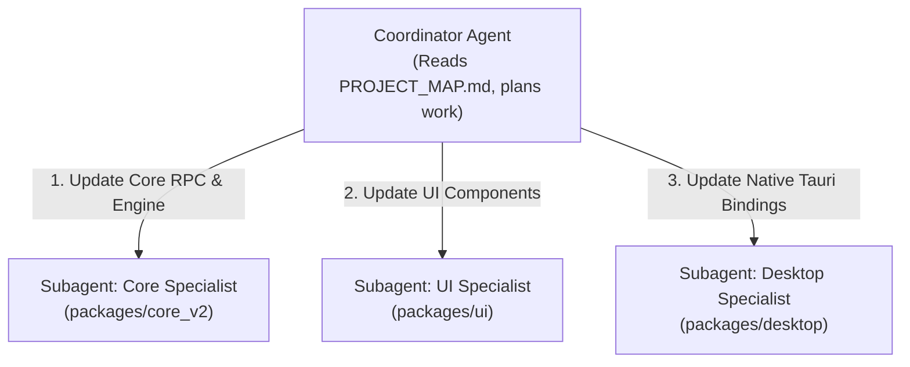

# PROJECT_MAP.md — Living Architecture & Domain Ownership Map

> **For AI Agents & Contributors:** This is the authoritative, machine-readable domain ownership map of the SuperAgent monorepo.
> Read this file first to identify which package owns a capability, which subagent to delegate to, and how to verify changes with minimal overhead.

---

## 1. Quick Navigation Matrix

| Domain / Capability | Primary Package | Language / Stack | Targeted Verification Command | Subagent Role |
| :--- | :--- | :--- | :--- | :--- |
| **Agent Engine, LLMs, Tools, WS Server** | `packages/core_v2` | Rust (Axum, Tokio) | `cargo check -p superagent-core-v2` | `Core Specialist` |
| **Canonical Wire Protocol** | `packages/core_v2/src/protocol` | Rust (Serde) | `cargo test -p superagent-core-v2 protocol` | `Core Specialist` |
| **Dedicated Web Client (Browser)** | `clients/web` | React 18 (Vite, TS) | `npm run test:web` / `npm run build:web` | `Web Specialist` |
| **Dedicated Linux Client (GTK4)** | `clients/linux` | Rust (GTK4, Libadwaita) | `cargo test -p superagent-linux-client` | `Linux Specialist` |
| **Dedicated macOS Client (SwiftUI)** | `clients/macos` | Swift 5.9 (SwiftUI) | `swift test` (or Xcode) | `macOS Specialist` |
| **Dedicated Windows Client (WinUI 3)** | `clients/windows` | C# / .NET 8 (WinUI 3) | `dotnet test` (or Visual Studio) | `Windows Specialist` |
| **Desktop Shell (Legacy Tauri)** | `packages/desktop` | Rust (Tauri v2) + TS | `cargo check -p superagent-desktop-app` | `Desktop Specialist` |
| **Shared UI Bundle (Legacy React)** | `packages/ui` | React 18, Tailwind v4 | `npm run build:tsc --workspace=@superagent/ui` | `UI Specialist` |
| **Browser Extension (MV3)** | `packages/browser-extension` | TypeScript (Vite) | `npx tsc -p packages/browser-extension/tsconfig.json --noEmit` | `Extension Specialist` |
| **Terminal CLI & TUI** | `packages/cli` | Rust (Ratatui, Clap) | `cargo check -p superagent-cli` | `CLI Specialist` |
| **Voice Dictation Native Overlay** | `packages/dictation-native` | Rust (egui, cpal) | `cargo test -p superagent-dictation-native` | `Native Overlay Specialist` |
| **Circle-to-Search Native Overlay** | `packages/circle-search-native` | Rust (egui, eframe) | `cargo check -p superagent-circle-native` | `Native Overlay Specialist` |
| **Artifacts Native Overlay** | `packages/artifacts-native` | Rust | `cargo test -p superagent-artifacts-native` | `Native Overlay Specialist` |
| **UI Behavioral & Functional Spec** | `docs/UI_SPECIFICATION.md` | Markdown | N/A | `All Frontend Specialists` |
| **Archived / Deprecated Core** | `legacy/` | TypeScript | 🚫 **NEVER TOUCH / READ ONLY** | N/A |

---

## 2. Package Ownership & Boundaries

### `packages/core_v2` (Pure Rust Intelligence Engine)
* **Role**: The central nervous system of SuperAgent. Runs as a background daemon on port `1469` (`http://` and `ws://`).
* **Sub-modules**:
  * `src/protocol/`: [NEW] Canonical wire contract: constants (`commands.rs`), typed events (`events.rs`), and envelopes (`dtos.rs`).
  * `src/orchestrator/`: ReAct loop, step planning, tool execution coordination.
  * `src/providers/`: LLM client integrations (OpenAI, Anthropic, Gemini, Groq, DeepSeek).
  * `src/tools/`: Built-in agent tools (filesystem, shell, browser, web search).
  * `src/memory/`: Session context window management, message compaction, sliding-window buffers.
  * `src/server/`: Axum HTTP and WebSocket `/ws` server with session-scoped subscription event filtering.
  * `src/storage/`: Settings store, scrypt-hashed auth store, workspace lock file (`web-server.lock`), chat history.
* **Strict Boundary Rule**: Does not depend on any frontend package. Communicates exclusively via structured JSON-RPC / WebSocket events over port 1469.

### `clients/` (Dedicated Platform-Native Frontends)
* **`clients/web/`**: Pure browser PWA client (`@superagent/web-client`). Built with Vite and React 18, communicating directly with the daemon via HTTP IPC and WebSocket.
* **`clients/linux/`**: Native Linux GTK4 / Libadwaita client (`superagent-linux-client`). Features `AdwApplicationWindow`, `NavigationSplitView`, chat streaming, and dynamic lockfile port discovery.
* **`clients/macos/`**: Native macOS client written in Swift 5.9 with SwiftUI. Features macOS window grouping, native menu bar commands, `NavigationSplitView`, URLSession HTTP/2, and Combine WebSocket streaming.
* **`clients/windows/`**: Native Windows 11 client written in C# / .NET 8 with WinUI 3 (Windows App SDK). Features Mica backdrop material, Fluent controls, MVVM architecture (`CommunityToolkit.Mvvm`), and full-duplex ClientWebSocket.

### `packages/ui` (Shared React Frontend)
* **Role**: Houses all user interface components, pages, hooks, state stores, and VRM 3D companion models.
* **Outputs**: Built with esbuild into `packages/ui/dist/`. Consumed directly by `@superagent/desktop` and the web server.
* **Strict Boundary Rule**: No direct filesystem or OS calls. All backend data is fetched via WebSocket client (`packages/ui/src/renderer/context/`) connecting to `core_v2`.

### `packages/desktop` (Tauri v2 Desktop Shell)
* **Role**: Host application for Windows, macOS, and Linux desktop builds.
* **Components**:
  * `src-tauri/`: Rust native shell, global shortcuts, system tray menus, auto-updater bindings.
  * `src/`: Client wrapper embedding the `@superagent/ui` dist bundle inside a Tauri webview.

### `packages/cli` (Terminal Interface)
* **Role**: Headless and interactive terminal usage.
* **Components**:
  * Interactive Ratatui-based TUI.
  * Clap-based CLI subcommands for automation and scripting.

### `packages/browser-extension` (Manifest V3)
* **Role**: Browser side-panel and overlay for Chrome, Edge, and Brave.
* **Components**:
  * `src/background/`: Service worker maintaining WebSocket connection to the local daemon.
  * `src/sidepanel/`: Compact agent chat interface.

---

## 3. Subagent Delegation Model

When working on complex, multi-package tasks, **do not attempt to load all packages into a single conversation**. Delegate platform-specific tasks to isolated subagents:



### Delegation Guidelines:
1. **Core Changes First**: Launch a `Core Specialist` subagent to implement data models, endpoints, or engine logic. Verify with `cargo check -p superagent-core-v2`.
2. **UI Implementation Next**: Pass the completed type definitions to a `UI Specialist` subagent. Verify with `npm run build:tsc --workspace=@superagent/ui`.
3. **Shell / Packaging Last**: If desktop bindings are affected, delegate to a `Desktop Specialist`.
4. **Native Frontends**: When implementing views in `clients/web`, `clients/macos`, `clients/windows`, or `clients/linux`, consult [`docs/UI_SPECIFICATION.md`](UI_SPECIFICATION.md) as the canonical design and behavioral specification.

---

## 4. Verification Workflow (Strictly Targeted)

> **Golden Rule**: Never run the full repo test suite (`npm test`) during rapid iteration on a single file. Always run the targeted check for the package you just modified:

```bash
# Core Rust Engine changes:
cargo check -p superagent-core-v2

# CLI changes:
cargo check -p superagent-cli

# Desktop Host changes:
cargo check -p superagent-desktop-app

# UI changes:
npm run build:tsc --workspace=@superagent/ui

# Single Vitest test:
npx vitest run packages/ui/src/path/to/test.test.ts
```
