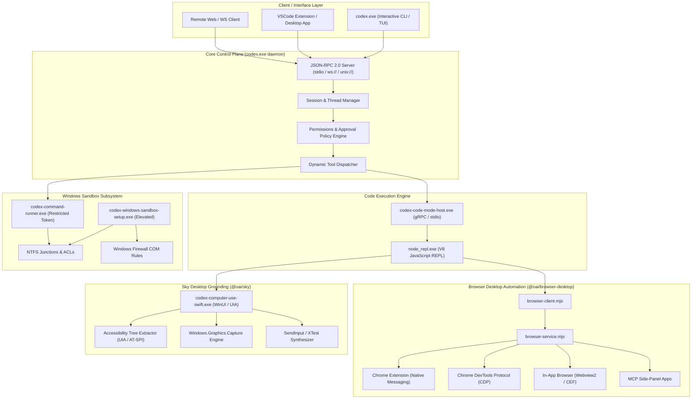
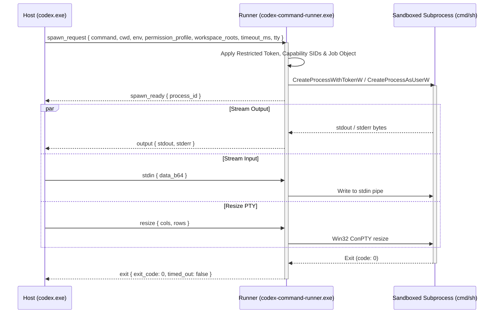

# Codex Decompiled Architecture & System Overview

## 1. Executive Summary & Core Philosophy

The decompiled **Codex** subsystem (`codex_decompiled`) reveals an enterprise-grade, defense-in-depth architecture designed for autonomous AI agent execution, browser automation, and native desktop control (Computer Use Agent — CUA). Rather than relying on a naive script execution loop or direct API calls from the LLM, Codex employs a decoupled, multi-process hierarchy where:

1. **The Core Orchestrator / App-Server (`codex.exe`)** acts as the central control plane, managing sessions, threads, configurations, feature flags, permissions, and tool dispatch via standard JSON-RPC 2.0 and WebSockets.
2. **The Code Mode Host (`codex-code-mode-host.exe`)** provides a specialized gRPC service (`codex.code_mode.v1.CodeModeHost`) for interactive code-based tool execution, session isolation, and bidirectional tool call streaming.
3. **The Sandboxed Execution Subsystem (`codex-command-runner.exe` & `codex-windows-sandbox-setup.exe`)** isolates arbitrary shell code using Windows Restricted Tokens, AppContainer capability SIDs, private desktops, NTFS directory junctions, and COM-configured Windows Firewall policies.
4. **The Custom Node.js CUA REPL (`cua-node` / `node_repl.exe`)** hosts a persistent V8 JavaScript execution environment equipped with pre-loaded native services (`@oai/browser-desktop/service`, `@oai/sky/service`), custom runtime hooks, and automatic output framing.
5. **The Browser Desktop Automation System (`browser-desktop`)** controls web browsers across multiple modes (In-App Browser `iab`, Chrome Extension `extension`, Chrome DevTools Protocol `cdp`, and `mcpapps`), implementing tab leasing, turn-based lifecycle cleanup, stealth emulation, and out-of-band credential authentication.
6. **The Sky Desktop Grounding Framework (`sky`)** bridges the agent to native OS accessibility trees (AT-SPI on Linux, UI Automation on Windows, Accessibility API on macOS) and visual framebuffers (`Windows.Graphics.Capture`), enabling unified desktop manipulation without requiring window focus.

---

## 2. High-Level System Topology



---

## 3. Root Manifest Analysis (`manifest.json`)

The decompiled package root contains `manifest.json`, defining the customized Node.js runtime environment tailored for Computer Use Agents (CUA):

```json
{
  "platform": "windows",
  "arch": "x64",
  "target": "windows-x64",
  "node_version": "24.21.0-cua.1",
  "node_binary_version": "24.21.0",
  "node_archive_path": "v24.21.0-cua.1/node-v24.21.0-win-x64.zip",
  "runtime_archive_name": "cua-node-0.0.29-20261005054403-144090e2ddcb-windows-x64.zip",
  "runtime_archive_version": "0.0.29/20261005054403-144090e2ddcb",
  "node_path": "bin/node.exe",
  "node_modules": "bin/node_modules",
  "node_repl_path": "bin/node_repl.exe"
}
```

### Architectural Key Points:
- **Custom Node Fork (`24.21.0-cua.1`)**: Rather than running untrusted code on standard system Node.js, Codex bundles a custom-compiled Node v24 runtime with CUA modifications (`node_repl.exe`).
- **Binary Separation**: Standard `node.exe` is segregated from `node_repl.exe`. `node_repl.exe` embeds custom V8 hooks, native module bindings for Sky and Browser Desktop, and communication channels for stdin/stdout structured message passing.
- **Reproducible Artifact Stamp**: The build ID `cua-node-0.0.29-20261005054403-144090e2ddcb` indicates an immutable, cryptographically pinned distribution artifact fetched and verified during runtime initialization.

---

## 4. Binary Architecture & Roles (`bin/`)

The core binaries reside under hash-indexed subdirectories (`bin/2e5e00daee91c61d` and `bin/9a7ba4b9ea0c44a3`):

| Binary Name | Size | Architecture / Stack | Primary Role |
| :--- | :--- | :--- | :--- |
| **`codex.exe`** | ~334 MB | Pure Rust (Cargo / Tokio / Clap / Serde) | Root CLI, TUI, App-Server daemon, session state store, protocol coordinator |
| **`codex-code-mode-host.exe`** | ~74.7 MB | Pure Rust (Tonic / Prost / Tokio / OTLP) | Standalone gRPC service implementing `codex.code_mode.v1.CodeModeHost` |
| **`codex-command-runner.exe`** | ~8.2 MB | Pure Rust (Windows API / Win32 Job Objects) | Sandboxed child process runner executed via named pipes |
| **`codex-windows-sandbox-setup.exe`** | ~17.7 MB | Pure Rust (Win32 Security / COM Firewall) | Elevated privilege manager for creating isolated accounts, ACLs, and firewall rules |
| **`rg.exe`** | ~4.35 MB | Pure Rust (BurntSushi Ripgrep) | Ultra-fast regex file searching utility bundled for tool execution |
| **`codex-computer-use-swift.exe`** | ~15 MB | Swift 5.9 / Windows SDK / WinUI / UIA | Native Windows UI Automation, occluded screen capture, and input synthesis |

### 4.1. `codex.exe` — The Central Orchestrator
`codex.exe` provides both the user-facing CLI and the headless daemon. Key command capabilities include:
- `app-server`: Runs the local daemon serving JSON-RPC over `stdio`, `ws://IP:PORT`, or `unix://`. Provides commands to generate TypeScript protocol bindings (`generate-ts`) and JSON schemas (`generate-json-schema`).
- `exec` & `review`: Non-interactive execution and autonomous code review workflows.
- `sandbox`: Invokes commands within configured sandbox environments (`read-only`, `workspace-write`, `danger-full-access`).
- `mcp` & `plugin`: Manages Model Context Protocol servers and packaged Codex plugins.
- `doctor`: Diagnoses runtime health, auth tokens, sandbox prerequisites, and networking.

### 4.2. `codex-code-mode-host.exe` — Code Mode Host
`codex-code-mode-host.exe` exposes an enterprise gRPC service on `stdio` or TCP (`grpc://IP:PORT`). It manages interactive code execution sessions where model-generated code can call dynamic tools, wait for asynchronous background tasks, yield observations back to the LLM, and stream OpenTelemetry (OTLP) traces.

### 4.3. `codex-command-runner.exe` — Low-Privilege Runner
`codex-command-runner.exe` is the actual process that executes user or agent commands inside the sandbox. It does not read directly from standard input/output of the parent terminal. Instead:
- It communicates via dedicated named pipes (`--pipe-in`, `--pipe-out`).
- It applies Windows Restricted Tokens, strips administrative and sensitive security identifiers (SIDs), assigns AppContainer capability SIDs, and restricts network communication to local proxy endpoints.
- It enforces strict execution timeouts, PTY terminal resizing, and process tree termination using Win32 Job Objects.

### 4.4. `codex-windows-sandbox-setup.exe` — Elevated Sandbox Provisioner
Because setting up true OS-level isolation on Windows requires administrator rights (UAC), this helper binary is launched with elevation when sandboxing is first initialized:
- It provisions a dedicated low-privilege Windows user account and group.
- It configures Windows Defender Firewall rules via COM interfaces (`INetFwPolicy2`) to block direct outbound network traffic from the sandbox user.
- It sets NTFS Access Control Entries (Deny-Read ACEs) on system roots and protected user directories.
- It encrypts sandbox metadata using Windows Data Protection API (DPAPI).
- It creates directory junctions (`mklink /J`) mapping necessary workspace directories into the sandbox scope.

---

## 5. Host-to-Runner IPC Protocol

The connection between `codex.exe` (or `codex-code-mode-host.exe`) and `codex-command-runner.exe` operates over bidirectional framed named pipes:



### Framed Protocol Messages (Serde Internally Tagged):
- `spawn_request`: Passes complete execution specifications including working directory, environment variables, AppContainer capability SIDs, private desktop names, and timeout limits.
- `spawn_ready`: Acknowledges successful process creation with the operating system `process_id`.
- `output`: Delivers incremental stdout and stderr chunks.
- `stdin`: Injects base64-encoded input data (`StdinPayload`).
- `close_stdin`: Notifies the runner to close the child process's standard input stream.
- `resize`: Dynamically adjusts ConPTY dimensions (rows/cols).
- `exit`: Reports final process exit code and timeout status.
- `error`: Reports fatal setup or runtime errors (`message`, `stage`, `windows_error_code`).
- `terminate`: Immediately terminates the child process and all descendants via the Win32 Job Object.

---

## 6. Summary of Architectural Strengths

1. **Isolation by Design**: Code execution never occurs in the context of the main orchestrator. Every command passes through either `node_repl.exe` or `codex-command-runner.exe`.
2. **Fail-Closed Security**: If elevated sandbox setup fails or permissions cannot be verified, execution fails closed rather than falling back to un-sandboxed execution.
3. **Out-of-Band Privacy**: Sensitive authentication credentials and browser secrets are handled by dedicated browser-client UI flows and never enter model prompt contexts.
4. **Token-Efficient Grounding**: State observation utilizes accessibility tree diffing and coordinate snapshot hashing, minimizing LLM context consumption.
