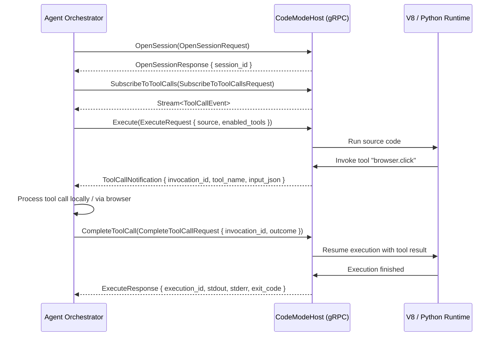

# Codex Tool Calls, Protocol Interfaces & Wire Schemas

This document provides a comprehensive technical reference for every tool call, RPC method, protocol message, and parameter schema discovered in the decompiled Codex architecture.

---

## 1. App-Server JSON-RPC 2.0 Protocol

The core daemon (`codex.exe app-server`) communicates with client surfaces (IDE extensions, desktop shells, CLI proxies) via JSON-RPC 2.0 over `stdio`, WebSockets (`ws://`), or Unix domain sockets (`unix://`).

### 1.1. Base Wire Framing

All messages follow the standard JSON-RPC 2.0 specification:

```typescript
interface JSONRPCRequest {
  jsonrpc: "2.0";
  id: string | number;
  method: string;
  params?: Record<string, unknown>;
}

interface JSONRPCResponse {
  jsonrpc: "2.0";
  id: string | number;
  result?: unknown;
  error?: JSONRPCError;
}

interface JSONRPCError {
  code: number;
  message: string;
  data?: unknown;
}

interface JSONRPCNotification {
  jsonrpc: "2.0";
  method: string;
  params?: Record<string, unknown>;
}
```

---

### 1.2. Interactive Human-in-the-Loop Approval Requests

When the agent attempts an action that breaches configured permission boundaries, the app server dispatches approval requests to the client.

#### A. Command Execution Approval (`command/execApproval`)

Used when the agent requests shell execution outside auto-approved directories or with dangerous flags:

```json
{
  "jsonrpc": "2.0",
  "id": "req-101",
  "method": "command/execApproval",
  "params": {
    "command": "git commit -m 'feat: update schema'",
    "cwd": "d:/Projects/OpenSource/AgentApp",
    "env": {
      "NODE_ENV": "development"
    },
    "reason": "Committing changes to working branch",
    "permission_profile": "workspace-write",
    "danger_level": "moderate"
  }
}
```

**Approval Response:**
```json
{
  "jsonrpc": "2.0",
  "id": "req-101",
  "result": {
    "decision": "approved", // "approved" | "rejected" | "approved_with_sandbox"
    "feedback": null,
    "remember": true
  }
}
```

#### B. Patch / File Edit Approval (`patch/applyApproval`)

Used before modifying files on disk when strict approval is active:

```json
{
  "jsonrpc": "2.0",
  "id": "req-102",
  "method": "patch/applyApproval",
  "params": {
    "path": "d:/Projects/OpenSource/AgentApp/Cargo.toml",
    "diff": "--- a/Cargo.toml\n+++ b/Cargo.toml\n@@ -10,3 +10,4 @@\n serde = \"1.0\"\n+tokio = { version = \"1.0\", features = [\"full\"] }",
    "intent": "Add tokio dependency to Cargo.toml"
  }
}
```

#### C. Tool User Input Request (`tool/requestUserInput`)

Allows an active tool to prompt the human user with interactive multiple-choice or free-text questions:

```json
{
  "jsonrpc": "2.0",
  "id": "req-103",
  "method": "tool/requestUserInput",
  "params": {
    "prompt": "Which target deployment environment should be configured?",
    "options": [
      { "id": "staging", "label": "Staging Environment" },
      { "id": "prod", "label": "Production Environment" }
    ],
    "is_multi_select": false,
    "default_option_id": "staging"
  }
}
```

---

## 2. Code Mode Host gRPC Protocol (`codex.code_mode.v1`)

The standalone binary `codex-code-mode-host.exe` implements the `codex.code_mode.v1.CodeModeHost` service. This is the backbone for high-performance agent code execution.



### 2.1. Protobuf Service Definition

```protobuf
syntax = "proto3";

package codex.code_mode.v1;

service CodeModeHost {
  // Session Lifecycle
  rpc OpenSession (OpenSessionRequest) returns (OpenSessionResponse);
  rpc CloseSession (CloseSessionRequest) returns (CloseSessionResponse);

  // Tool Call Dispatch Loop
  rpc SubscribeToToolCalls (SubscribeToToolCallsRequest) returns (stream ToolCallEvent);
  rpc CompleteToolCall (CompleteToolCallRequest) returns (CompleteToolCallResponse);
  rpc AcknowledgeNotification (AcknowledgeNotificationRequest) returns (AcknowledgeNotificationResponse);

  // Execution & Observation
  rpc Execute (ExecuteRequest) returns (ExecuteResponse);
  rpc Wait (WaitRequest) returns (WaitResponse);
  rpc YieldObservation (YieldObservationRequest) returns (YieldObservationResponse);
  rpc CancelWait (CancelWaitRequest) returns (CancelWaitResponse);
  rpc Terminate (TerminateRequest) returns (TerminateResponse);
}
```

### 2.2. Key Message Schemas

#### `ExecuteRequest`
```protobuf
message ExecuteRequest {
  string session_id = 1;
  string execution_id = 2;
  string source = 3;                       // User or model JavaScript/Python code
  repeated ToolDefinition enabled_tools = 4; // Tools exposed inside this execution
  int32 max_output_tokens = 5;
  int32 cell_id = 6;
  int64 timeout_ms = 7;
}

message ToolDefinition {
  string tool_name = 1;                    // e.g. "browser.click"
  string description = 2;
  string kind = 3;                         // "sync" | "async" | "streaming"
  string input_schema_json = 4;            // JSON Schema for arguments
  string output_schema_json = 5;           // JSON Schema for return value
}
```

#### `CompleteToolCallRequest`
```protobuf
message CompleteToolCallRequest {
  string session_id = 1;
  string invocation_id = 2;
  oneof outcome {
    ToolCallSucceeded succeeded = 3;
    ToolCallFailed failed = 4;
  }
}

message ToolCallSucceeded {
  string output_json = 1;
}

message ToolCallFailed {
  string message = 1;
  string error_code = 2;
}
```

---

## 3. CUA REPL Tool Definitions (`cua_repl`)

The Computer Use Agent exposes two primary tools to the model via `NODE_REPL_TOOL_OVERRIDES`:

### 3.1. `js` Tool Call
Executes JavaScript within the persistent Node.js REPL context (`node_repl.exe`). Pre-loaded with `cua`, `browser`, `sky`, `nodeRepl`, and `tab` global bindings.

- **Tool Name**: `js`
- **Parameters**:
  - `code` (`string`, required): The JavaScript expression or statement block to execute.
- **Return Type**: Formatted string representation of evaluated result, or structured UI observation (AX tree / screenshot).

**Example Invocation:**
```json
{
  "name": "js",
  "arguments": {
    "code": "let tab = await cua.getTab({ mention: tabMentionUrl });\nawait tab.click(14);\nawait tab.getAXState();"
  }
}
```

### 3.2. `js_reset` Tool Call
Resets the persistent V8 execution context without closing open browser tabs or native desktop windows.

- **Tool Name**: `js_reset`
- **Parameters**: None (`{}`)
- **Return Type**: `string` confirming runtime reset and re-initialization of `#instructions/banner.js`.

---

## 4. Browser Desktop Automation Command Inventory (`browser-client.mjs`)

The browser automation client encapsulates more than 50 distinct command classes under `P` (`Commands`). Each command is strongly typed with Zod schemas.

### 4.1. Browser & Tab Lifecycle Commands

| Command | Payload Parameters | Result Type | Description |
| :--- | :--- | :--- | :--- |
| `ListBrowsers` | `{}` | `Array<BrowserInfo>` | Lists available browser instances (`iab`, `extension`, `cdp`, `mcpapps`). |
| `GetBrowser` | `{ id?: string; url?: string }` | `BrowserInfo` | Selects a specific browser instance. |
| `CreateTab` | `{ browserId: string; url?: string; visible?: boolean }` | `TabInfo` | Opens a new browser tab. |
| `GetTab` | `{ id: string }` | `TabInfo` | Resolves an existing tab by unique ID. |
| `ListTabs` | `{ browserId?: string }` | `Array<TabInfo>` | Lists open tabs within a browser session. |
| `CloseTab` | `{ tabId: string }` | `void` | Closes the specified tab. |
| `NavigateTab` | `{ tabId: string; url: string }` | `void` | Navigates tab to target URL. |
| `NavigateTabBack` | `{ tabId: string }` | `void` | Triggers browser back navigation. |
| `NavigateTabForward` | `{ tabId: string }` | `void` | Triggers browser forward navigation. |
| `NavigateTabReload` | `{ tabId: string }` | `void` | Reloads current tab. |
| `MarkTab` | `{ tabId: string; mark: "deliverable" \| "handoff" }` | `void` | Prevents automatic tab destruction at turn end. |
| `NameSession` | `{ name: string }` | `void` | Sets human-visible session name with emoji prefix. |

---

### 4.2. Playwright-Style DOM Locators & Actions

| Command | Payload Parameters | Result Type | Description |
| :--- | :--- | :--- | :--- |
| `PlaywrightLocatorClick` | `{ selector: string; button?: "left" \| "right" \| "middle"; force?: boolean; timeoutMs?: number }` | `void` | Clicks the element matched by selector. |
| `PlaywrightLocatorDblclick`| `{ selector: string; timeoutMs?: number }` | `void` | Double-clicks matched element. |
| `PlaywrightLocatorFill` | `{ selector: string; value: string; timeoutMs?: number }` | `void` | Clears and fills text into an input field. |
| `PlaywrightLocatorPress` | `{ selector: string; key: string; timeoutMs?: number }` | `void` | Presses a key chord while element is focused. |
| `PlaywrightLocatorSelectOption` | `{ selector: string; value: string \| string[]; timeoutMs?: number }` | `void` | Selects option(s) in a native `<select>`. |
| `PlaywrightLocatorSetChecked` | `{ selector: string; checked: boolean; timeoutMs?: number }` | `void` | Toggles checkbox or radio state. |
| `PlaywrightLocatorInnerText` | `{ selector: string; timeoutMs?: number }` | `string` | Reads rendered visible inner text. |
| `PlaywrightLocatorTextContent` | `{ selector: string; timeoutMs?: number }` | `string \| null` | Reads raw text content. |
| `PlaywrightLocatorGetAttribute` | `{ selector: string; name: string; timeoutMs?: number }` | `string \| null` | Reads element HTML attribute. |
| `PlaywrightDomSnapshot` | `{ tabId: string }` | `string` | Serializes complete DOM snapshot including iframes. |
| `PlaywrightElementScreenshot`| `{ tabId: string; x: number; y: number }` | `Uint8Array` | Generates cropped element bounding-box screenshot. |
| `PlaywrightFileChooserSetFiles` | `{ files: string[]; timeoutMs?: number }` | `void` | Sets file paths into intercepted file chooser. |

---

### 4.3. Coordinate-Based CUA & Accessibility Commands

| Command | Payload Parameters | Result Type | Description |
| :--- | :--- | :--- | :--- |
| `TabAxGetState` | `{ tabId: string; disableDiffing?: boolean }` | `{ state: string; screenshot?: Uint8Array }` | Returns condensed accessibility tree and screenshot. |
| `TabAxAction` | `{ tabId: string; action: string; elementIndex: number }` | `void` | Invokes named accessibility secondary action. |
| `CuaClick` | `{ x: number; y: number; button?: number; keypress?: string[] }` | `void` | Dispatches hardware/synthetic mouse click. |
| `CuaDrag` | `{ path: Array<{ x: number; y: number }>; keys?: string[] }` | `void` | Drags pointer along coordinate path. |
| `CuaScroll` | `{ x: number; y: number; scrollX: number; scrollY: number; keypress?: string[] }` | `void` | Emits scroll wheel delta events. |
| `CuaType` | `{ text: string }` | `void` | Types raw characters into current focus. |
| `CuaKeypress` | `{ keys: string[] }` | `void` | Presses control or modifier key chords. |
| `DomCuaClick` | `{ node_id: string }` | `void` | Clicks DOM node by snapshot ID. |
| `DomCuaGetVisibleDom` | `{}` | `unknown` | Filters visible, interactable DOM elements. |

---

### 4.4. Browser Capability Collections

#### `botDetection.report`
```typescript
interface BotDetectionOptions {
  reason: "captcha_failed" | "access_denied" | "challenge_loop" | "unexpected_bot_error";
}

interface BotDetectionResult {
  hostname: string | null; // Parsed hostname only (no path or query parameters)
  status: "reported";
}
```

#### `browserAuth.request`
```typescript
interface BrowserAuthRequestOptions {
  origin: string; // Canonical scheme + host + port
  fields: Array<{
    id: string;
    label: string; // e.g. "Email", "Password"
    type: string;  // "email", "password", "tel", "text"
    autocomplete?: string;
    required: boolean;
    selector: string | PlaywrightLocator;
  }>;
  options?: Array<{
    id: string;
    label: string; // e.g. "Continue with Google"
    selector?: string | PlaywrightLocator;
    field_ids?: string[];
  }>;
  submit?: {
    selector: string | PlaywrightLocator;
    action: "click" | "press_enter";
  };
  qr_code?: boolean;
}

interface BrowserAuthResult {
  status:
    | "submitted"
    | "submission_failed"
    | "origin_changed"
    | "page_changed"
    | "locator_invalid"
    | "declined"
    | "cancelled"
    | "expired"
    | "unavailable";
  selected_option?: string;
  reason?: "user_took_over";
  locator_error?: { field_id: string; reason: "not_user_visible" };
}
```

#### `cdp.send` & `cdp.readEvents`
```typescript
interface CdpSendOptions {
  method: string;
  params?: Record<string, unknown>;
  options?: {
    target?: { sessionId?: string; targetId?: string };
    timeoutMs?: number;
  };
}

interface CdpEventsOptions {
  afterSequence?: number;
  limit?: number; // 1 to 1000
  methods?: string[];
  timeoutMs?: number;
}
```

#### `pageAssets.bundle` & `pageAssets.list`
```typescript
interface PageAssetsListResult {
  id: string;
  pageUrl: string | null;
  assets: Array<{
    id: string;
    name: string;
    url: string;
    kind: "font" | "image" | "stylesheet" | "video" | "script" | "other";
  }>;
  inlineSvgs: Array<{ id: string; name: string; markup: string }>;
  summary: Record<string, number>;
}

interface PageAssetsBundleOptions {
  inventoryId: string;
  kinds?: Array<"font" | "image" | "stylesheet" | "video">;
  assetIds?: string[];
}
```

---

## 5. Sky Desktop Grounding Schemas (`@oai/sky`)

### 5.1. Common Point and Geometry Types

```typescript
type Point = { x: number; y: number };
type Vec2 = [x: number, y: number];
type MouseButton = "left" | "right" | "middle" | "l" | "r" | "m";
type Direction = "up" | "down" | "left" | "right" | "u" | "d" | "l" | "r";
```

### 5.2. `WindowState` Schema

```typescript
type WindowState = {
  window: Window;
  ax_tree: AccessibilityNode;             // Linux AT-SPI / X11 tree
  ax_tree_source?: "at_spi" | "x11";      // Source flag on Linux
  accessibility?: AccessibilityState;     // Windows UIA formatted text
  screenshots: Array<Screenshot>;
};

type Screenshot = {
  id: string;                             // Cached ID for coordinate input validation
  url: string;                            // Base64 JPEG data URL
  width?: number;
  height?: number;
  originX?: number;
  originY?: number;
  zIndex: number;
};
```

### 5.3. Audio Recording Interface

```typescript
interface StartAudioRecordingInput {
  max_duration_ms?: number; // Default 60,000ms; Max 300,000ms
}

interface AudioResult {
  filepath: string;         // Local path to saved .wav
  bytes: Uint8Array;        // Raw 24 kHz stereo WAV bytes
  data_url: string;         // Base64 data URL
}
```
