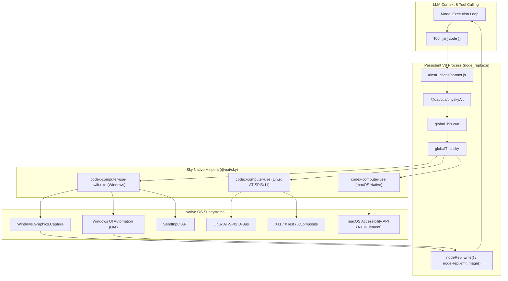

# Computer Use Agent (CUA) & Sky Desktop Grounding Framework

## 1. Overview & Execution Architecture

The Computer Use Agent (CUA) subsystem in Codex provides autonomous desktop control and UI grounding across Linux, macOS, and Windows. It bridges the reasoning capability of LLMs with native operating system window managers, accessibility APIs, and framebuffers.

Rather than relying on brittle computer vision alone (blind screenshot-to-coordinate mapping), Codex uses a **dual-engine hybrid grounding architecture**:
1. **Semantic Grounding**: Direct extraction of OS accessibility trees (UIA on Windows, AT-SPI on Linux, NSAccessibility on macOS) provides structured element hierarchies, numeric element IDs, accessible names, roles, values, and named secondary actions.
2. **Visual Grounding**: Bounded window screenshots captured via native high-performance APIs (`Windows.Graphics.Capture` on Windows, Quartz Window Services on macOS, X11 Composite on Linux) provide visual spatial context even when windows are partially or completely occluded.



---

## 2. The CUA REPL Loop (`cua-repl`)

### 2.1. Process Launcher (`launch.js`)
The Node.js REPL is orchestrated by `cua-repl/dist/lib/js/oai_js_cua_repl/src/launch.js`. When Codex starts a CUA session:
1. It validates the executable path in `CUA_REPL_NODE_REPL_PATH`.
2. It parses `CUA_REPL_ENABLED_SURFACES` (comma-separated list of `browser` and/or `computer`).
3. It configures trusted internal service modules via `NODE_REPL_TRUSTED_SERVICES`:
   - If `browser` is enabled: `{"browser": "@oai/browser-desktop/service"}`
   - If `computer` is enabled: `{"sky": "@oai/sky/service"}`
4. It sets the session startup banner (`NODE_REPL_JS_BANNER`), which loads `#instructions/banner.js`:
   ```javascript
   await import("@oai/cua/tinyskyAlt");
   ```
5. It configures tool overrides (`NODE_REPL_TOOL_OVERRIDES`) exposing `js` and `js_reset` to the model.
6. It spawns `node_repl.exe` as a child process and binds UNIX signal handlers (`SIGINT`, `SIGTERM`, `SIGHUP`) to ensure clean process termination.

### 2.2. REPL Execution Semantics
- **Persistent V8 Context**: Variables declared with `var` or properties attached to `globalThis` persist across multiple LLM turns.
- **Auto-Observation Binding**: When `cua.getApp(...)`, `cua.getTab(...)`, or `cua.createBrowserTab(...)` are executed, the runtime automatically serializes and displays the initial UI accessibility state without requiring an extra tool call.
- **Reset Mechanism (`js_reset`)**: Discards all in-memory JavaScript variables and evaluates a fresh banner. It **does not** close open desktop windows or browser tabs, permitting fast error recovery.

### 2.3. Output Buffering & Image Streaming
- `nodeRepl.write(value)`: Streams text or serialized JSON objects to the tool result buffer.
- `nodeRepl.emitImage(image)`: Streams screenshots as base64 JPEG data URLs.
- **Deduplication Guard**: Observation methods (`getAXState()`, `getScreenshot()`, `getState()`) output internally; wrapping them in `nodeRepl.write(...)` duplicates output. The API accepts `{ emit: false }` to suppress redundant rendering.

---

## 3. Platform Implementations

The framework abstracts OS differences through three dedicated client interfaces:

| Capability | Linux (`FullDesktopComputerUseClient`) | macOS (`WindowComputerUseClient`) | Windows (`Window2ComputerUseClient`) |
| :--- | :--- | :--- | :--- |
| **Target String** | `"linux"` | `"mac"` | `"windows"` |
| **Backend Binary** | `codex-computer-use` | `codex-computer-use` | `codex-computer-use-swift.exe` |
| **Target Scope** | Desktop-wide or targeted window | App window (by app bundle / ID) | Window object (by window ID) |
| **Window Activation** | Explicit (`activate_window`); background input supported | Automatic on interaction | Automatic on interaction |
| **Accessibility Source** | AT-SPI with X11 fallback (`ax_tree_source`) | NSAccessibility API | Windows UI Automation (UIA) |
| **Tree Representation** | Structured `AccessibilityNode` hierarchy | Formatted text with diffing | Formatted text + document text |
| **Capture Engine** | X11 Composite / Shm | Quartz Window Services | `Windows.Graphics.Capture` (occluded-safe) |
| **Coordinate System** | Desktop or Window-relative | App Window-relative | Screenshot-cached window-relative (`screenshotId`) |
| **Audio Loopback** | Supported (`start_audio_recording`) | Supported (`start_audio_recording`) | Supported (`start_audio_recording`) |

---

## 4. Accessibility Tree Grounding (`ax_tree`)

### 4.1. Structure of an `AccessibilityNode` (Linux / AT-SPI)

```typescript
type AccessibilityNode = {
  id: string;                         // Compact decimal identifier (e.g. "12")
  role: string;                       // e.g. "window", "button", "entry", "menu_item"
  name?: string;                      // Accessible name (e.g. "Save", "Submit")
  description?: string;               // Tooltip or accessibility description
  value?: string;                     // Current text value in an editable field
  states?: Array<AccessibilityState>; // "focused", "focusable", "editable", "expanded", etc.
  actions?: Array<string>;            // Named actions (e.g. "click", "press", "expand")
  children: Array<AccessibilityNode>;
  to_string(): string;                // Compact text representation for LLM prompt
};
```

### 4.2. Token-Saving Tree Diffing
On Windows and macOS, full accessibility trees can easily consume tens of thousands of tokens. Codex implements **turn-based tree diffing**:
- After the initial turn, subsequent calls to `get_window_state` return only an incremental diff:
  - Elements removed (`- [12] button 'Cancel'`)
  - Elements added (`+ [45] dialog 'Save As'`)
  - Elements mutated (`* [14] entry 'Search' value='agents'`)
- If the model loses track of state or context is compacted, passing `{ disableDiff: true }` forces a full snapshot.

### 4.3. Secondary Actions (`perform_secondary_action`)
Beyond standard mouse clicks, complex desktop controls expose non-click semantics. Codex supports invoking these natively:
- **`Expand` / `Collapse`**: Toggles disclosure trees, tree-views, and accordions.
- **`Raise`**: Brings a child window or popup to the foreground.
- **`Scroll Up` / `Scroll Down` / `Scroll Left` / `Scroll Right`**: Dispatches accessibility-driven container scrolling without calculating pixel deltas.

---

## 5. Input Primitives & Coordinate Routing

### 5.1. Mouse Primitives

#### A. Direct Element Click vs. Coordinate Click
```typescript
// Click via accessibility index (preferred, resolution-independent)
await sky.click({ window: targetWindow, element_index: 12 });

// Click via window-relative screenshot coordinates with cache validation
await sky.click({
  window: targetWindow,
  screenshotId: state.screenshots[0].id,
  x: 450,
  y: 320,
  click_count: 1,
  mouse_button: "left"
});
```

#### B. Timed Mouse Hold (`duration`)
On Linux and macOS, actions like drawing, dragging sliders, or triggering long-press context menus require holding the mouse button down:
- Parameter `duration`: Milliseconds (Linux) or seconds (macOS) to hold the button before release.

#### C. Continuous Drag Handles (`drag_handle`)
When dragging requires checking visual progress between movements:
```typescript
const handle = sky.drag_handle();
await handle.start({ x: 100, y: 200 });
await handle.move_to({ x: 300, y: 200 });
// Inspect intermediate screenshot
await handle.move_to({ x: 500, y: 200 });
await handle.end();
```

#### D. Relative Pointer Movement (`move_relative`)
Moves the pointer by integer offsets from its current location (`dx`, `dy` from `-32768` to `32767`), essential for CAD software, canvas panning, and games.

---

### 5.2. Keyboard Primitives

#### A. Keysym Syntax & Modifiers
Keys are specified using X11 keysym names with aliases:
- Chords are combined with `+` (whitespace ignored): `Control_L+a`, `Ctrl+Shift+period`, `Super_L+d`, `Alt+F4`.
- Supported key names: `Return`, `Tab`, `Escape`, `BackSpace`, `Delete`, `space`, `Up`, `Down`, `Left`, `Right`, `KP_0` through `KP_9`.

#### B. Persistent Key Hold (`key_down` / `key_up`)
Allows holding modifier keys across separate tool invocations:
```typescript
await sky.key_down({ key: "Shift_L", window });
await sky.click({ window, x: 100, y: 100 });
await sky.click({ window, x: 200, y: 200 });
await sky.key_up({ key: "Shift_L", window });
```

---

### 5.3. Text Typing & Atomic Value Replacement
- `type_text({ window, text })`: Emits keystroke-by-keystroke input into the currently focused element.
- `set_value({ window, element_index, value })`: Uses native UI Automation / AT-SPI value pattern to replace the contents atomically in one operation, avoiding typing delays and auto-complete interference.

---

### 5.4. Rich Clipboard Paste (`sky.paste`)
Typing long text through virtual keystrokes is slow and error-prone. `sky.paste` inserts multiline content instantly:
- Formats: `"text"`, `"md"`, `"html"`.
- **Clipboard Restoration**: On macOS and Linux, the runtime snapshots existing clipboard data before paste and restores it immediately afterward, protecting the user's active clipboard contents.

```typescript
await sky.paste({
  window: targetWindow,
  text: "<h1>Document Title</h1><p>Generated content...</p>",
  format: "html"
});
```

---

### 5.5. Clipboard Snapshot Handles (`clipboard_read` / `clipboard_write`)
On Linux, clipboard interaction uses opaque handles to isolate data from the host:
- `clipboard_read({ window })` triggers Copy in the app and returns an opaque `ClipboardHandle`.
- `clipboard_write({ window, handle })` pastes from that handle without exposing raw clipboard data to other processes.
- `clipboard_release({ handle })` frees the snapshot.

---

## 6. System Audio Loopback Recording

Codex includes native capability to capture system audio output during desktop tasks:

```typescript
// 1. Begin loopback recording (background capture)
await sky.start_audio_recording({ max_duration_ms: 60000 });

// 2. Perform desktop actions that play audio (video playback, voice call, etc.)
await sky.click({ window: targetWindow, element_index: 5 }); // Play button

// 3. Stop recording and retrieve captured WAV
const audio = await sky.stop_audio_recording();
console.log(audio.filepath); // Local WAV file path
console.log(audio.bytes);    // 24 kHz stereo PCM bytes
console.log(audio.data_url); // data:audio/wav;base64,...
```

---

## 7. Window & Application Lifecycle Management

### 7.1. Discovery and Activation
- `list_apps()`: Returns installed system applications, their IDs, running states, and open windows.
- `launch_app({ app })`: Launches an application binary or desktop entry without invoking a shell.
- `list_windows()`: Enumerates open top-level and dialog windows.
- `get_window({ id, app })`: Rehydrates a window object by handle ID if state was lost across turns.
- `activate_window({ window })`: Brings the target window to foreground and transfers OS focus.

### 7.2. Occluded Window Capture on Windows
On Microsoft Windows, standard `BitBlt` or `PrintWindow` fails when windows are occluded, minimized, or behind other applications. `codex-computer-use-swift.exe` utilizes the modern **`Windows.Graphics.Capture` (WGC)** API:
- Captures pixel buffers directly from the Desktop Window Manager (DWM) composition surface.
- Obtains crystal-clear window screenshots even when completely hidden behind other windows.
- Tags each capture with a `screenshotId`, logical `width`, `height`, `originX`, `originY`, and relative `zIndex`.
