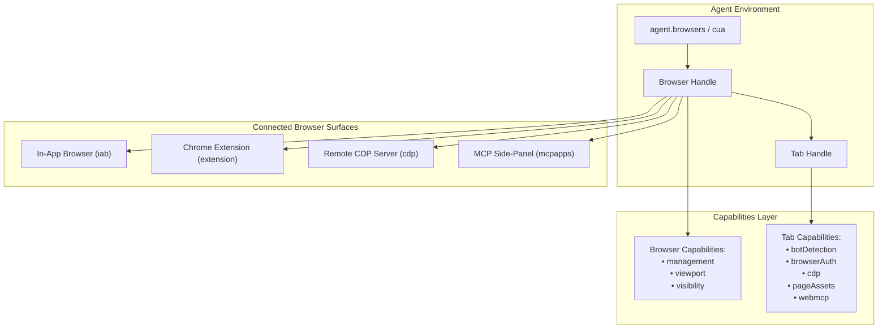
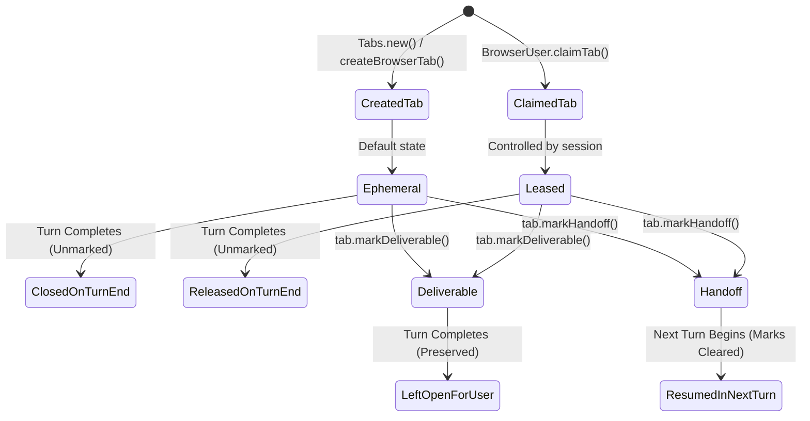
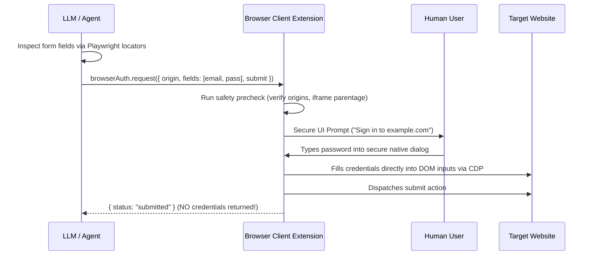

# Browser Automation, Tab Leasing & Security Controls

## 1. Overview & Multi-Environment Architecture

The Codex browser automation subsystem (`@oai/browser-desktop`) provides a unified, highly controlled interface for automating modern web browsers. It supports four distinct execution environments:

1. **`iab` (In-App Browser)**: An embedded browser engine running directly inside the Codex desktop host (via WebView2 or CEF).
2. **`extension`**: External real-world browsers (Google Chrome, Microsoft Edge, Brave, Opera, Vivaldi) connected via the official Codex Native Messaging browser extension.
3. **`cdp`**: Direct, headless, or remote browser control over the raw Chrome DevTools Protocol (CDP).
4. **`mcpapps`**: Interactive MCP applications hosted in side-panel tabs.



---

## 2. Object Model Hierarchy & APIs

The browser interface exposed to the model follows a strict hierarchy defined in `browser-desktop/environment-docs/codex-app/api.json`:

### 2.1. Hierarchy Map
- **`Agent`**: The top-level gateway.
  - `browsers: Browsers`: Discovery and selection.
  - `documentation: Documentation`: Packaged browser manuals.
- **`Browsers`**:
  - `list()`: Returns all available browsers with metadata (`family`, `id`, `name`, `type`, `profileName`).
  - `get(id)`: Selects a browser by ID or client type.
  - `getDefault()`, `getForUrl(url)`: Heuristic selectors.
- **`Browser`**:
  - `browserId: string`: Bound instance identity.
  - `tabs: Tabs`: Tab creation and querying.
  - `user: BrowserUser`: User-owned tab leasing and claiming.
  - `capabilities: BrowserCapabilityCollection`: Discovers and activates browser-scoped features (`management`, `viewport`, `visibility`).
  - `nameSession(name)`: Labels the current automation session.
  - `history(options)`: Queries recent browsing history.
- **`Tabs`**:
  - `list()`: Lists tabs currently leased by this session.
  - `get(id)`: Binds a controllable `Tab`.
  - `new()`: Creates a new ephemeral tab.
  - `selected()`: Returns the active tab.
  - `content(options)`: Headless background content extractor without tab selection.
- **`Tab`**:
  - `id: string`: Unique tab handle.
  - `url()`, `title()`: Current page metadata.
  - `goto(url)`, `back()`, `forward()`, `reload()`, `close()`: Standard navigation.
  - `screenshot(options)`: Viewport or full-page image capture.
  - `ax: AXAPI`: Accessibility-tree element interaction.
  - `cua: CUAAPI`: Viewport coordinate interaction.
  - `dom_cua: DomCUAAPI`: Filtered DOM snapshot interaction.
  - `playwright: PlaywrightAPI`: Robust locator-based interaction (`locator`, `getByRole`, `frameLocator`).
  - `content: ContentAPI`: Export page content, Google Workspace docs (`exportGsuite`), or YouTube transcripts (`exportYouTubeTranscript`).
  - `clipboard: TabClipboardAPI`: Virtual browser clipboard reads and writes.
  - `dev: TabDevAPI`: Console log stream inspection (`logs()`).
  - `capabilities: TabCapabilityCollection`: Scoped tab extensions (`botDetection`, `browserAuth`, `cdp`, `pageAssets`, `webmcp`).
  - `markDeliverable()`, `markHandoff()`: Turn lifecycle leasing controls.

---

## 3. Tab Claiming & Leasing Mechanics

When automating an existing browser with live user tabs, Codex strictly avoids hijacking tabs without user intent or risking stale tab ID collisions.

### 3.1. Tab Mentions (`@tab`)
User prompts often contain explicit tab references formatted as URIs:
```
plugin://browser@openai-bundled?mention=tab-v1&source=extension&browserId=ext-1&tabId=42&title=Inbox&url=https://mail.google.com
```

#### The Claiming Protocol (`tab-claiming-chrome.md`):
1. **URI Parameter Decoding**: The agent extracts `browserId`, `tabId`, `title`, and `url`.
2. **Browser Instance Resolution**:
   - Calls `agent.browsers.list()`.
   - Filters for the browser whose `metadata.extensionInstanceId` matches `browserId`.
   - Binds `mentionedBrowser = await agent.browsers.get(match.id)`.
3. **Snapshot Validation & Fail-Closed Protection**:
   - Browser tabs frequently change or close, and OS/browser PID recycling can reuse numeric IDs.
   - The agent calls `mentionedBrowser.user.openTabs()`.
   - It searches for the exact object matching `providerTabId === tabId`, `title === title`, and `url === url`.
   - If any property has changed, the agent **fails closed** and reports that the tab is no longer available. It **never** silently claims a different tab.
4. **Acquiring the Lease**:
   - The agent passes the validated candidate object to `mentionedBrowser.user.claimTab(tab)`.
   - Claiming transitions the tab into the session's active control set without altering its user tab group.

---

## 4. Tab Lifecycle & Turn Cleanup

By default, agent interactions with browsers are designed to leave zero unwanted clutter.



### 4.1. The Three Tab Classes
1. **Ephemeral Tabs (Created by Agent)**:
   - Created via `browser.tabs.new()` or `cua.createBrowserTab()`.
   - Unless marked, **they are automatically closed when the turn ends**.
2. **Claimed Tabs (User Owned)**:
   - Taken over via `claimTab()`.
   - Unless marked, **they are released from control when the turn ends and left open for the user**.
3. **Marked Deliverable (`tab.markDeliverable()`)**:
   - Used when the live page itself is a final user output (e.g., an authored document, generated spreadsheet, or confirmed order).
   - Survives turn cleanup and remains open in the browser.
4. **Marked Handoff (`tab.markHandoff()`)**:
   - Used when the workflow must pause for human intervention (MFA verification, CAPTCHA, payment authorization, or credential entry).
   - Remains open across turns.
   - **Crucial Rule**: Handoff marks are turn-scoped. When resuming a session in the next turn, previous marks are wiped. The agent must re-mark any tab that needs to survive subsequent turns.

---

## 5. Bot Detection Avoidance & Stealth Emulation

Automated browsers are frequently flagged and blocked by Cloudflare, Akamai, Datadome, and PerimeterX. Codex incorporates multi-layered stealth capabilities.

### 5.1. Bot Detection Reporting (`botDetection`)
When a cloud or local browser encounters anti-bot friction, it categorizes the blocker via `tab.capabilities.get("botDetection")`:

```typescript
const botDetection = await tab.capabilities.get("botDetection");
await botDetection.report({
  reason: "captcha_failed" // "captcha_failed" | "access_denied" | "challenge_loop" | "unexpected_bot_error"
});
```

- **Telemetry Privacy**: The runtime records **only the parsed hostname**, never query parameters, paths, or full URLs that might leak sensitive user tokens.
- **Fail-Safe Distinctions**: Network errors (`ERR_BLOCKED_BY_ADMINISTRATOR`, DNS drops, TLS drops) are explicitly disallowed from being reported as bot detection.

### 5.2. Stealth Browser Fingerprint Emulation
In `browser-client.mjs`, Codex contains comprehensive definitions of browser families (Google Chrome, Microsoft Edge, Brave, Opera, Vivaldi):
- Replicates authentic user agent substrings (`Chrome/`, `Edg/`, `Brave/`, `OPR/`, `Vivaldi/`).
- Emulates Native Messaging host paths across macOS, Linux, and Windows:
  - Windows: `Google\Chrome\User Data`, `Microsoft\Edge\User Data`, `BraveSoftware\Brave-Browser\User Data`
  - Linux: `.config/google-chrome/NativeMessagingHosts`
  - macOS: `Library/Application Support/Google/Chrome/NativeMessagingHosts`
- Registers verified Chrome Web Store Extension IDs:
  - Codex Beta Extension: `lfkehkpjohcoelkpembgemeipeppanef`
  - ChatGPT Stable Extension: `hehggadaopoacecdllhhajmbjkdcmajg`
  - Microsoft Edge Add-ons ID: `odlomjlbamekndcpllcnffbgeohgkmjh`

---

## 6. Secure Browser Authentication (`browserAuth`)

The biggest security vulnerability in browser automation is credential exposure: models hallucinating passwords, users pasting secrets into prompts, or agents logging passwords in clear text.

Codex solves this with an **out-of-band credential handoff**:
> **The LLM NEVER sees, receives, or enters the user's password.**



### 6.1. Security Invariants
- **Blind Entry**: The user types their password into a native ChatGPT/Codex UI overlay. The credentials are sent directly to the browser runtime and injected via CDP into the DOM.
- **QR Code Authentication**: When a login screen displays a cross-device QR code, Codex uses bundled WebAssembly barcode scanning (`zxing_reader.wasm`) to decode the target, prompting the user via push/mobile notification without exposing raw session tokens.
- **`browserAuthSafetyPrecheck`**: Compares `top_level_origin`, `credential_frame_origin`, and `form_submission_origin`. If an iframe attempts to collect credentials for a different origin without a validated OAuth/SSO relationship, the request is blocked as a phishing attempt.

---

## 7. The Four-Tier Confirmation Policy

Because browser actions create external side effects, Codex enforces a four-level friction policy (`confirmations.md`):

| Level | Policy | Triggers & Examples | Action Handling |
| :--- | :--- | :--- | :--- |
| **Tier 1** | **Hand-off Required** | • Password change submission<br>• Bypassing HTTPS security warnings<br>• Bypassing paywalls | Agent cannot proceed. Must ask user to take manual control. |
| **Tier 2** | **Always Confirm at Action-Time** | • Deleting cloud or local data (emails, files)<br>• Account creation finalization<br>• Solving CAPTCHAs<br>• Installing software / extensions<br>• Sending emails / messages to 3rd parties<br>• Financial transactions & subscriptions<br>• Transmitting sensitive PII | Requires explicit blocking confirmation immediately before action execution. Initial-prompt pre-approval is invalid. |
| **Tier 3** | **Pre-Approval Allowed** | • Logging into websites mentioned in initial prompt<br>• Uploading user-specified files<br>• File rename / move operations<br>• Submitting age verification | Allowed if explicitly stated in initial prompt; otherwise requires confirmation. |
| **Tier 4** | **No Confirmation Needed** | • Accepting cookie consent banners<br>• Accepting ToS/Privacy policies during account creation<br>• Downloading files (inbound transfer)<br>• Standard web navigation & reading | Always allowed automatically. |

---

## 8. WebMCP & MCP Apps

### 8.1. In-Page WebMCP (`tab.capabilities.get("webmcp")`)
Websites can expose structured tools to visiting AI agents via the WebMCP standard:
```javascript
const webmcp = await tab.capabilities.get("webmcp");
const tools = await webmcp.fetchTools();
const result = await tools.call("search_inventory", { query: "mechanical keyboard" });
```
- Tools are discovered dynamically via `fetchTools()`.
- Avoids fragile DOM scraping when the website provides an explicit machine-readable tool contract.

### 8.2. Side-Panel MCP Apps (`mcpapps`)
Controls full-screen or side-panel MCP applications:
- Discovered via `cua.getBrowser({ id: "mcpapps" })`.
- Cannot navigate or create arbitrary URLs.
- Uses synthetic DOM events and chained frame locators (`tab.playwright.frameLocator(...)`) to manipulate embedded app frames.
