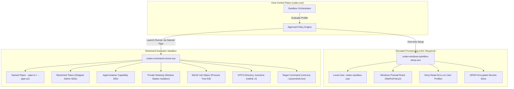

# Codex Sandboxing, Process Isolation & Execution Safety

## 1. Overview & Security Philosophy

Executing untrusted model-generated shell commands on a developer's local machine presents significant security hazards: arbitrary file deletion, credential exfiltration, persistence establishment, and network probing.

Codex implements a **zero-trust, multi-tiered containment architecture** for command execution on Microsoft Windows. Rather than executing commands directly under the user's primary interactive session token, Codex enforces strict OS-level isolation through a dual-binary subsystem:
1. **`codex-windows-sandbox-setup.exe`**: An elevated (UAC) provisioning agent that configures persistent isolation primitives: dedicated unprivileged user accounts, Windows Defender Firewall COM policies, and root NTFS Access Control Lists (ACLs).
2. **`codex-command-runner.exe`**: A low-privilege execution proxy that runs sandboxed processes using Windows Restricted Tokens, AppContainer capability SIDs, private Windows Desktops, and Win32 Job Objects.



---

## 2. Sandbox Execution Policies

Codex defines three explicit sandbox policies selectable via `-s, --sandbox <MODE>`:

| Sandbox Mode | Filesystem Access | Network Access | Shell Token Type | Typical Use Case |
| :--- | :--- | :--- | :--- | :--- |
| **`read-only`** | Workspace read-only; temp directory write | Blocked (or local proxy only) | Restricted Token + Deny-Write ACLs | Repository inspection, searching, read-only analysis |
| **`workspace-write`** | Read-write inside primary workspace & `--add-dir`; system roots blocked | Local proxy or outbound port-restricted | Restricted Token + Workspace Junctions | Standard agent coding, editing, compiling, testing |
| **`danger-full-access`** | Full access inherited from host user | Unrestricted network | Standard User Interactive Token | Explicit external automation, CI environments |

> [!CAUTION]
> The flag `--dangerously-bypass-approvals-and-sandbox` bypasses all sandbox token restrictions and human confirmations. It is explicitly guarded by internal warnings and designed strictly for pre-isolated Docker/VM runners.

---

## 3. Windows Sandbox Architecture Deep-Dive

### 3.1. Provisioning & Elevation (`codex-windows-sandbox-setup.exe`)

Setting up machine-wide isolation on Windows requires administrator privileges. The orchestrator checks elevation status; if unprivileged, it triggers a UAC elevation prompt and executes `codex-windows-sandbox-setup.exe` with a base64-encoded setup payload (`helper_request_args`).

#### Provisioning Lifecycle Stages:
1. **User Account Creation (`helper_user_provision_failed`)**:
   - Creates a dedicated local user account (e.g., `codex-sandbox-user`) and a dedicated local group.
   - Sets non-expiring passwords, disables interactive GUI login rights (`SeDenyInteractiveLogonRight`), and enables service logon rights.
2. **DPAPI Credential Protection (`helper_dpapi_protect_failed`)**:
   - Encrypts sandbox user credentials using the Windows Data Protection API (DPAPI) with machine-wide and user-scope keys.
   - Writes credentials to a protected users file accessible only by the orchestrator.
3. **Firewall Policy Configuration (`helper_firewall_policy_access_failed`)**:
   - Interacts with the Windows Advanced Firewall COM interfaces (`INetFwPolicy2`, `INetFwRules`).
   - Generates outbound blocking rules targeting the sandbox user SID, preventing malicious code from establishing direct C2 (command & control) or data exfiltration channels.
   - Only permitted local proxy SIDs (`network_proxy_restricting_sid`) can route outbound traffic.
4. **Deny-Read Root ACLs (`helper_read_acl_helper_spawn_failed`)**:
   - Traverses user profiles (`C:\Users\<CurrentAdminUser>`) and sensitive directories (SSH keys, AWS/Azure credentials, browsers).
   - Applies Access Control Entries (Deny-Read ACEs) specifically targeting the sandbox group SID.
   - Protects against accidental sandbox corruption: "refusing to apply a deny-read ACE to filesystem root".
5. **Setup Marker & Error Logging (`setup_error.json`)**:
   - Writes atomic setup completion markers.
   - If any step fails, serializes comprehensive diagnostics to `.sandbox/setup_error.json`.

---

### 3.2. Token Restriction & Isolation Primitives (`codex-command-runner.exe`)

When executing a command within `workspace-write` or `read-only`:

#### A. Restricted Security Tokens
- Calls `CreateRestrictedToken` to derive a restricted token from the primary token.
- **Disables Administrative SIDs**: Strips `BUILTIN\Administrators`, `Power Users`, and privileged groups, marking them as `SE_GROUP_USE_FOR_DENY_ONLY`.
- **Restricts Privileges**: Removes sensitive Win32 privileges (`SeDebugPrivilege`, `SeImpersonatePrivilege`, `SeLoadDriverPrivilege`, `SeBackupPrivilege`, `SeRestorePrivilege`).
- **Restricting SIDs List**: Appends Restricting SIDs so every access check requires *both* normal group authorization and restricting group authorization.

#### B. AppContainer Capability SIDs (`cap_sids`)
- Applies modern Windows AppContainer capability SIDs to restrict access to network interfaces, webcam, microphone, location, and documents.

#### C. Private Desktop Isolation (`private_desktop_name`)
- On Windows, all processes in the same interactive window station (`WinSta0`) can communicate via Windows Messages (`SendMessage`, `PostMessage`), install global keyboard/mouse hooks (`SetWindowsHookEx`), and read clipboard contents.
- `codex-command-runner.exe` creates or assigns a **private desktop** (`CreateDesktopW`) detached from the interactive user desktop.
- Subprocesses running in the private desktop cannot inject keystrokes, intercept window messages, or tamper with the host user's active GUI windows.

#### D. Win32 Job Object Containment
- Creates an anonymous Win32 Job Object (`CreateJobObjectW`).
- Sets `JOB_OBJECT_LIMIT_KILL_ON_JOB_CLOSE`: If `codex-command-runner.exe` crashes or is killed, the Windows kernel automatically terminates all child, grandchild, and descendant processes.
- Enforces hard process limits (memory ceilings, CPU rate limits).

#### E. Filesystem Virtualization via Junctions (`mklink /J`)
- Rather than granting the sandbox access to arbitrary disk paths, Codex uses NTFS directory junctions:
  ```
  .codex/sandbox/<session-id>/workspace -> D:\Projects\OpenSource\AgentApp
  ```
- If a junction already exists, it validates its target; if mismatched, it recreates it safely via `cmd /c mklink /J`.

---

## 4. The Host-to-Runner Pipe Protocol

Communication between `codex.exe` and `codex-command-runner.exe` operates entirely over duplex named pipes (`--pipe-in`, `--pipe-out`).

### 4.1. The `SpawnRequest` Schema

The orchestrator sends a structured `spawn_request` message containing complete process execution constraints:

```typescript
interface SpawnRequest {
  command: string[];                       // Executable and arguments (e.g. ["npm", "test"])
  cwd: string;                             // Working directory
  env: Record<string, string>;             // Sanitized environment variables
  permission_profile: string;              // "read-only" | "workspace-write"
  workspace_roots: string[];               // Allowed writable directories
  codex_home: string;                      // Sanitized sandbox CODEX_HOME
  real_codex_home: string;                 // Real host CODEX_HOME
  cap_sids: string[];                      // AppContainer Capability SIDs
  network_proxy_restricting_sid?: string;  // Proxy restricting SID
  timeout_ms?: number;                     // Hard timeout in milliseconds
  tty: boolean;                            // Allocate Windows ConPTY
  stdin_open: boolean;                     // Whether stdin stream remains open
  private_desktop_name?: string;           // Isolated desktop identifier
}
```

### 4.2. Streamed Framed Messages

All messages on the pipe are internally tagged Serde JSON objects:

```typescript
type Message =
  | { type: "spawn_request"; payload: SpawnRequest }
  | { type: "spawn_ready"; process_id: number }
  | { type: "output"; stdout?: string; stderr?: string }
  | { type: "stdin"; payload: { data_b64: string } }
  | { type: "close_stdin" }
  | { type: "resize"; cols: number; rows: number }
  | { type: "exit"; payload: { exit_code: number; timed_out: boolean } }
  | { type: "error"; payload: { message: string; stage: string; windows_error_code?: number } }
  | { type: "terminate" };
```

---

## 5. Diagnostic Error Catalog & Failure Recovery

The sandbox architecture defines structured failure stages to ensure that errors are actionable and never degrade into an un-sandboxed fallback:

| Error Identifier | Subsystem | Cause | Fail-Safe Recovery |
| :--- | :--- | :--- | :--- |
| `orchestrator_elevation_required` | Orchestrator | User is not running as administrator and UAC setup is needed. | Prompts user to run `codex sandbox setup` with elevation. |
| `orchestrator_elevation_check_failed` | Orchestrator | Win32 token query failed when checking elevation status. | Fails closed; denies execution. |
| `helper_user_provision_failed` | Setup Helper | Local account creation failed (e.g. domain policy restrictions). | Logs error to `setup_error.json`; prompts for manual user account setup. |
| `helper_firewall_policy_access_failed` | Setup Helper | Windows Defender Firewall COM interface access denied. | Disables sandbox networking completely. |
| `helper_firewall_policy_ineffective` | Setup Helper | Firewall rules were registered but active group policy overrides them. | Blocks execution with explicit GPO warning. |
| `helper_dpapi_protect_failed` | Setup Helper | DPAPI encryption failed (corrupt DPAPI master key). | Re-initializes sandbox secret keystore. |
| `helper_read_acl_helper_spawn_failed` | Setup Helper | Failed to spawn sub-helper to set Deny-Read ACLs on user profiles. | Halts setup; prevents partially secured sandbox state. |
| `junction: mklink failed` | Runner | NTFS directory junction creation failed. | Cleans stale links and retries; reports NTFS permissions error. |
| `timed_out` | Runner | Subprocess exceeded `timeout_ms`. | Emits Job Object termination signal; sends `exit { timed_out: true }`. |

---

## 6. Security Analysis & Key Takeaways for SuperAgent

Codex's sandboxing architecture sets a benchmark for local AI agent execution:

1. **Never Trust In-Process Sandboxes**: In-process runtime sandboxes (such as Node `vm` or WebWorkers) are trivially bypassable via prototype pollution or memory corruption. Codex delegates isolation entirely to the **Windows Kernel Security Reference Monitor (SRM)**.
2. **Multi-Layered Hardening**: Even if a malicious command bypasses filesystem restrictions, it is trapped in a private desktop (preventing UI tampering) and blocked by firewall COM rules (preventing network egress).
3. **Fail-Closed Execution**: If any setup invariant fails (firewall, ACL, token), the task is rejected. It never defaults to running with elevated or host privileges.
