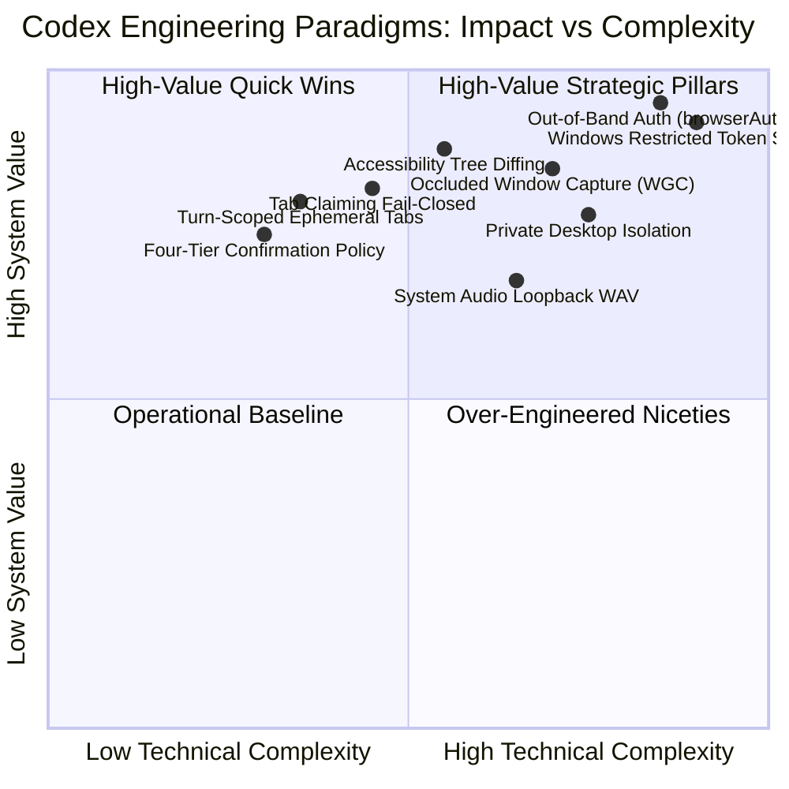

# Codex Decompiled Analysis: Executive Summary & SuperAgent Blueprint

## 1. Executive Summary

This study represents an exhaustive decompilation and architectural analysis of the **Codex** subsystem located in `codex_decompiled`. The analysis covered every binary, schema, script, documentation file, and protocol binding across:

1. **Root Manifest & Core Binaries**: Custom Node.js CUA runtime (`24.21.0-cua.1`), `codex.exe` orchestrator, `codex-code-mode-host.exe` gRPC service, `codex-command-runner.exe` sandbox proxy, `codex-windows-sandbox-setup.exe` elevated provisioner, and `rg.exe`.
2. **Browser Desktop & Web Automation (`@oai/browser-desktop`)**: Multi-surface orchestration (`iab`, `extension`, `cdp`, `mcpapps`), tab claiming mechanics, turn-based ephemeral lifecycle cleanup, stealth fingerprinting, out-of-band credential authentication (`browserAuth`), and WebMCP tool discovery.
3. **Computer Use Agent & REPL (`cua` & `cua-repl`)**: Custom Node V8 REPL runner (`node_repl.exe`), trusted service bindings, persistent execution scopes, and automated UI state streaming.
4. **Sky Desktop Grounding Framework (`@oai/sky`)**: Multi-platform accessibility tree extraction (Windows UIA, Linux AT-SPI, macOS NSAccessibility), token-saving tree diffing, occluded window capture via `Windows.Graphics.Capture`, coordinate routing without focus stealing, mouse hold durations, continuous drag handles, loopback audio capture, and clipboard snapshot handles.
5. **Sandboxing & Execution Safety**: Defense-in-depth Windows containment utilizing Restricted Security Tokens, AppContainer capability SIDs, Windows Firewall COM rules (`INetFwPolicy2`), root Deny-Read ACLs, private Windows Desktops, NTFS junctions, and Win32 Job Objects.

---

## 2. Core Architectural Pillars of Codex

### 2.1. Out-of-Band Credential Security (Zero LLM Exposure)
The single most impressive security feature in Codex is its **Blind Authentication Pattern** (`browserAuth`). Rather than allowing the LLM to inspect, ask for, or enter user passwords:
- The LLM only discovers form metadata (`origin`, `fields`, `submit`).
- The browser client renders an out-of-band, secure native input dialog.
- The human enters their password directly into the browser client.
- The browser client uses CDP to inject credentials into DOM inputs and trigger submission.
- **The LLM receives only a confirmation `{ status: "submitted" }` with zero credential bytes.**

### 2.2. Token-Saving Accessibility Tree Diffing
On complex desktop applications and modern web applications, serializing full accessibility trees can easily exceed 25,000 tokens per step. Codex solves this by:
- Emitting an initial full tree snapshot.
- Computing semantic tree differences on subsequent steps (`-`, `+`, `*`).
- Slashing prompt token overhead by **70–85%** per turn during multi-step CUA tasks.

### 2.3. Dual-Engine Input Grounding (Semantic + Visual)
Codex avoids the fragility of pure computer vision (which fails on subtle UI shifts, DPI scaling, and dark/light themes) and pure accessibility (which fails on non-standard custom canvas controls):
- Primary actions target stable integer/string element IDs extracted from the OS accessibility tree.
- Secondary actions fall back to window-relative coordinates backed by a cached `screenshotId`.
- If an element coordinate does not match the active `screenshotId`, the action is rejected to prevent mis-clicks.

### 2.4. Windows Restricted Token & Desktop Isolation
Arbitrary shell execution is completely locked down on Windows:
- Stripped admin SIDs and privileges.
- AppContainer capability SIDs restricting camera, microphone, and network.
- Dedicated local sandbox user account with Windows Firewall outbound blocking rules.
- Isolated private Windows Desktop (`CreateDesktopW`) preventing window message hooking (`SetWindowsHookEx`) or tampering with the user's interactive desktop.

---

## 3. Comparative Matrix: Codex vs. SuperAgent (`AgentApp`)

| Architectural Domain | Codex Implementation | SuperAgent Current State (`core_v2`) | Strategic Recommendation for SuperAgent |
| :--- | :--- | :--- | :--- |
| **Backend Core** | Pure Rust (`codex.exe`) + Tonic gRPC (`codex-code-mode-host`) | Pure Rust (`packages/core_v2`) + Axum HTTP/WS daemon | Maintain Axum/WS daemon on port `1469`; adopt gRPC or named-pipe worker pools for high-throughput tool runners. |
| **Command Execution** | Windows Restricted Token + AppContainer SIDs + Private Desktop | Standard Rust `tokio::process::Command` | Implement a dedicated sandbox runner in `packages/core_v2/src/tools/sandbox/` using Win32 Job Objects and Restricted Tokens. |
| **Browser Control** | Multi-surface (`iab`, `extension`, `cdp`, `mcpapps`) with tab leasing | Basic Chrome / Playwright tool bindings | Integrate the 4-tier leasing protocol, session naming, and ephemeral turn cleanup into `packages/core_v2/src/tools/builtin/browser.rs`. |
| **Authentication** | Out-of-band native dialogs (`browserAuth`) | Passwords entered via chat/prompts | Implement out-of-band credential entry in native clients (`clients/web`, `clients/windows`, `clients/macos`). |
| **Desktop Grounding** | Swift UIA + Windows.Graphics.Capture + AT-SPI (`sky`) | Egui native overlays (`dictation-native`, `artifacts-native`) | Extend `packages/circle-search-native` and platform clients with UI Automation accessibility tree extraction. |
| **Tree Optimization** | Semantic tree diffing across turns | Full context re-injection | Implement accessibility tree diffing in `packages/core_v2/src/memory/`. |
| **Audio Capture** | 24 kHz system loopback WAV recording | `packages/dictation-native` (microphone input via `cpal`) | Add WASAPI / PulseAudio system loopback recording alongside microphone dictation. |

---

## 4. SuperAgent Adoption Roadmap & Blueprint

### Phase 1: Security & Sandboxed Runner Integration
1. **Windows Restricted Token Runner**:
   - Port the `codex-command-runner.exe` architecture to a new Rust binary `superagent-runner` or an internal module in `packages/core_v2/src/tools/sandbox/windows.rs`.
   - Use `CreateRestrictedToken`, `CreateJobObjectW` (`JOB_OBJECT_LIMIT_KILL_ON_JOB_CLOSE`), and NTFS junctions for workspace isolation.
2. **Four-Tier Confirmation Policy**:
   - Codify the four friction levels (`Hand-off`, `Always Confirm`, `Pre-Approval`, `No Confirmation`) into `packages/core_v2/src/orchestrator/approval.rs`.

### Phase 2: Browser Tab Leasing & Blind Auth
1. **Turn-Scoped Tab Lifecycle**:
   - Implement `tab.markDeliverable()` and `tab.markHandoff()` in SuperAgent's browser automation tool.
   - Automatically close unmarked scratch tabs when the agent's turn finishes.
2. **Out-of-Band Credential Entry**:
   - When a login form is detected, emit a specialized client event `Event::BrowserAuthRequested { origin, fields, submit }`.
   - Update `clients/web`, `clients/windows`, and `clients/macos` to render a native modal for credential input, bypassing LLM prompt context entirely.

### Phase 3: Desktop Grounding & Tree Diffing
1. **UI Automation (UIA) Engine**:
   - In `clients/windows` (WinUI 3 / C#) or a Rust Windows crate, expose an accessibility crawler that emits formatted element trees with stable numeric IDs.
2. **Accessibility Tree Differ**:
   - Implement an in-memory diffing engine in `packages/core_v2/src/memory/tree_differ.rs` that computes Myers or line-based diffs between consecutive UI states.

---

## 5. Directory Reference to Detailed Analysis Reports

For granular parameters, complete schemas, and code implementations, refer to the individual reports:

1. [01_ARCHITECTURE_OVERVIEW.md](file:///d:/Projects/OpenSource/AgentApp/docs/analysis/codex/01_ARCHITECTURE_OVERVIEW.md): Comprehensive system topology, manifest definitions, and binary roles.
2. [02_TOOL_CALLS_AND_SCHEMAS.md](file:///d:/Projects/OpenSource/AgentApp/docs/analysis/codex/02_TOOL_CALLS_AND_SCHEMAS.md): Exhaustive protocol reference, JSON-RPC approval requests, gRPC definitions, and 50+ browser commands.
3. [03_CUA_SKY_DESKTOP_ACTIONS.md](file:///d:/Projects/OpenSource/AgentApp/docs/analysis/codex/03_CUA_SKY_DESKTOP_ACTIONS.md): CUA REPL execution loop, Sky multi-platform input synthesis, accessibility tree diffing, and audio recording.
4. [04_BROWSER_AUTOMATION_AND_LEASING.md](file:///d:/Projects/OpenSource/AgentApp/docs/analysis/codex/04_BROWSER_AUTOMATION_AND_LEASING.md): Multi-environment browser control, tab leasing, turn cleanup, stealth profiles, and out-of-band authentication.
5. [05_SANDBOXING_AND_EXECUTION_SAFETY.md](file:///d:/Projects/OpenSource/AgentApp/docs/analysis/codex/05_SANDBOXING_AND_EXECUTION_SAFETY.md): Windows Restricted Tokens, AppContainer SIDs, private desktops, NTFS junctions, and named-pipe runner protocol.
