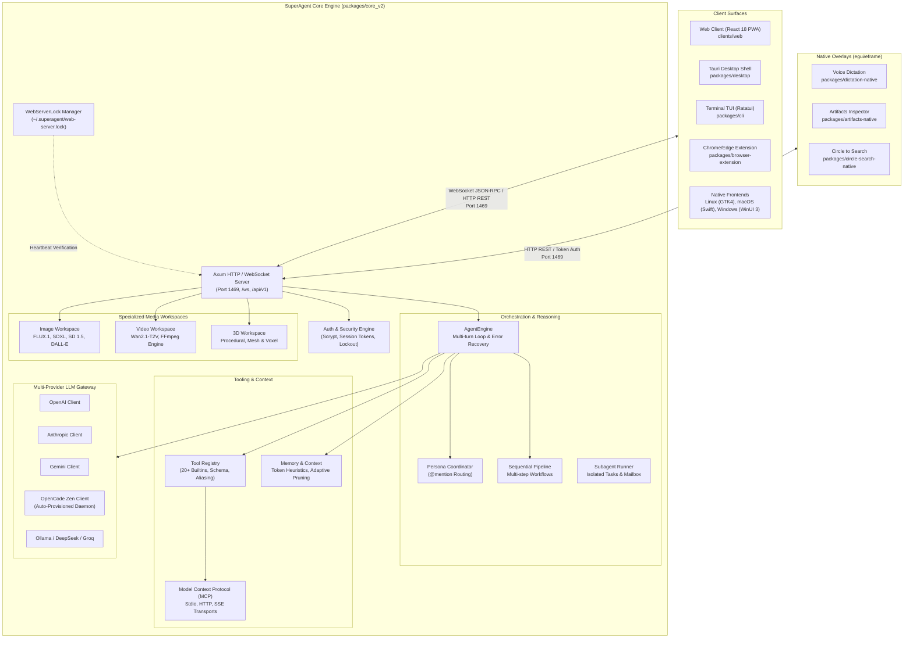
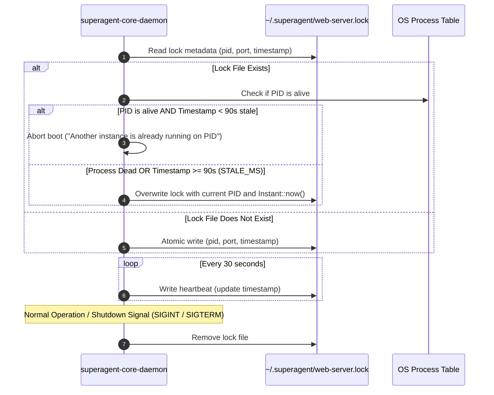
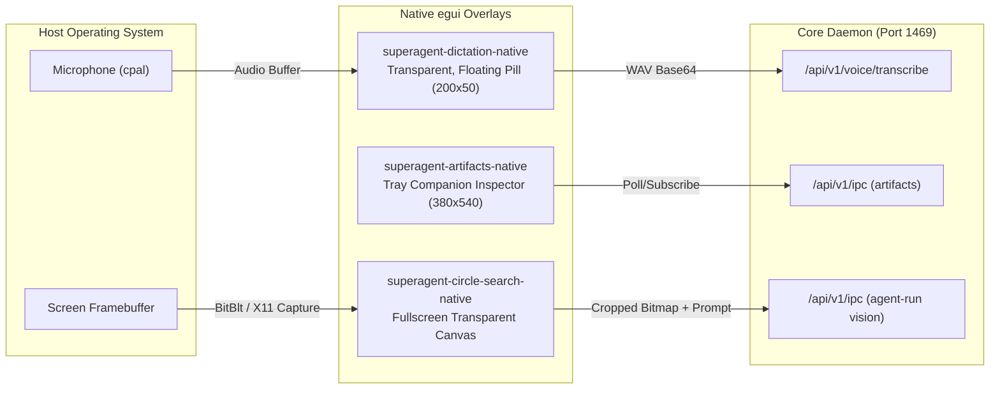

# SuperAgent Core Architecture Overview

## 1. Executive Summary & System Topology

SuperAgent (`AgentApp`) is an enterprise-grade autonomous AI assistant and developer platform structured as a multi-package hybrid monorepo. Its foundational backend intelligence engine, **`packages/core_v2`**, is authored entirely in high-performance, memory-safe **Rust**, replacing the retired TypeScript engine (`legacy/core`). 

The core daemon acts as the centralized coordinator, hosting an asynchronous Axum HTTP and WebSocket server on port `1469`, dispatching multi-provider LLM inference, managing persistent memory, executing a sandboxed 20+ tool registry, orchestrating local and online image/video/3D neural pipelines, and serving multiple client surfaces across desktop, web, terminal, and browser environments.



---

## 2. Daemon Bootstrapping & Lifecycle Management

### 2.1 Entrypoint & Mode Selection
The daemon binary entrypoint is defined in [`packages/core_v2/src/main.rs`](file:///d:/Projects/OpenSource/AgentApp/packages/core_v2/src/main.rs#L1-L180). SuperAgent supports two core operational modes via the `CliMode` enum:
1. **`CliMode::Server`**: The long-running Axum HTTP/WS daemon hosting the background engine.
2. **`CliMode::Run`**: Headless batch execution mode that boots the engine in memory, executes a user prompt with real-time stdout streaming, and cleanly shuts down.

```rust
// packages/core_v2/src/main.rs
enum CliMode {
    Server {
        port: u16,
        host: String,
        ui_dir: Option<PathBuf>,
        no_auth: bool,
    },
    Run {
        prompt: String,
        provider: String,
        model: Option<String>,
        workspace: PathBuf,
    },
}
```

When started with no arguments or `--server`, SuperAgent parses CLI flags:
- `--port` / `PORT` env var (defaults to `1469`).
- `--host` / `HOST` env var (defaults to `0.0.0.0` for universal LAN/WAN access).
- `--ui-dir`: Optional path to static web assets. If omitted, it automatically scans for `clients/web/dist`, `packages/ui/dist`, or fallbacks in `~/.superagent/web`.
- `--no-auth`: Disables scrypt login authentication, intended for automated headless testing or isolated container environments.

### 2.2 Axum Server Initialization & State Composition
The server runtime is spawned in [`packages/core_v2/src/server/mod.rs`](file:///d:/Projects/OpenSource/AgentApp/packages/core_v2/src/server/mod.rs#L50-L240) using Tokio's multi-threaded asynchronous runtime. Shared system state is encapsulated in `AppState` ([`packages/core_v2/src/server/state.rs`](file:///d:/Projects/OpenSource/AgentApp/packages/core_v2/src/server/state.rs#L30-L80)):

```rust
// packages/core_v2/src/server/state.rs
pub struct AppState {
    pub ws_broadcast: broadcast::Sender<String>,
    pub active_runs: Arc<RwLock<HashMap<String, CancellationToken>>>,
    pub run_results: Arc<RwLock<HashMap<String, RunResultEntry>>>,
    pub tool_registry: Arc<ToolRegistry>,
    pub settings_store: Arc<RwLock<SettingsStore>>,
    pub auth_store: Arc<RwLock<AuthStore>>,
    pub image_workspace: Arc<ImageWorkspaceManager>,
    pub video_workspace: Arc<VideoWorkspaceManager>,
    pub threed_workspace: Arc<ThreeDWorkspaceManager>,
    pub session_subscriptions: Arc<RwLock<HashMap<String, HashSet<String>>>>,
    pub client_tool_waiters: Arc<RwLock<HashMap<String, oneshot::Sender<Value>>>>,
    pub disable_auth: bool,
}
```

### 2.3 Single-Instance Lock Lifecycle & Heartbeat Loop
To prevent port collision, split-brain database corruption, or concurrent execution race conditions, SuperAgent implements a filesystem-based lock coordinator in [`packages/core_v2/src/storage/lock.rs`](file:///d:/Projects/OpenSource/AgentApp/packages/core_v2/src/storage/lock.rs#L1-L198).



The lock file stores:
```json
{
  "pid": 28412,
  "port": 1469,
  "updated_at": 1728901234567
}
```
If a process crashes or loses power, stale locks older than `STALE_MS = 90_000` (90 seconds) are automatically reclaimed during the next boot. When running, a background Tokio task (`tokio::spawn`) pulses the lock file every 30 seconds with an updated timestamp.

### 2.4 OS Autostart Subsystem
The startup module ([`packages/core_v2/src/startup/autostart.rs`](file:///d:/Projects/OpenSource/AgentApp/packages/core_v2/src/startup/autostart.rs#L1-L150)) enables unattended system service configuration across Windows, macOS, and Linux:
- **Windows**: Manipulates `HKCU\Software\Microsoft\Windows\CurrentVersion\Run` registry keys (`SuperAgent` or `SuperAgent-CLI`) with configured executable paths and startup arguments (`--server --port 1469`).
- **macOS**: Generates LaunchAgent property lists (`~/Library/LaunchAgents/com.superagent.daemon.plist`).
- **Linux**: Creates Systemd user units (`~/.config/systemd/user/superagent.service`).

---

## 3. Server Architecture & API Routing

The Axum server constructs its HTTP and WebSocket routing tree with explicit middleware layering:
- **CORS Middleware**: Permissive `AllowOrigin::any()`, `AllowMethods::any()`, and `AllowHeaders::any()` configured via `tower_http::cors::CorsLayer`, allowing desktop web views and extension popups across differing origins to communicate.
- **Authentication Middleware**: `axum::middleware::from_fn_with_state(state.clone(), auth_middleware)` protecting all mutating `/api/v1/` routes while exempting public endpoints.
- **WebSocket Protocol**: `/ws` bidirectional channel hosting the full agent execution lifecycle.
- **Static SPA Fallback**: `ServeDir` mapping to the compiled web UI dist directory with SPA fallback to `index.html`.

### Route Mapping Matrix

| Route Path | Method | Auth Required | Description | Handler Location |
| :--- | :--- | :--- | :--- | :--- |
| `/ws` | `GET` (Upgrade) | Token/Cookie | Real-time WebSocket IPC channel | `server/ws.rs:handle_ws` |
| `/api/v1/ipc` | `POST` | Yes | HTTP JSON-RPC command execution | `server/ipc/mod.rs:handle_ipc_request` |
| `/api/v1/auth/login` | `POST` | **No** (Public) | Scrypt password login & session cookie issuance | `server/auth.rs:login_handler` |
| `/api/v1/auth/verify`| `GET` | Yes | Validates active session token | `server/auth.rs:verify_handler` |
| `/api/v1/auth/logout`| `POST` | Yes | Invalidates active session token | `server/auth.rs:logout_handler` |
| `/api/v1/voice/transcribe` | `POST` | Yes | Audio transcription API (WAV/MP3 base64) | `server/voice.rs:transcribe_handler` |
| `/health` | `GET` | **No** (Public) | Liveness probe returning JSON status | `server/mod.rs:health_check` |
| `/api/v1/image/*` | `POST/GET`| Yes | Local & online image generation / catalogs | `image_workspace/mod.rs` |
| `/api/v1/video/*` | `POST/GET`| Yes | Video generation, status polling, stream | `video_workspace/mod.rs` |
| `/api/v1/threed/*` | `POST/GET`| Yes | 3D mesh and scene generation | `threed_workspace/mod.rs` |
| `/*` | `GET` | **No** (Public) | Serves compiled React web UI bundle | `tower_http::services::ServeDir` |

---

## 4. Specialized Media Workspaces

SuperAgent integrates specialized local and cloud-based generative media subsystems directly into the Rust daemon, eliminating reliance on external microservices.

### 4.1 Image Workspace Manager
Located in [`packages/core_v2/src/image_workspace/`](file:///d:/Projects/OpenSource/AgentApp/packages/core_v2/src/image_workspace/mod.rs#L1-L120):
- **Local Engine Management**: Manages downloaded diffusion weights (`models.rs`), model registries, and execution runtimes (`engine.rs`).
- **Supported Local Model Families**: `flux-schnell` (FLUX.1), `sdxl-turbo` / `sdxl-base` (Stable Diffusion XL), `sd35-medium`, and `sd15` (Stable Diffusion 1.5).
- **Dynamic Hardware & RAM Pre-flight Verification**: Before launching a local diffusion job, `ImageWorkspaceManager::generate_local` inspects the host's physical RAM using `sysinfo::System`. If available memory is below safety thresholds (e.g., < 7,168 MB for FLUX, or < 2,560 MB for SDXL), it aborts early with an informative diagnostic message rather than allowing an ungraceful OOM abort.
- **Online Fallbacks**: Cloud providers (`online.rs`) supporting OpenAI DALL-E 3, Stability AI, Replicate, and Midjourney proxies.

### 4.2 Video Workspace Manager
Located in [`packages/core_v2/src/video_workspace/`](file:///d:/Projects/OpenSource/AgentApp/packages/core_v2/src/video_workspace/mod.rs#L1-L100):
- **Local Video Synthesis**: Bundles support for modern diffusion video models like `wan2.1-t2v-1.3b` (Wan2.1 Text-to-Video).
- **FFmpeg Automated Pipeline**: The `VideoEngineManager` verifies, downloads, and invokes local `ffmpeg` binaries to stitch frame buffers, transcode output into MP4/WebM containers, and normalize framerates.
- **Memory & VRAM Verification**: Requires pre-flight memory validation (> 12 GB RAM for video synthesis pipelines).

### 4.3 3D Workspace Manager
Located in [`packages/core_v2/src/threed_workspace/`](file:///d:/Projects/OpenSource/AgentApp/packages/core_v2/src/threed_workspace/mod.rs#L1-L70):
- Supports mesh generation, procedural world building, vertex count validation, and asset persistence into GLB, OBJ, and USDZ formats for 3D web previewers.

---

## 5. Model Context Protocol (MCP) Integration

SuperAgent includes a native implementation of the **Model Context Protocol (MCP)** specification (Protocol Version `2024-11-05`) in [`packages/core_v2/src/mcp/`](file:///d:/Projects/OpenSource/AgentApp/packages/core_v2/src/mcp/client.rs#L1-L298).

### 5.1 Transport Architecture
`McpClient` provides an abstraction across three distinct transport mediums:
1. **`McpTransport::Stdio`**: Spawns an external CLI binary (e.g., `npx -y @modelcontextprotocol/server-postgres`) as a child process using `tokio::process::Command`, piping `stdin` and `stdout` with line-delimited JSON-RPC 2.0 communication. On Windows, child processes are configured with creation flag `0x08000000` (`CREATE_NO_WINDOW`) to prevent distracting terminal windows from popping up.
2. **`McpTransport::Http`**: Standard HTTP POST requests dispatching JSON-RPC 2.0 envelopes to remote MCP endpoints.
3. **`McpTransport::Sse`**: Server-Sent Events transport receiving asynchronous notifications from remote servers with paired HTTP POST requests for client command dispatch.

### 5.2 Dynamic Tool Bridging
Remote MCP tools discovered via `tools/list` are transparently wrapped into native SuperAgent tools via `McpToolWrapper` ([`packages/core_v2/src/mcp/client.rs:236-298`](file:///d:/Projects/OpenSource/AgentApp/packages/core_v2/src/mcp/client.rs#L236-L298)):

```rust
// packages/core_v2/src/mcp/client.rs
pub struct McpToolWrapper {
    client: Arc<Mutex<McpClient>>,
    info: McpTool,
}

#[async_trait]
impl Tool for McpToolWrapper {
    fn name(&self) -> &str { &self.info.name }
    fn description(&self) -> &str { ... }
    fn parameters_schema(&self) -> Value { self.info.input_schema.clone() }
    async fn execute(&self, input: Value) -> Result<String> {
        let mut client = self.client.lock().await;
        let result = client.call_tool(&self.info.name, args).await?;
        // Formats text, images, or errors into standard agent responses
        ...
    }
}
```
This enables the core `AgentEngine` to invoke external database connectors, API clients, or custom developer MCP servers without any architectural divergence from builtin tools.

---

## 6. Native Overlays & Multi-Surface Architecture

In addition to traditional desktop and web frontends, SuperAgent includes three zero-overhead, GPU-accelerated desktop overlays built with **egui / eframe**:



1. **`superagent-dictation-native`** ([`packages/dictation-native`](file:///d:/Projects/OpenSource/AgentApp/packages/dictation-native/src/main.rs)):
   - A minimalist, borderless, floating pill (200x50 px) anchored dynamically at the bottom center of the active monitor.
   - Captures microphone input via `cpal`, encodes audio buffers to WAV format, resolves local session tokens from `~/.superagent/auth.json`, and streams transcriptions directly into the active OS window or daemon.
2. **`superagent-artifacts-native`** ([`packages/artifacts-native`](file:///d:/Projects/OpenSource/AgentApp/packages/artifacts-native/src/main.rs)):
   - A companion inspector window (380x540 px) docked to the desktop notification area or macOS status bar.
   - Displays real-time generated artifacts (code snippets, interactive SVGs, documentation, plans) produced during ongoing agent turns.
3. **`superagent-circle-search-native`** ([`packages/circle-search-native`](file:///d:/Projects/OpenSource/AgentApp/packages/circle-search-native/src/main.rs)):
   - Captures the active desktop screen under the cursor with zero flicker before displaying a fullscreen transparent viewport.
   - Allows users to lasso, circle, or select any screen region, automatically sending the cropped bitmap to the agent's multimodal vision model with user queries.

---

## 7. Architectural Assessment: Strengths & Bottlenecks

### 7.1 Key Architectural Strengths
- **Native Memory Safety & Predictable Performance**: Zero garbage-collection pauses. Memory consumption of the base daemon sits under 35 MB RAM, contrasting sharply with Node.js/Electron alternatives that consume 400MB+.
- **Resilient Multi-Surface Wire Contract**: The dual Axum HTTP + WebSocket layer decouples the backend engine from presentation clients, enabling headless CLI, Web PWA, desktop apps, and lightweight egui overlays to share the identical intelligence state.
- **Fail-Safe Pre-flight Resource Verification**: Builtin checks for RAM and VRAM before executing resource-heavy diffusion or video pipelines prevent out-of-memory crashes.
- **Universal External Extensibility**: Native MCP implementation allows instant ecosystem compatibility with hundreds of existing Model Context Protocol servers.

### 7.2 Architectural Bottlenecks & Limitations
- **Single-Process Daemon Bottleneck**: While asynchronous tasks run efficiently on Tokio, CPU-bound tasks (e.g., synchronous image preprocessing or large diff computations) can momentarily contend with WebSocket broadcast loops if not strictly isolated with `tokio::task::spawn_blocking`.
- **Global Lock Stale Window**: The 90-second timeout on `web-server.lock` creates a theoretical window where an ungracefully terminated instance prevents an immediate restart unless the process PID check explicitly verifies death.
- **Platform-Specific Windows Shell Dependencies**: Window creation flags (`0x08000000`) and registry manipulations are carefully guarded with `#[cfg(target_os = "windows")]`, but cross-platform parity requires continuous CI maintenance across Linux and macOS environments.
