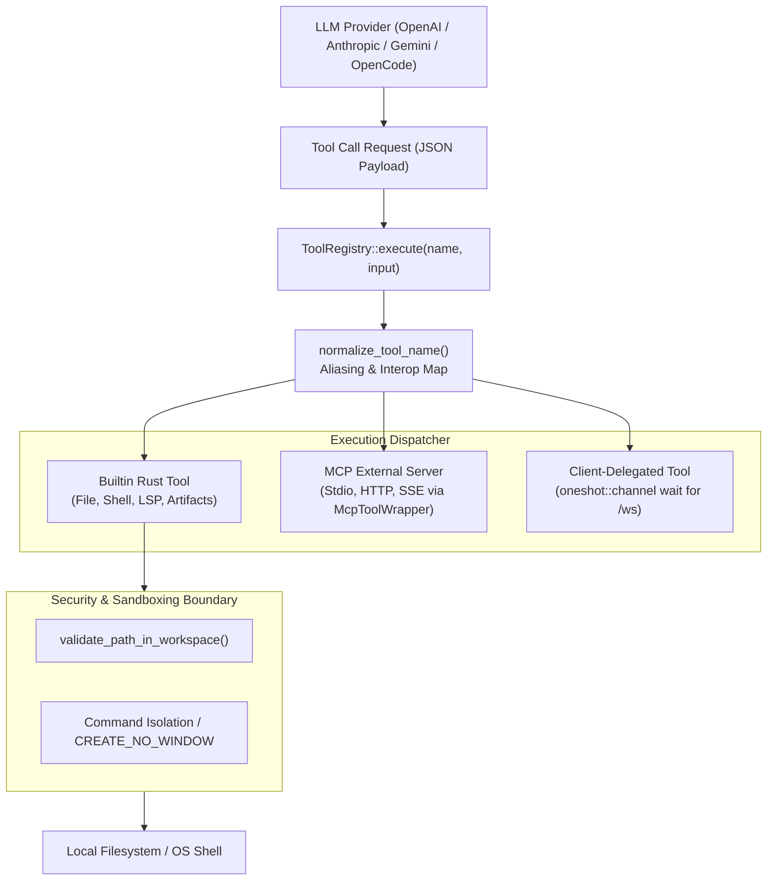
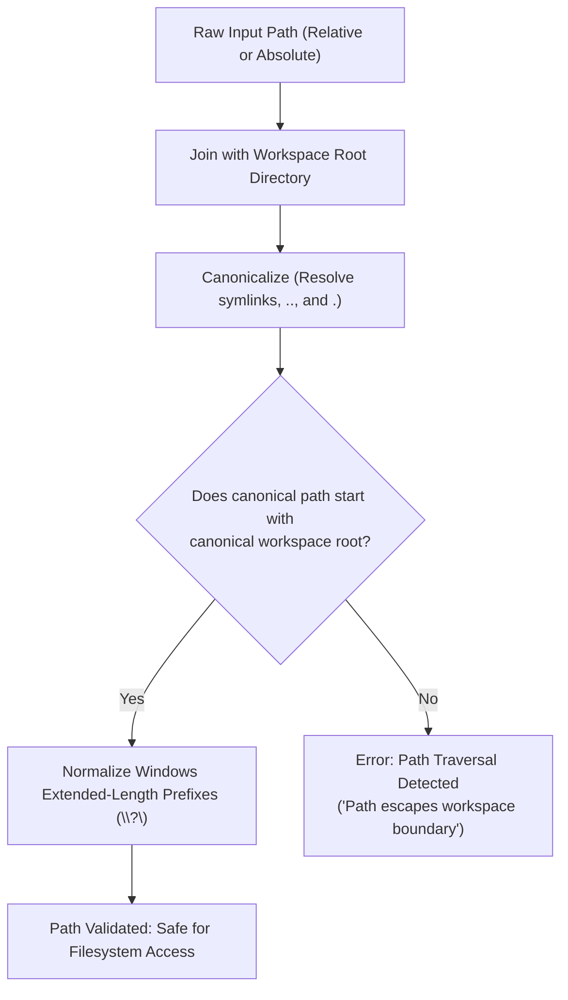
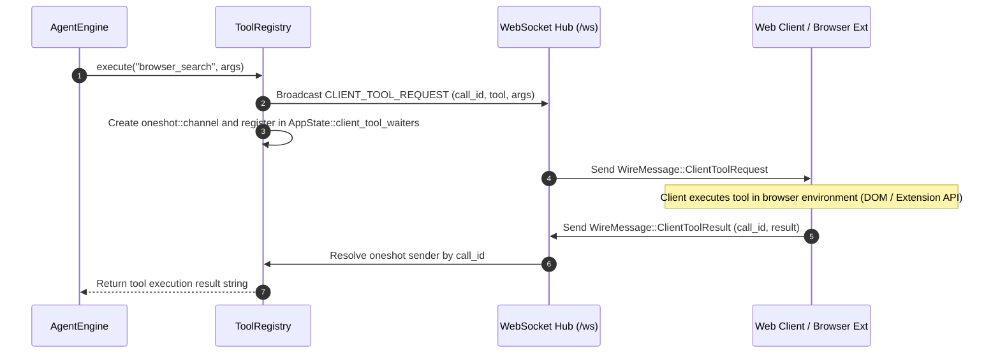

# SuperAgent Tool Registry & Execution Architecture

## 1. Architectural Overview

The SuperAgent tool execution subsystem ([`packages/core_v2/src/tools/`](file:///d:/Projects/OpenSource/AgentApp/packages/core_v2/src/tools/)) provides a unified, thread-safe, extensible interface through which LLMs safely inspect, manipulate, compile, and interact with the local filesystem, terminal processes, development tooling, and external environments.

The subsystem operates under four core engineering invariants:
1. **Dynamic Polymorphism**: All tools implement an asynchronous Rust trait (`Tool`) allowing uniform dispatch across builtin Rust commands, external Model Context Protocol (MCP) servers, and client-delegated UI tools.
2. **Schema Reflection & Normalization**: Tools reflect OpenAPI / JSON Schema specifications directly to LLM providers and utilize an intelligent aliasing layer (`normalize_tool_name`) to bridge divergent nomenclature across Antigravity, OpenCode, and SuperAgent conventions.
3. **Strict Path Sandboxing**: Every filesystem mutation is validated against the active workspace boundary (`validate_path_in_workspace`), neutralizing directory traversal attacks and normalizing platform-specific Windows UNC prefixes.
4. **Resilient Process Isolation**: Background tasks and long-running daemons execute under an asynchronous supervision manager capable of stdout/stderr streaming, stdin piping, and graceful or forced termination.



---

## 2. The `Tool` Trait Specification

The foundational abstraction for all agent capabilities is defined in [`packages/core_v2/src/tools/trait.rs`](file:///d:/Projects/OpenSource/AgentApp/packages/core_v2/src/tools/trait.rs#L1-L35):

```rust
// packages/core_v2/src/tools/trait.rs
use anyhow::Result;
use async_trait::async_trait;
use serde_json::Value;

#[async_trait]
pub trait Tool: Send + Sync {
    /// The canonical identifier of the tool (e.g., "run_command", "read_file")
    fn name(&self) -> &str;

    /// Human- and LLM-readable description explaining capabilities and constraints
    fn description(&self) -> &str;

    /// JSON Schema describing input parameters, required fields, and types
    fn parameters_schema(&self) -> Value;

    /// Asynchronous execution body taking raw JSON arguments and returning formatted text
    async fn execute(&self, input: Value) -> Result<String>;
}
```

### Key Design Properties
- **Thread Safety (`Send + Sync`)**: Tools are wrapped in `Arc<dyn Tool>` inside `ToolRegistry`, allowing concurrent execution across multiple subagent loops and parallel background turns without mutex contention.
- **Async Execution (`#[async_trait]`)**: Execution yields control back to Tokio's reactor during disk I/O, network requests, or child process waiting, ensuring the server daemon's event loop remains responsive.
- **Universal Value Exchange**: Inputs arrive as parsed `serde_json::Value` objects and return `Result<String>`. Error results are captured as `anyhow::Result` and formatted for LLM self-correction rather than crashing the orchestrator loop.

---

## 3. The `ToolRegistry` Engine & Normalization Layer

The tool registry ([`packages/core_v2/src/tools/registry.rs`](file:///d:/Projects/OpenSource/AgentApp/packages/core_v2/src/tools/registry.rs#L1-L245)) acts as the catalog and dispatch engine.

### 3.1 Tool Aliasing & Cross-Platform Normalization
Different LLMs and upstream agent environments call tools by divergent identifiers (e.g., `bash` vs `run_command` vs `terminal`; `view_file` vs `read_file`). SuperAgent addresses this through `ToolRegistry::normalize_tool_name`:

```rust
// packages/core_v2/src/tools/registry.rs
pub fn normalize_tool_name(name: &str) -> &str {
    match name {
        // Antigravity & OpenCode execution aliases
        "bash" | "sh" | "terminal" | "exec" | "execute_command" | "run" => "run_command",
        "read" | "cat" | "view" | "view_file" | "readFile" => "read_file",
        "write" | "create_file" | "writeFile" | "write_to_file" => "write_file",
        "edit" | "str_replace" | "replace_file_content" | "editFile" => "edit_file",
        "ls" | "dir" | "list_directory" | "listDir" => "list_dir",
        "grep" | "search" | "find_in_files" | "grepSearch" => "grep_search",
        "apply_patch" | "patch" => "apply_patch",
        "task" | "manage_task" | "taskManager" => "task_manager",
        "peek_task" | "peekTask" => "peek_task",
        "question" | "ask_question" | "user_question" => "question",
        "plan" | "update_plan" => "plan",
        "todo" | "update_todo" => "todo",
        "artifact" | "create_artifact" | "update_artifact" => "artifact",
        "recall_memory" | "search_memory" => "recall_memory",
        "skill" | "run_skill" | "execute_skill" => "skill",
        "telegram" | "send_telegram" => "telegram",
        "timer" | "schedule" | "set_timer" => "timer",
        "subagent" | "invoke_subagent" | "run_subagent" => "subagent",
        _ => name,
    }
}
```

This mapping guarantees backward compatibility with:
- **Antigravity conventions**: e.g., `view_file`, `replace_file_content`, `ask_question`, `invoke_subagent`, `manage_task`.
- **OpenCode Zen conventions**: e.g., `bash`, `read`, `write`, `edit`, `glob`, `grep`, `lsp`, `task`, `question`.
- **Standard Linux utilities**: e.g., `cat`, `ls`, `dir`, `grep`.

### 3.2 Dynamic Tool Schema Export
`ToolRegistry::get_definitions(&self)` iterates through all registered tools, translating their schemas into the native tool definition formats expected by OpenAI, Anthropic, Gemini, and Ollama APIs.

---

## 4. Comprehensive Catalog of Builtin Tools

SuperAgent provides more than 20 specialized tools natively implemented in pure Rust.

### 4.1 Filesystem & Code Editing Tools

| Tool Identifier | Source File | Description | Parameters |
| :--- | :--- | :--- | :--- |
| `read_file` | `tools/builtin/read_file.rs` | Reads file content with optional line slicing and offset controls | `path`: string, `offset`: optional int, `limit`: optional int |
| `write_file` | `tools/builtin/write_file.rs` | Writes or overwrites entire file contents atomically | `path`: string, `content`: string |
| `edit_file` | `tools/builtin/edit_file.rs` | Exact string replacement (`old_str` -> `new_str`) with single/multiple match enforcement | `path`: string, `old_str`: string, `new_str`: string, `allow_multiple`: bool |
| `list_dir` | `tools/builtin/list_dir.rs` | Lists directory entries with file sizes, modified dates, and recursion | `path`: string, `depth`: optional int |
| `grep_search` | `tools/builtin/grep_search.rs` | Fast regex and substring code search across the workspace tree | `query`: string, `path`: optional string, `case_sensitive`: bool |
| `patch` | `tools/builtin/patch_tool.rs` | Computes or previews unified diff patches across codebase targets | `path`: string, `patch_content`: string |
| `apply_patch` | `tools/builtin/apply_patch_tool.rs` | Applies standard unified diff patches (`@@ -line,col +line,col @@`) | `patch`: string |
| `file_ops` | `tools/builtin/file_ops.rs` | Composite file operations: move, copy, delete, and directory creation | `operation`: enum, `source`: string, `destination`: optional string |

#### The String Replacement Engine (`edit_file`)
To prevent models from rewriting 2,000-line files when altering a single line, `EditFileTool` performs targeted block replacements. It checks:
1. Occurrence count: If `old_str` is not found, it returns an explicit error stating the string was missing.
2. Ambiguity check: If `old_str` occurs more than once and `allow_multiple` is `false`, it rejects the edit and prompts the LLM to provide more surrounding lines for unique disambiguation.
3. Atomic flush: Writes to a temporary buffer before syncing to disk.

### 4.2 Process Execution & Task Management Tools

| Tool Identifier | Source File | Description | Parameters |
| :--- | :--- | :--- | :--- |
| `run_command` | `tools/builtin/command_runner.rs` | Executes shell commands synchronously or launches background daemons | `command`: string, `background`: bool, `timeout_ms`: optional int |
| `task_manager` | `tools/builtin/task_manager.rs` | Inspects, sends input to, or terminates running background tasks | `action`: "list" \| "status" \| "send_input" \| "kill", `task_id`: string |
| `peek_task` | `tools/builtin/peek_task_tool.rs` | Tails the stdout/stderr stream of a background task without blocking | `task_id`: string, `lines`: optional int |

#### Process Isolation in `RunCommandTool`
Executing arbitrary commands requires strict operational control:
- **Shell Resolution**: On Windows, commands are dispatched via `powershell.exe -NoProfile -Command "..."` or `cmd.exe /C "..."`. On Unix, commands run via `sh -c "..."`.
- **Background Task Management**: When `background: true` is passed, the process is detached into an asynchronous Tokio task. A unique `task_id` (e.g., `task_a8f9c1`) is allocated and registered into `AppState::active_runs`.
- **Zero-Flicker Daemon Execution**: On Windows, child processes use `.creation_flags(0x08000000)` (`CREATE_NO_WINDOW`) to eliminate intrusive flashing terminal windows.

### 4.3 Code Intelligence & LSP Tool

| Tool Identifier | Source File | Description | Parameters |
| :--- | :--- | :--- | :--- |
| `lsp` | `tools/builtin/lsp_tool.rs` | Interfaces with Language Server Protocol daemons (Rust Analyzer, TSServer) | `operation`: "hover" \| "definition" \| "references" \| "diagnostics", `file`: string, `line`: int, `column`: int |

Enables models to request compiler diagnostics, symbol references, and type definitions directly from active language servers rather than blindly guessing syntax.

### 4.4 Agent Interaction, Governance & Artifact Tools

| Tool Identifier | Source File | Description | Parameters |
| :--- | :--- | :--- | :--- |
| `question` | `tools/builtin/question_tool.rs` | Renders an interactive modal on client UIs, suspending agent execution | `question`: string, `options`: array of strings, `is_multi_select`: bool |
| `artifact` | `tools/builtin/artifact_tool.rs` | Generates or updates interactive visual artifacts (code, diagrams, tables) | `action`: "create" \| "update", `identifier`: string, `title`: string, `content`: string |
| `todo` | `tools/builtin/todo_tool.rs` | Manages structured turn-by-turn task lists with checkboxes | `todos`: array of `{ id, text, done }` |
| `plan` | `tools/builtin/plan_tool.rs` | Creates or updates high-level architectural phase plans | `steps`: array of `{ step, description, status }` |

#### The Interactive `QuestionTool` Workflow
When the agent encounters ambiguous user instructions, it does not guess. Instead, calling `question` emits a specialized WebSocket event to all connected frontends, opening an interactive dialog. The backend orchestrator awaits resolution using a `tokio::sync::oneshot` channel, pausing execution until the user submits their selection or write-in answer.

### 4.5 Specialized Automation & Subagent Tools

| Tool Identifier | Source File | Description | Parameters |
| :--- | :--- | :--- | :--- |
| `subagent` | `tools/builtin/subagent_tool.rs` | Spawns an isolated subagent with custom prompt and role | `role`: string, `prompt`: string, `workspace_mode`: "inherit" \| "branch" |
| `recall_memory` | `tools/builtin/recall_memory_tool.rs` | Searches persistent long-term vector/keyword memory | `query`: string, `limit`: optional int |
| `skill` | `tools/builtin/skill_tool.rs` | Discovers and executes specialized multi-step SKILL.md packages | `skill_name`: string, `parameters`: optional object |
| `telegram` | `tools/builtin/telegram_tool.rs` | Transmits outbound alerts, reports, or questions to a Telegram bot | `message`: string, `chat_id`: optional string |
| `timer` | `tools/builtin/timer_tool.rs` | Schedules one-shot timeouts or recurring cron notifications | `duration_seconds`: optional int, `cron_expression`: optional string, `prompt`: string |

---

## 5. Security & Path Traversal Sandboxing

To prevent path traversal (`../../etc/passwd` or `..\..\Windows\System32`) and unauthorized access, SuperAgent enforces strict workspace path validation in [`packages/core_v2/src/tools/builtin/file_ops.rs`](file:///d:/Projects/OpenSource/AgentApp/packages/core_v2/src/tools/builtin/file_ops.rs#L1-L150).

### 5.1 Validation Algorithm: `validate_path_in_workspace`



### 5.2 Handling Platform Quirks (Windows UNC Normalization)
On Windows, `std::fs::canonicalize` prepends `\\?\` (the Win32 extended-length path prefix). If the workspace root was canonicalized differently from the relative target, string prefix checks fail. SuperAgent strips the `\\?\` prefix uniformly before comparison:
```rust
fn strip_unc_prefix(path: &Path) -> PathBuf {
    let s = path.to_string_lossy();
    if s.starts_with(r"\\?\") {
        PathBuf::from(&s[4..])
    } else {
        path.to_path_buf()
    }
}
```

---

## 6. Client-Delegated Tools vs Server-Side Tools

SuperAgent supports hybrid tool dispatching where certain operations cannot or should not execute on the headless server:



1. **Server-Side Execution**: File manipulation, terminal commands, LSP, and local media synthesis run directly inside the Rust daemon.
2. **Client-Side Delegation**: Operations such as DOM inspection, Chrome tab automation, user biometric authorization, or browser-based OAuth flows are delegated via WebSocket messages. The engine suspends until the client responds with `CLIENT_TOOL_RESULT`.

---

## 7. Architectural Evaluation

### 7.1 Strengths
- **Exhaustive Aliasing Shield**: Handles model naming hallucinations seamlessly (`view_file` vs `read_file`), eliminating wasted agent turns.
- **Unified Trait Abstraction**: MCP tools and native tools are indistinguishable to the engine, enabling infinite modular extension.
- **Robust Path Security**: Path traversal attacks are structurally impossible due to rigorous post-canonicalization prefix verification.

### 7.2 Vulnerabilities & Trade-offs
- **Unbounded Shell Command Risks**: While `validate_path_in_workspace` secures file tools, `run_command` executes general shell commands. If an untrusted agent runs `rm -rf ~` or Windows disk formatting utilities, the shell can still escape the workspace boundary unless operating inside a Docker container or OS sandbox (e.g., AppContainer / bubblewrap).
- **Synchronous File Operation Load**: Extremely large file reads (e.g., 50MB log files) load entirely into memory before returning text. Implementing streaming chunk readers for files > 5MB would reduce peak memory allocation.
