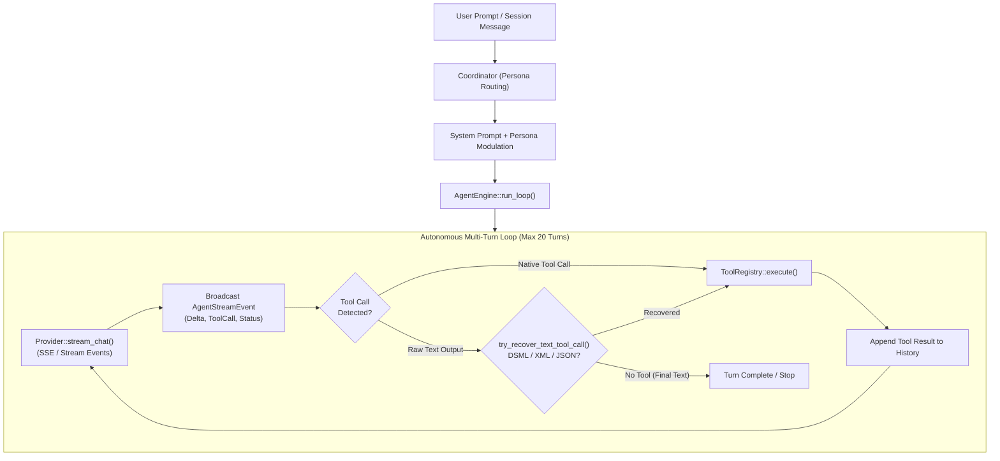
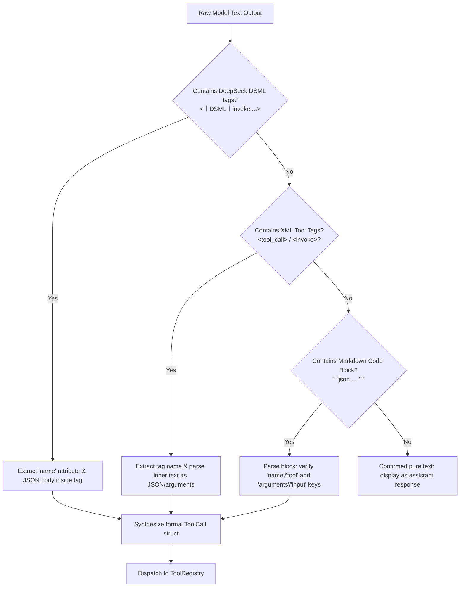
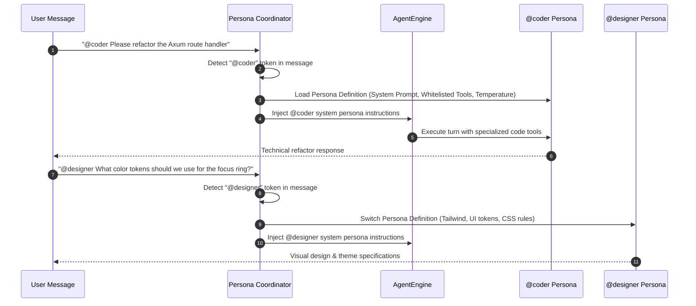
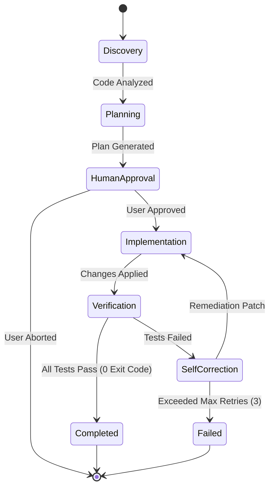

# SuperAgent Orchestrator, Coordinator & Execution Pipeline

## 1. Executive Summary

The orchestration subsystem of SuperAgent (`packages/core_v2/src/orchestrator/`) represents the cognitive engine of the platform. It is responsible for:
1. Driving the autonomous **`AgentEngine`** multi-turn decision loop.
2. Managing real-time SSE / WebSocket streaming event pipelines.
3. Automatically recovering from malformed model outputs (DeepSeek DSML tags, raw JSON code blocks, XML invocation wrappers).
4. Dispatching multi-persona routing through the **`Coordinator`** via `@mention` triggers.
5. Executing deterministic multi-stage workflows via the **`SequentialPipeline`**.
6. Spawning isolated child tasks via the **`Subagent`** execution framework.
7. Interfacing with a heterogeneous multi-provider LLM gateway (`packages/core_v2/src/providers/`).



---

## 2. The `AgentEngine` Multi-Turn Execution Loop

The core engine loop is implemented in [`packages/core_v2/src/orchestrator/engine.rs`](file:///d:/Projects/OpenSource/AgentApp/packages/core_v2/src/orchestrator/engine.rs#L50-L380).

### 2.1 State Machine & Turn Budget
The engine enforces a maximum turn boundary (`max_turns = 20`, configurable) to prevent runaway execution loops, runaway API costs, or infinite recursion.

```rust
// packages/core_v2/src/orchestrator/engine.rs
pub struct AgentEngine {
    provider: Arc<dyn LlmProvider>,
    tools: Arc<ToolRegistry>,
    context: ConversationContext,
    cancellation_token: Option<CancellationToken>,
    max_turns: usize,
    retry_limit: usize,
}
```

During each turn:
1. **Context Window Check**: The engine invokes `context.ensure_budget()`, calculating token limits.
2. **Provider Dispatch**: The engine calls `provider.stream_chat(...)`, which yields a stream of tokens or structured tool calls.
3. **Cancellation Monitoring**: At every yielded stream chunk, the engine queries `cancellation_token.is_cancelled()`. If a user presses "Stop" or aborts via WebSocket, the loop terminates immediately and cleanly flushes history.
4. **Tool Execution Phase**: If the model emitted one or more tool calls, the engine enters the dispatch phase, executing tools concurrently or sequentially depending on dependency markers.

### 2.2 Event Streaming Pipeline (`AgentStreamEvent`)
SuperAgent does not buffer entire assistant responses before emitting them. Every token and execution transition emits an `AgentStreamEvent` ([`packages/core_v2/src/protocol/events.rs`](file:///d:/Projects/OpenSource/AgentApp/packages/core_v2/src/protocol/events.rs#L1-L90)):

```rust
// packages/core_v2/src/protocol/events.rs
pub enum AgentStreamEvent {
    ThoughtDelta { delta: String },
    ContentDelta { delta: String },
    ToolCallStarted { call_id: String, tool: String, input: Value },
    ToolCallOutput { call_id: String, output: String, is_error: bool },
    TurnCompleted { turn_index: usize, total_tokens: Option<u64> },
    Error { message: String, recoverable: bool },
    Finished { total_turns: usize },
}
```
These events are multiplexed onto the WebSocket broadcast channel (`AppState::ws_broadcast`) and forwarded to subscribed client UIs.

### 2.3 Transient Error Recovery & Backoff
LLM APIs frequently encounter HTTP 429 (Rate Limit), HTTP 500/503 (Server Overload), or socket timeouts. `AgentEngine` implements an exponential backoff retry loop:
- Up to **3 retries** per turn.
- Backoff formula: `wait_ms = base_delay * (2 ^ attempt_count) + jitter`.
- Non-retryable errors (e.g., HTTP 401 Unauthorized or Model Not Found) terminate immediately with actionable diagnostic messages.

---

## 3. Intelligent Tool Recovery: DSML, XML, and Raw JSON Blocks

Smaller or fine-tuned open-source models (such as DeepSeek-R1, Qwen 2.5 Coder, Llama 3) frequently fail to use standard JSON tool-calling schemas and instead output tool invocations directly into the markdown body.

SuperAgent features a resilient AST/Regex parser in `try_recover_text_tool_call` ([`packages/core_v2/src/orchestrator/engine.rs:320-395`](file:///d:/Projects/OpenSource/AgentApp/packages/core_v2/src/orchestrator/engine.rs#L320-L395)).



### 3.1 DeepSeek DSML Extraction
DeepSeek models often emit:
```text
<｜DSML｜invoke name="read_file">
{"path": "src/main.rs"}
<｜DSML｜end>
```
The recovery engine strips the DSML tags, normalizes the tool name via `ToolRegistry::normalize_tool_name`, extracts the JSON payload, and synthesizes a valid `ToolCall` without raising an error.

### 3.2 Markdown Code Block Fallback
If a model outputs:
````text
I will now read the file:
```json
{
  "tool": "read_file",
  "arguments": { "path": "Cargo.toml" }
}
```
````
The recovery parser identifies the embedded JSON object, extracts the tool target, executes it, and appends the result to the conversation context seamlessly.

---

## 4. Persona Coordinator & Dynamic Routing

The Coordinator ([`packages/core_v2/src/orchestrator/coordinator.rs`](file:///d:/Projects/OpenSource/AgentApp/packages/core_v2/src/orchestrator/coordinator.rs#L1-L180)) enables multi-agent collaboration within a single session using `@mention` triggers.



### 4.1 Persona Configuration
Each persona defines:
- **System Prompt**: Specialized domain instructions (e.g., Senior Systems Architect vs UI/UX Specialist).
- **Tool Whitelist**: Restricts sensitive tools (e.g., `@designer` cannot run terminal commands or format disks, but can edit CSS and inspect artifacts).
- **Model Overrides**: Allows routing `@coder` queries to DeepSeek-Coder or Claude 3.7 Sonnet, while routing general conversational queries to smaller, lower-latency models.

---

## 5. Sequential Execution Pipelines

For complex, multi-stage software engineering operations that require deterministic phase gates, SuperAgent provides the `SequentialPipeline` ([`packages/core_v2/src/orchestrator/pipeline.rs`](file:///d:/Projects/OpenSource/AgentApp/packages/core_v2/src/orchestrator/pipeline.rs#L1-L150)).

### 5.1 Pipeline Structure
A pipeline consists of an ordered sequence of stages:
1. **Research & Code Discovery**: Searches workspace, reads files, and analyzes dependencies.
2. **Architecture & Plan Approval**: Generates a phase plan via `plan_tool` and optionally waits for human approval via `question_tool`.
3. **Implementation**: Executes file modifications via `edit_file` and `apply_patch`.
4. **Verification & Testing**: Runs compilation checks (`cargo check`) and unit test suites (`npm test` / `cargo test`).
5. **Self-Correction Loop**: If tests fail, error outputs are fed back into the engine for up to 3 automated remediation cycles before failing the pipeline.



---

## 6. Subagent Architecture & Mailbox Concurrency

The Subagent subsystem ([`packages/core_v2/src/orchestrator/subagent.rs`](file:///d:/Projects/OpenSource/AgentApp/packages/core_v2/src/orchestrator/subagent.rs#L1-L160)) enables hierarchical problem decomposition.

### 6.1 Isolation Boundaries
When `subagent_tool` is invoked:
- **Dedicated Memory Space**: The subagent receives its own isolated `ConversationContext`, preventing context pollution and exponential token inflation in the parent session.
- **Role Scoping**: The subagent is launched with an explicit job description (e.g., `"Test Execution Runner"` or `"Security Auditor"`).
- **Workspace Modes**:
  - `WorkspaceMode::Inherit`: Subagent operates directly on the shared workspace.
  - `WorkspaceMode::Branch`: Subagent executes inside an isolated git worktree, ensuring experimental changes do not corrupt the working tree until validated.

### 6.2 Mailbox Communication Protocol
Subagents do not communicate via shared memory. Instead, they interact via a message-passing mailbox:
- Subagents emit completion artifacts and findings back to the parent agent via structured responses.
- The parent agent incorporates only the summarized synthesis into its primary context, maintaining high signal-to-noise ratios over extended development sessions.

---

## 7. Multi-Provider LLM Gateway

The providers layer ([`packages/core_v2/src/providers/`](file:///d:/Projects/OpenSource/AgentApp/packages/core_v2/src/providers/)) provides a unified, zero-latency streaming gateway across commercial and local AI models.

### 7.1 Provider Capabilities Matrix

| Provider | File | Streaming (SSE) | Native Tool Calling | Vision / Multimodal | Local / Cloud | Special Features |
| :--- | :--- | :---: | :---: | :---: | :---: | :--- |
| **OpenAI** | `providers/openai.rs` | ✅ | ✅ | ✅ | Cloud | Prompt injection fallback, o1/o3 reasoning tokens |
| **Anthropic** | `providers/anthropic.rs`| ✅ | ✅ | ✅ | Cloud | Extended thinking blocks, Claude 3.7 Sonnet hybrid |
| **Gemini** | `providers/gemini.rs` | ✅ | ✅ | ✅ | Cloud | Multimodal context window (1M+ tokens), audio/video |
| **OpenCode Zen**| `providers/opencode.rs` | ✅ | ✅ | ❌ | Local/Hybrid | Auto-provisioned server daemon, 16 whitelisted tools |
| **Ollama** | `providers/ollama.rs` | ✅ | Partial | Model-dependent | Local | Fully offline local models (Llama 3, DeepSeek-R1) |
| **Groq** | `providers/groq.rs` | ✅ | ✅ | ❌ | Cloud | Ultra-low latency LPU inference (500+ tok/sec) |
| **DeepSeek** | `providers/deepseek.rs`| ✅ | ✅ | ❌ | Cloud | Native V3 and R1 reasoning distillation |

### 7.2 OpenCode Zen Gateway Integration
The `OpenCode` provider ([`packages/core_v2/src/providers/opencode.rs`](file:///d:/Projects/OpenSource/AgentApp/packages/core_v2/src/providers/opencode.rs#L1-L220)) represents a unique hybrid integration:
- **Auto-Provisioning**: If the local `opencode` binary is not found, SuperAgent automatically downloads the correct platform release from GitHub assets into `~/.superagent/bin/`.
- **Background Daemon Management**: It spawns an isolated OpenCode Zen server on port `4096+` and connects via local HTTP/SSE.
- **Whitelist Enforcement**: It enforces compatibility across OpenCode's 16 official tool specifications (`bash`, `read`, `write`, `edit`, `glob`, `grep`, `lsp`, `task`, `question`, `todo`, `plan`, `webfetch`, `websearch`, `patch`, `apply_patch`, `skill`).

---

## 8. Architectural Assessment

### 8.1 Strengths
- **Fault-Tolerant Tool Recovery**: The regex/AST recovery pipeline allows open-weights models that fail standard JSON formatting to function reliably as autonomous agents.
- **Hierarchical Token Preservation**: Subagent isolation prevents primary conversation threads from saturating token budgets during large exploratory searches.
- **Provider Agnosticism**: Seamless switching between cloud providers (Anthropic, OpenAI, Gemini) and local models (Ollama, OpenCode) with zero client reconfiguration.

### 8.2 Bottlenecks & Weaknesses
- **Synchronous Subagent Blocking**: Subagents currently block the parent turn until completion. Transitioning to fully asynchronous, event-driven background subagents with live mailbox streaming would improve multi-tasking velocity.
- **Retry Jitter Tuning**: Under severe provider outages, 3 retries with exponential backoff can stall the user interface for 15-30 seconds before reporting failure.
