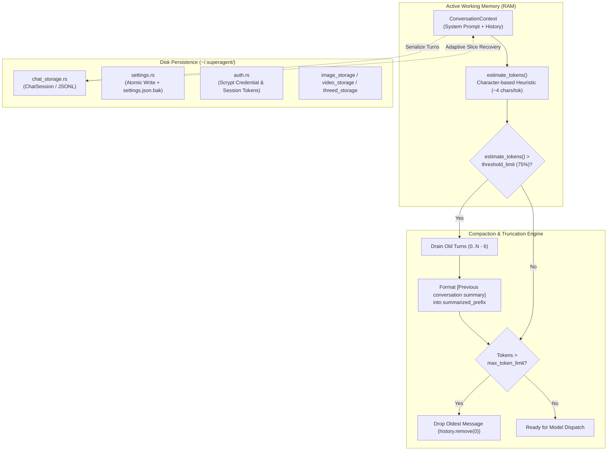

# SuperAgent Memory, Context & Persistence Architecture

## 1. Executive Summary

Autonomous development agents require long-lived memory systems that satisfy two opposing requirements:
1. **Token Economy**: Maintaining compliance with model context ceilings (e.g. 128k tokens) without incurring prohibitive API token expenses or degrading attention quality over long sessions.
2. **Context Fidelity**: Preserving essential user instructions, architectural phase plans, critical file snapshots, and historical tool results across hours or days of asynchronous work.

The SuperAgent memory and persistence subsystem ([`packages/core_v2/src/memory/`](file:///d:/Projects/OpenSource/AgentApp/packages/core_v2/src/memory/) and [`packages/core_v2/src/storage/`](file:///d:/Projects/OpenSource/AgentApp/packages/core_v2/src/storage/)) implements a hybrid, multi-tiered persistence layer. It features character-based token estimation heuristics, adaptive time-gap compaction, sliding-window truncation, atomic JSON file transactions with automatic `.bak` recovery, and dedicated indexing stores for conversation, media, and authorization data.



---

## 2. Token Budgeting & Estimation Engine

### 2.1 The 4-Character Heuristic (`estimate_tokens`)
Because loading native BPE tokenizers (such as `tiktoken` for OpenAI, or SentencePiece for Claude/Gemini) introduces heavy C++ bindings or large binary bloat, SuperAgent uses an optimized character-ratio heuristic implemented in [`packages/core_v2/src/memory/context.rs`](file:///d:/Projects/OpenSource/AgentApp/packages/core_v2/src/memory/context.rs#L85-L126):

```rust
// packages/core_v2/src/memory/context.rs
pub fn estimate_tokens(&self) -> usize {
    let mut total_chars = 0;
    if let Some(ref sys) = self.system_prompt { total_chars += sys.len(); }
    if let Some(ref prefix) = self.summarized_prefix { total_chars += prefix.len(); }

    for msg in &self.history {
        for block in &msg.content {
            match block {
                ContentBlock::Text { text } => total_chars += text.len(),
                ContentBlock::ToolUse { name, input, .. } => {
                    total_chars += name.len() + input.to_string().len();
                }
                ContentBlock::ToolResult { content, .. } => {
                    total_chars += content.len();
                }
                ContentBlock::Image { data, .. } => {
                    total_chars += data.len().min(1000);
                }
                ContentBlock::Audio { data, .. } => {
                    total_chars += data.len().min(1000);
                }
                ContentBlock::Video { data, .. } => {
                    total_chars += data.len().min(1000);
                }
                ContentBlock::Document { filename, data, .. } => {
                    total_chars += filename.len() + data.len().min(2000);
                }
            }
        }
    }
    if total_chars == 0 { 0 } else { (total_chars + 3) / 4 }
}
```

### 2.2 Multimodal Content Normalization
Raw base64 images or video keyframes can contain megabytes of text data. If raw string lengths were used directly, a single 1MB image would erroneously be estimated as 250,000 tokens, triggering an immediate false compaction. `estimate_tokens` caps binary payload weights (`data.len().min(1000)`), accurately reflecting how multimodal vision encoders tile and compress image patches into fixed token embeddings.

---

## 3. Dynamic Compaction & Adaptive History Slicing

### 3.1 Inline Token Enforcement (`enforce_token_limit`)
`ConversationContext` defines a soft threshold (`summarize_threshold = 0.75`). When estimated tokens exceed 75% of `max_token_limit` (e.g. 96,000 tokens on a 128k window):
1. **Window Splitting**: The engine preserves the most recent **6 messages** (`keep_count = 6`) untouched to ensure the agent maintains immediate short-term coherence.
2. **Summary Drain**: Messages preceding the keep window (`0..history.len() - 6`) are drained and concatenated into a formatted structured block:
   ```text
   [Previous conversation summary]:
   User: Refactor the auth router
   Assistant: I will inspect packages/core_v2/src/server/auth.rs...
   Tool: [Tool output: auth.rs 732 lines]
   ```
3. **Prefix Accumulation**: This summary is injected into `summarized_prefix`, which is prepended as a system instruction in subsequent turns.
4. **Hard Ceiling Clamp**: If total tokens still exceed 100% of `max_token_limit`, the oldest individual messages are popped one by one until the budget is met.

### 3.2 Time-Gap Compaction (`prepare_adaptive_history`)
When a user resumes an existing session after several hours or days, loading 50 prior turns is both wasteful and disorienting to the model.

`prepare_adaptive_history` ([`packages/core_v2/src/memory/context.rs:171-256`](file:///d:/Projects/OpenSource/AgentApp/packages/core_v2/src/memory/context.rs#L171-L256)) inspects the elapsed duration between `Utc::now()` and `last_activity_timestamp_ms`:

```rust
// packages/core_v2/src/memory/context.rs
let diff_secs = ((now_ms - last_ts).max(0) / 1000) as u64;
let is_gap = diff_secs >= gap_threshold_secs; // Default: 7200s (2 hours)
```

If `is_gap` evaluates to `true`:
1. **Tighter Verbatim Window**: The active window is reduced from 10+ turns to only the last 4 turns (`max_verbatim_messages.min(4)`).
2. **Context Gap Notice**: A clear notification is injected:
   ```text
   [Notice: Conversation resumed after ~3 hour(s) gap. Older context has been compacted to save tokens. Detailed past messages can be retrieved using the 'recall_memory' tool.]
   ```
3. **Condensed Key Topic List**: Older turns are distilled into 160-character role snippets (`- User: ...`, `- SuperAgent: ...`).

---

## 4. Persistent Storage Architecture

All persistent agent data resides under `~/.superagent/` (or OS-standard directories resolved by `get_config_dir()` / `get_superagent_dir()`).

```
~/.superagent/
├── config/
│   ├── settings.json          # Primary application settings & API keys
│   ├── settings.json.bak      # Fail-safe backup snapshot
│   ├── auth.json              # Scrypt hashes, active session tokens, lockout state
│   └── models.json            # Model catalog metadata & provider mappings
├── conversation/              # Chat sessions stored as individual JSON/JSONL files
│   ├── session_a1b2c3.json
│   └── session_d4e5f6.json
├── image_workspace/           # Local diffusion models, generated PNGs, and records
│   ├── models/                # Downloaded weights (flux-schnell, SDXL)
│   ├── outputs/               # Saved image assets
│   └── records.json           # Generation metadata index
├── video_workspace/           # Wan2.1 models, FFmpeg binaries, and MP4 outputs
└── web-server.lock            # Single-instance PID and heartbeat lock
```

### 4.1 Hierarchical Settings Engine (`storage/settings.rs`)
`SettingsStore` ([`packages/core_v2/src/storage/settings.rs`](file:///d:/Projects/OpenSource/AgentApp/packages/core_v2/src/storage/settings.rs#L1-L1126)) handles application configuration with deep fallback discovery:
- **Location Hierarchy**: Scans custom `SUPERAGENT_CONFIG_DIR`, standard AppData/XDG directories, `~/.superagent/config/settings.json`, and legacy directories (`AgentApp`, `OpenSource/AgentApp`).
- **Fail-Safe `.bak` Recovery Loop**: If `settings.json` is corrupted, truncated, or zero bytes due to a sudden power outage, `SettingsStore::load()` automatically discovers and restores from `settings.json.bak`. It merges missing keys (such as `providers` or `api_keys`) from legacy paths to ensure user configurations are never lost.

### 4.2 Conversation Storage Engine (`storage/chat_storage.rs`)
Chat histories are represented by `ChatSession` ([`packages/core_v2/src/storage/chat_storage.rs:10-48`](file:///d:/Projects/OpenSource/AgentApp/packages/core_v2/src/storage/chat_storage.rs#L10-L48)):

```rust
// packages/core_v2/src/storage/chat_storage.rs
pub struct ChatSession {
    pub id: String,
    pub title: String,
    pub project: Option<String>,
    pub model: Option<String>,
    pub created_at: i64,
    pub updated_at: i64,
    pub messages: Vec<ChatMessage>,
}
```
- **Metadata Indexing**: To populate client sidebar session lists without parsing multi-megabyte message arrays, `ChatSessionMetadata` extracts lightweight summaries (`id`, `title`, `project`, `model`, `message_count`, `updated_at`).
- **Auto-Title Extraction**: `extract_first_user_prompt_from_json` inspects both standard `messages` arrays and legacy `steps` arrays, extracting initial prompt text up to 50 characters to generate intuitive default thread titles.

### 4.3 Media Indexing Stores
- **`image_storage.rs`**: Tracks image generation records (`GenerationRecord`), mapping UUIDs to prompts, dimensions, seed, inference steps, and disk filepaths.
- **`video_storage.rs`**: Manages `VideoGenerationRecord`, tracking generation statuses (`Queued`, `Processing`, `Completed`, `Failed`), duration, FPS, and FFmpeg output paths.
- **`threed_storage.rs`**: Manages `ThreeDGenerationRecord`, storing vertex counts, polygon counts, and format mappings (`.glb`, `.obj`, `.usdz`).

---

## 5. Architectural Evaluation

### 5.1 Strengths
- **Immunity to Memory Leaks**: Rust's ownership model guarantees that vectors of old turns are deallocated immediately upon `drain()`, preventing heap memory bloat during long-running sessions.
- **Corrupt-Proof Configuration**: Automatic `.bak` snapshotting and multi-candidate recovery prevent settings wipes during system reboots or sudden application crashes.
- **Intelligent Time-Gap Compaction**: Preserves token budgets naturally without requiring manual session archiving by the user.

### 5.2 Bottlenecks & Limitations
- **Token Estimation Imprecision**: The 4-character heuristic can deviate by ±15-20% on non-English natural languages (e.g. CJK or Cyrillic characters) or heavily indented source code. Integrating an optional lightweight BPE tokenizer or calibrated language-specific multipliers would improve boundary precision.
- **Unbounded JSON Session Growth**: In massive 500-turn software engineering projects, single `session_*.json` files can grow beyond 20MB. Introducing chunked JSONL streaming formats for chat persistence would improve serialization latency on mechanical drives.
