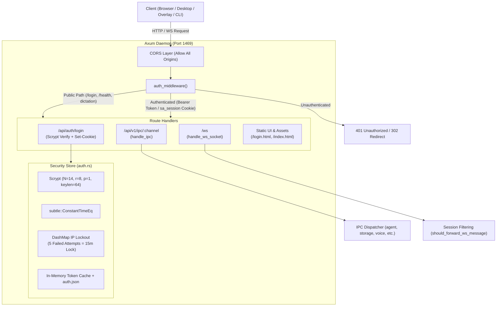
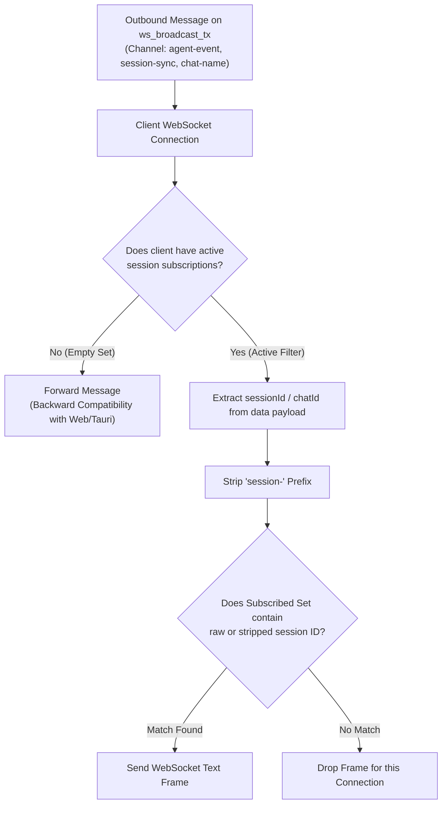
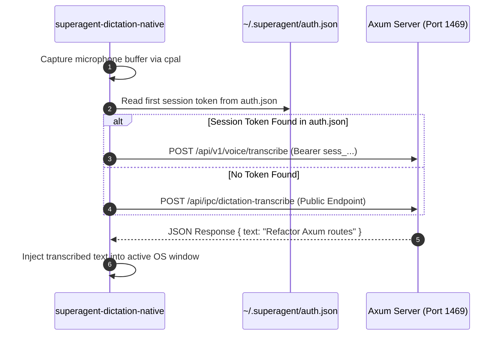

# SuperAgent Server IPC, WebSocket & Security Architecture

## 1. Executive Summary

SuperAgent's server layer ([`packages/core_v2/src/server/`](file:///d:/Projects/OpenSource/AgentApp/packages/core_v2/src/server/)) bridges the high-performance Rust core engine to the external world. It hosts:
1. An asynchronous **Axum HTTP JSON-RPC endpoint** (`/api/v1/ipc/:channel`) processing command envelopes from native apps and scripts.
2. A full-duplex **WebSocket hub** (`/ws`) providing real-time streaming deltas, subscription-filtered session events, and bidirectional client-delegated tool calls.
3. An enterprise-grade **Scrypt authentication and security layer** enforcing constant-time password validation, 30-day HttpOnly session cookies, brute-force IP lockout protection, and granular public-path whitelisting.



---

## 2. Universal IPC Dispatcher Layer

The IPC dispatcher ([`packages/core_v2/src/server/ipc/mod.rs`](file:///d:/Projects/OpenSource/AgentApp/packages/core_v2/src/server/ipc/mod.rs#L73-L112)) processes incoming JSON-RPC calls over HTTP POST at `/api/v1/ipc/:channel` and `/api/ipc/:channel`.

### 2.1 Request & Response Envelopes
Defined in [`packages/core_v2/src/server/state.rs`](file:///d:/Projects/OpenSource/AgentApp/packages/core_v2/src/server/state.rs):

```rust
// packages/core_v2/src/server/state.rs
#[derive(Debug, Deserialize)]
pub struct IpcRequest {
    #[serde(default)]
    pub args: Vec<serde_json::Value>,
    #[serde(flatten)]
    pub extra: HashMap<String, serde_json::Value>,
}
```

The payload accepts positional arguments in `args` (e.g. `[{"prompt": "hello", "sessionId": "..."}]`) or flattened key-value fields.

### 2.2 IPC Subsystem Routing Architecture
When a request arrives, `handle_ipc` delegates across specialized domain modules in priority order:

```rust
// packages/core_v2/src/server/ipc/mod.rs
pub async fn handle_ipc(...) -> Result<Json<Value>, (StatusCode, Json<Value>)> {
    // 1. Agent run, abort, and model discovery
    if let Some(res) = agent::handle_agent_channel(ch, &state, args.clone()).await { return res; }
    // 2. Multimodal circle-to-search snapshot analysis
    if let Some(res) = circle_search::handle_circle_search_channel(ch, &state, args.clone()).await { return res; }
    // 3. Audio dictation & transcription
    if let Some(res) = voice::handle_voice_channel(ch, &state, args.clone()).await { return res; }
    // 4. Memory vector recall and compaction
    if let Some(res) = memory::handle_memory_channel(ch, &state, args.clone()).await { return res; }
    // 5. Chat history, sessions, and configuration storage
    if let Some(res) = storage::handle_storage_channel(ch, &state, args.clone()).await { return res; }
    // 6. Token usage tracking and billing analytics
    if let Some(res) = usage::handle_usage_channel(ch, &state, args.clone()).await { return res; }
    // 7. External MCP integrations
    if let Some(res) = integrations::handle_integrations_channel(ch, &state, args).await { return res; }

    warn!("IPC channel not found: {}", ch);
    Ok(Json(json!({ "data": null })))
}
```

### 2.3 Canonical IPC Channel Directory

| IPC Channel | Submodule | Function / Purpose | Payload Signature |
| :--- | :--- | :--- | :--- |
| `agent-run` | `ipc/agent.rs` | Starts an autonomous agent execution run in a session | `{ sessionId, prompt, model, attachments }` |
| `agent-abort` | `ipc/agent.rs` | Cancels an ongoing agent turn via its `CancellationToken` | `{ sessionId }` or `{ runId }` |
| `models-catalog` | `ipc/agent.rs` | Returns available providers, API keys status, and model lists | `{ refresh?: bool }` |
| `storage-get-chat` | `ipc/storage.rs` | Retrieves full message history and metadata for a session | `{ sessionId }` |
| `storage-list-chats`| `ipc/storage.rs` | Returns metadata summaries for all stored conversations | `{ limit?: int, offset?: int }` |
| `storage-save-settings`| `ipc/storage.rs` | Writes updated configuration to `settings.json` (atomic) | `{ settings: UserSettings }` |
| `circle-search-analyze`| `ipc/circle_search.rs` | Multimodal vision query on cropped screenshot bitmap | `{ image_base64, query }` |
| `voice-transcribe` | `ipc/voice.rs` | Transcribes audio buffers from dictation overlays | `{ audio_base64, filename, language }` |

---

## 3. WebSocket Real-Time Communication Hub

The WebSocket hub ([`packages/core_v2/src/server/ws.rs`](file:///d:/Projects/OpenSource/AgentApp/packages/core_v2/src/server/ws.rs#L1-L193)) manages persistent duplex streams connecting user interfaces to running execution loops.

### 3.1 Session Subscription Filtering (`should_forward_ws_message`)
In a multi-window or multi-tab environment, multiple sessions may execute simultaneously. If every token delta was broadcast to every connected client, network bandwidth would degrade and client state stores would cross-pollinate.



```rust
// packages/core_v2/src/server/ws.rs
pub fn should_forward_ws_message(msg_str: &str, subscribed_sessions: &HashSet<String>) -> bool {
    if subscribed_sessions.is_empty() {
        return true; // Backward compatibility
    }

    if let Ok(val) = serde_json::from_str::<serde_json::Value>(msg_str) {
        let channel = val.get("channel").and_then(|v| v.as_str()).unwrap_or("");
        if channel == "agent-event" || channel == "session-sync" || channel == "chat-name" {
            let session_id = val.get("data")
                .and_then(|d| d.get("sessionId").or_else(|| d.get("chatId")).or_else(|| d.get("session_id")))
                .and_then(|v| v.as_str());

            if let Some(sid) = session_id {
                let clean = sid.trim_start_matches("session-");
                return subscribed_sessions.contains(sid) || subscribed_sessions.contains(clean);
            }
        }
    }
    true // Forward system alerts and global notices
}
```

### 3.2 Inbound WebSocket Actions
Clients interact with the WebSocket via structured JSON envelopes `{ action, data }`:
- **`subscribe-session`**: Registers one or more session IDs into `subscribed_sessions`, activating the session filter.
- **`unsubscribe-session`**: Removes session IDs from the connection filter.
- **`sync-session`**: Triggers immediate synchronization of messages and metadata for a target session.
- **`client-tool-result`**: Delivers results of client-delegated tools (browser interactions, tab queries) back to the pending `oneshot::Sender` waiting in `AppState::client_tool_waiters`.
- **`ping` / `pong`**: Heartbeat protocol preventing intermediate proxies or NAT routers from dropping idle connections.

---

## 4. Authentication & Security Engine

Security is enforced via `AuthStore` ([`packages/core_v2/src/storage/auth.rs`](file:///d:/Projects/OpenSource/AgentApp/packages/core_v2/src/storage/auth.rs#L1-L732)) and guarded by `auth_middleware` ([`packages/core_v2/src/server/auth.rs`](file:///d:/Projects/OpenSource/AgentApp/packages/core_v2/src/server/auth.rs#L104-L176)).

### 4.1 Scrypt Password Hashing Specification
SuperAgent rejects weak or insecure hash functions (such as plain MD5 or unsalted SHA-256) for stored master passwords:
- **Algorithm**: `scrypt` key derivation.
- **Parameters**: `N = 14` (CPU/memory cost parameter $2^{14} = 16,384$), `r = 8` (block size), `p = 1` (parallelization).
- **Key Length**: 64 bytes (`target_len = 64`), hex-encoded to a 128-character string.
- **Salt Generation**: 16 bytes of cryptographically secure randomness generated via `rand::thread_rng()`.

### 4.2 Constant-Time Verification (`subtle::ConstantTimeEq`)
To defeat side-channel timing attacks (where attackers measure minuscule CPU clock cycle differences to deduce password characters byte-by-byte), SuperAgent uses constant-time string comparisons:

```rust
// packages/core_v2/src/storage/auth.rs
if let Ok(candidate_hash) = hash_password_scrypt(pass, &cred.salt, keylen) {
    if candidate_hash.as_bytes().ct_eq(cred.hash.as_bytes()).into() {
        return true;
    }
}
```

### 4.3 Brute-Force IP Lockout Protection
To neutralize automated dictionary and brute-force password cracking attacks against internet-facing or LAN instances:
- Tracked concurrently in-memory via `failed_attempts: Arc<DashMap<String, (u32, DateTime<Utc>)>>`.
- **Threshold**: After **5 consecutive failed login attempts** from an IP address:
  - Account state locks for **15 minutes** (`DateTime<Utc> + Duration::minutes(15)`).
  - All subsequent login requests from that IP receive `HTTP 429 Too Many Requests`:
    ```json
    {
      "ok": false,
      "error": "Too many failed attempts. Account temporarily locked for 15 minutes."
    }
    ```
- Successful authentication immediately resets the failed counter to zero.

### 4.4 Session Tokens & Multi-Transport Resolution
When a user logs in, `create_session_with_metadata` issues a cryptographically random session token:
`sess_<uuid4>` (e.g., `sess_550e8400-e29b-41d4-a716-446655440000`).

`extract_session_token` checks three transport mechanisms:
1. **HTTP Authorization Header**: `Authorization: Bearer sess_...`
2. **HttpOnly Cookie**: `sa_session=sess_...; Path=/; Max-Age=2592000; HttpOnly; SameSite=Lax` (30 days validity).
3. **Query Parameter (WebSocket Upgrades)**: `ws://localhost:1469/ws?token=sess_...` or `?sa_session=sess_...`

### 4.5 Whitelisted Public Paths (`is_public_path`)
To allow static UI rendering and native overlay communication without authentication deadlocks:
- **Authentication Routes**: `/login`, `/api/auth/login`, `/api/auth/status`, `/api/auth/setup`.
- **System Probes**: `/health`, `/api/health`.
- **Local Native Overlays**: `/api/ipc/circle-search-analyze`, `/api/ipc/voice-transcribe`, `/api/ipc/dictation-transcribe`.
- **Static Frontend Assets**: `/manifest.json`, `/sw.js`, `.css`, `.js`, `.png`, `.svg`, `.woff2`.
- **Public Media Streams**: `/api/images/generations/:id/file`, `/api/videos/generations/:id/file`.

---

## 5. Native Overlay IPC Integration

The three native egui overlays interface with the daemon with zero friction:



By supporting both local session file discovery (`~/.superagent/auth.json`) and whitelisted loopback IPC endpoints, native desktop tools function smoothly even when strict web authentication is active.

---

## 6. Threat Modeling & Security Evaluation

### 6.1 Attack Surface Analysis

| Threat Vector | Severity | SuperAgent Defense Mechanism | Status |
| :--- | :---: | :--- | :---: |
| **Path Traversal / Jailbreak** | Critical | Post-canonicalization workspace boundary enforcement (`validate_path_in_workspace`) | ✅ Mitigated |
| **Timing Attacks on Passwords** | High | `subtle::ConstantTimeEq` constant-time hash comparisons | ✅ Mitigated |
| **Credential Brute-Force** | High | IP-level DashMap tracking: 5 failed attempts = 15m lockout | ✅ Mitigated |
| **Cross-Site Scripting (XSS) Session Theft** | High | `HttpOnly` and `SameSite=Lax` session cookie attributes | ✅ Mitigated |
| **Arbitrary Shell Execution** | High | Tool registry restrictions; commands require user permission in standard mode | ⚠️ Sandboxing Recommended |
| **Unauthenticated LAN Exposure** | Medium | Binds to `0.0.0.0:1469` by default; requires password setup on initial boot | ⚠️ Advise Localhost Default |

### 6.2 Key Security Recommendations
1. **Bind to Loopback by Default**: Unless explicitly configured with `--host 0.0.0.0`, default to `127.0.0.1` to prevent unauthenticated access across untrusted public Wi-Fi networks before the initial password seed is configured.
2. **Containerized / Bubblewrap Shell Isolation**: For unattended execution, wrap `run_command` in an OS-level sandbox (Docker container, Linux bubblewrap, or Windows AppContainer) to ensure arbitrary bash commands cannot touch host operating system files outside the repository.
