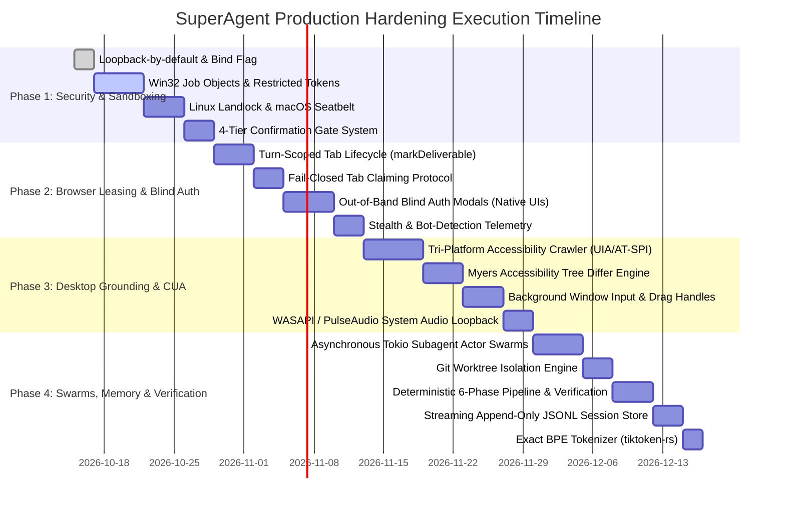

# Master Blueprint: The SuperAgent Improved Backend Plan
## Elevating SuperAgent to Enterprise-Grade, High-Stakes Production Standards

---

## 1. Executive Vision & The "Super Agent" Benchmark

In enterprise production environments, high-stakes development, and autonomous software engineering, an agent cannot simply be a chat wrapper around LLM completions. A **True Super Agent** must operate with the precision, safety, determinism, and environmental awareness of a senior staff engineer and security operations lead.

To achieve this benchmark, SuperAgent (`AgentApp`) must bridge the architectural gap revealed in our analysis of the decompiled **OpenAI Codex** subsystem while extending its own distinct strengths (sub-millisecond pure Rust runtime, local generative media workspaces, GPU-accelerated native egui overlays, and AST error-recovery pipelines).

```
┌────────────────────────────────────────────────────────────────────────────────────────┐
│                                The SuperAgent Standard                                │
│                                                                                        │
│   Deterministic        Zero-Trust           Multi-Surface         Asynchronous         │
│   Verification         Sandboxing           Grounding             Agent Swarms         │
│   • Multi-pass audit   • Restricted Tokens  • Semantic UIA/AT-SPI • Non-blocking Tokio │
│   • Compiler gating    • AppContainer SIDs  • Myers Tree Diffing  • Git Worktrees      │
│   • Auto-rollback      • Private Desktops   • Tab Leasing / CDP   • Streaming Mailbox  │
└───────────────────────────────────────────┬────────────────────────────────────────────┘
                                            │
                                            ▼
┌────────────────────────────────────────────────────────────────────────────────────────┐
│                        SuperAgent Core v2 (Pure Rust Engine)                           │
│                                                                                        │
│   ┌──────────────────────────┐  ┌──────────────────────────┐  ┌────────────────────┐   │
│   │   Orchestrator v2        │  │   Isolation & Sandbox    │  │ Grounding (CUA/Web)│   │
│   │ • 6-Phase Pipeline       │  │ • Win32 Job Objects      │  │ • UIA / AT-SPI Differ│   │
│   │ • Async Subagent Actor   │  │ • Token SIDs / cgroups   │  │ • Tab Lease Engine │   │
│   │ • Proof-of-Work Verifier │  │ • Landlock / Seatbelt    │  │ • Blind Auth Modal │   │
│   └─────────────┬────────────┘  └─────────────┬────────────┘  └──────────┬─────────┘   │
│                 │                             │                          │             │
│                 ▼                             ▼                          ▼             │
│   ┌──────────────────────────┐  ┌──────────────────────────┐  ┌────────────────────┐   │
│   │    Context & Memory      │  │    4-Tier Confirmation   │  │ Provider Gateway   │   │
│   │ • Exact BPE (tiktoken)   │  │ • Interactive Blocking   │  │ • DSML/XML AST Rec │   │
│   │ • Append-Only JSONL Store│  │ • Out-of-Band Auth Gate  │  │ • Model Tiering    │   │
│   │ • AST Symbol Memory      │  │ • Audit Trail & Replay   │  │ • Streaming Hub    │   │
│   └──────────────────────────┘  └──────────────────────────┘  └────────────────────┘   │
└────────────────────────────────────────────────────────────────────────────────────────┘
```

---

## 2. Comparative Synthesis: Codex Decompiled vs. SuperAgent Current State

| Dimension | OpenAI Codex Decompiled (`codex_decompiled`) | SuperAgent Current State (`core_v2`) | Target SuperAgent Production Architecture |
| :--- | :--- | :--- | :--- |
| **Command Execution & Sandboxing** | Windows Restricted Tokens, AppContainer SIDs, Private Desktops (`CreateDesktopW`), NTFS Junctions, Named-Pipe Runner | Standard `tokio::process::Command` with workspace canonical path prefix check | **Multi-Platform Sandbox Engine**: Win32 Job Objects + Restricted Tokens on Windows; Landlock/bwrap on Linux; Seatbelt on macOS. Default loopback binding. |
| **Browser Automation & Control** | Multi-surface (`iab`, `extension`, `cdp`, `mcpapps`), Fail-Closed Tab Claiming, Turn Ephemeral Scratches, Stealth Evasion | Basic Playwright `BrowserNavigateTool` and `BrowserScreenshotTool` | **Enterprise Tab Leasing Engine**: Turn-scoped lifecycle (`markDeliverable`, `markHandoff`), fail-closed URI mentions, anti-bot telemetry, and WebMCP integration. |
| **Credential & Auth Security** | **Blind Authentication (`browserAuth`)**: Passwords never enter LLM context; injected directly via native dialog & CDP | Passwords entered via prompt text or environment variables | **Zero-Exposure Credential Flow**: Native modal dialogs in `clients/web`, `clients/windows`, `clients/macos` inject credentials directly via CDP / OS keystrokes. |
| **Desktop Grounding (CUA)** | Swift UIA + AT-SPI + `Windows.Graphics.Capture` (occluded windows), Background window input without focus stealing | GPU egui overlays (`dictation-native`, `artifacts-native`, `circle-search-native`) | **Dual-Engine Grounding Engine**: OS Accessibility Crawler (UIA/AT-SPI) + Screen capture; targeted input routing without stealing desktop user focus. |
| **Token Optimization** | **Accessibility Tree Diffing**: Semantic Myers diffs (`-`, `+`, `*`) saving 70–85% tokens per turn | Full message re-serialization; sliding window heuristic at 75% limit | **AST & Tree Differ**: Myers diffing for UI trees; AST-aware symbol context; exact BPE tokenizer via `tiktoken-rs`. |
| **Subagent Concurrency** | Centralized session orchestration with forked threads | Synchronous execution loop blocking parent turn | **Asynchronous Tokio Actor Swarms**: Dedicated task IDs, non-blocking `AgentMailbox`, isolated Git worktrees, and streaming WebSocket events. |
| **Task Verification & Proof of Work** | Mandated visual screenshot embedding in final reply; 4-tier confirmation policy | Passive text response ("Awaiting user input") | **Deterministic 6-Phase Pipeline**: Discovery -> Plan -> Gate -> Execute -> Verify (test/compiler/lint) -> Visual Proof-of-Work embedding. |
| **Persistence & Auditability** | Paginated rollouts, session archives, and thread forks | Single monolithic JSON chat sessions (`session_*.json`) | **Streaming JSONL Engine**: Append-only log with memory-mapped indices and deterministic replay capabilities. |

---

## 3. Pillar 1: Defense-in-Depth Process Isolation & Sandboxing

### 3.1 Windows Containment Engine
To protect the user's host operating system in high-stakes environments, SuperAgent will implement a native sandbox runner (`packages/core_v2/src/tools/sandbox/windows.rs`):
1. **Restricted Security Token (`CreateRestrictedToken`)**:
   - Strip all administrative and elevated SIDs (`WinBuiltinAdministratorsSid`, `SeDebugPrivilege`).
   - Retain only restricted SIDs: `RestrictedCodeSid` and explicit AppContainer capability SIDs (disallowing raw network sockets, camera, microphone).
2. **Win32 Job Objects (`CreateJobObjectW`)**:
   - Assign `JOB_OBJECT_LIMIT_KILL_ON_JOB_CLOSE`. When SuperAgent cancels a task or crashes, all child and descendant processes terminate immediately without leaving zombie background processes.
   - Enforce hard memory limits (`JOBOBJECT_EXTENDED_LIMIT_INFORMATION.JobMemoryLimit = 2GB`) and CPU rate limits.
3. **Private Desktop Isolation (`CreateDesktopW`)**:
   - Spawn sandboxed command runners into an isolated desktop handle (e.g. `SuperAgent_Sandbox_Desktop`).
   - Prevents GUI window message spoofing (`WM_COMMAND`, `SetWindowsHookEx`) and protects user clipboard/keystrokes from inspection.
4. **Filesystem Virtualization via NTFS Directory Junctions**:
   - Read-only junction for system runtime (`C:\Windows\System32`, `Node`, `Cargo`).
   - Read-write junction mapped strictly to the designated `workspace_root`.
   - Root Deny-Read ACLs applied to user profile roots (`C:\Users\<user>\*` outside workspace).

```rust
// packages/core_v2/src/tools/sandbox/windows.rs (Target Architecture)
pub struct WindowsSandbox {
    job_handle: RawHandle,
    restricted_token: RawHandle,
    desktop_handle: RawHandle,
    workspace_root: PathBuf,
}

impl WindowsSandbox {
    pub fn spawn_sandboxed(&self, command: &str, cwd: &Path) -> Result<tokio::process::Child> {
        // 1. Assign command to Win32 Job Object with KILL_ON_JOB_CLOSE
        // 2. Set STARTUPINFOEXW with PROC_THREAD_ATTRIBUTE_PARENT_PROCESS or restricted token
        // 3. Direct stdout/stderr to framed named pipes
        // 4. Spawn child process under isolated desktop
    }
}
```

### 3.2 Linux & macOS Sandboxing
- **Linux**: Implement `Landlock LSM` rules to restrict filesystem access to `workspace_root` with fallback to `Bubblewrap` (`bwrap --ro-bind / / --bind <workspace> <workspace> --dev /dev --unshare-all`).
- **macOS**: Generate dynamic Seatbelt profiles compiled on-the-fly (`sandbox-exec -p "(version 1)(deny default)(allow file-read* ...)(allow file-write* (subpath \"<workspace>\"))"`).

### 3.3 Default Network Binding
- Default daemon listener binds strictly to `127.0.0.1:1469`.
- External interfaces (`0.0.0.0`) require explicit `--host 0.0.0.0` or `--lan` flag combined with enforced Scrypt authentication.

---

## 4. Pillar 2: Production Browser Automation & Enterprise Tab Leasing

### 4.1 Turn-Scoped Tab Leasing Lifecycle
SuperAgent must treat browser tabs as stateful leases rather than ephemeral side-effects:

```
┌───────────────────────────────────────────────────────────────────────────────────────────┐
│                               Tab Leasing State Machine                                  │
│                                                                                           │
│   User Prompt ──► [Claim Existing Tab] OR [Create Ephemeral Scratch Tab]                 │
│                                │                                                          │
│                                ▼                                                          │
│                      [Perform Turn Actions]                                               │
│                                │                                                          │
│             ┌──────────────────┴──────────────────┐                                       │
│             ▼                                     ▼                                       │
│    tab.markDeliverable()                 tab.markHandoff()                                │
│    • Preserves tab open                  • Pauses loop                                    │
│    • Embedded in final reply             • Native auth / CAPTCHA handoff                  │
│             │                                     │                                       │
│             └──────────────────┬──────────────────┘                                       │
│                                │                                                          │
│                   [Unmarked Scratch Tabs Closed]                                          │
│                   [Claimed User Tabs Released Safely]                                     │
└───────────────────────────────────────────────────────────────────────────────────────────┘
```

1. **Fail-Closed Tab Claiming**:
   - Decodes `plugin://browser...` mentions.
   - Verifies `{ providerTabId, title, url }` against active browser state. If the tab title/URL has drifted, the claim fails closed rather than operating on incorrect user data.
2. **Ephemeral Turn Cleanup**:
   - Any tab created during a turn without `tab.markDeliverable()` or `tab.markHandoff()` is automatically pruned at turn completion.
   - User tabs claimed from Chrome/Edge are unhooked without closing the user's underlying tab.
3. **Structured Bot-Detection Telemetry**:
   - Structured classifier reporting `captcha_failed`, `access_denied`, `challenge_loop`, or `unexpected_bot_error`, alerting the orchestrator to switch sources or request human handoff.

### 4.2 Out-of-Band Blind Authentication (`browserAuth`)
To achieve zero credential leakage:
- When a login form is detected, the agent tool emits a WebSocket event:
  `Event::BrowserAuthRequested { session_id, origin, field_selectors }`
- The client UI (Web, Windows, macOS, or egui overlay) displays a native secure credential dialog.
- The user provides credentials directly to the client runtime.
- The client injects the credentials into DOM inputs via CDP (`Input.dispatchKeyEvent`, `DOM.setAttribute`) and submits the form.
- The agent loop receives only: `{ status: "submitted", success: true }`. **Zero passwords, tokens, or OTPs enter the LLM's conversation history.**

---

## 5. Pillar 3: Desktop Grounding & Token-Efficient CUA Engine

### 5.1 Dual-Engine Desktop Grounding
To support complex native applications across Windows, macOS, and Linux:

```mermaid
flowchart TD
    subgraph UI_Grounding ["Dual-Engine Grounding Architecture"]
        OS_Tree["OS Accessibility Crawler\n(UIA / AT-SPI / NSAccessibility)"]
        Screen_Cap["Screen Capture Subsystem\n(WGC / Desktop Duplication / CoreGraphics)"]
        
        OS_Tree -->|Structured Element Nodes| Tree_Differ["Semantic Tree Differ\n(Myers Diff Engine)"]
        Tree_Differ -->|Compact Token Diff (+, -, *)| Context_Assembly["Agent Context Assembly"]
        
        Screen_Cap -->|Direct Visual Frame| Vision_Validator["Coordinate & Screenshot Validator"]
        Vision_Validator -->|Bounding Box Verification| Context_Assembly
    end
```

1. **Accessibility Crawling & Tree Diffing**:
   - First step emits structured accessibility tree (`ax_tree`).
   - Subsequent steps emit token-efficient Myers diffs:
     ```diff
     - [Window "Settings" id=102]
     + [Window "Network Configuration" id=104 focused=true]
       * [Button "Save Changes" id=205 enabled=true]
     ```
   - **Token Savings**: Reduces turn prompt size from ~30,000 tokens to under 1,500 tokens for native GUI tasks.
2. **Non-Focus-Stealing Targeted Input**:
   - Background window input routing: On Linux (AT-SPI) and Windows (SendMessage / UIA Patterns), invoke actions (`InvokePattern`, `ValuePattern`) directly without moving the physical desktop cursor or stealing user keyboard focus.
3. **Rich Input Primitives**:
   - `drag_handle`: Continuous drag-and-drop handles allowing visual intermediate checks before mouse release.
   - `clipboard_snapshot`: Captures current clipboard contents into a managed memory handle, applies agent copy/paste operations, and restores user clipboard state on completion.
   - `system_audio_loopback`: Captures 24 kHz system audio output (via WASAPI loopback on Windows / PulseAudio on Linux) for audio transcription and verification alongside microphone dictation in `packages/dictation-native`.

---

## 6. Pillar 4: Orchestration, Asynchronous Swarms & High-Stakes Reliability

### 6.1 The 6-Phase High-Stakes Engineering Pipeline
In production tasks, an agent must never execute destructive edits impulsively:

```
┌───────────────────────────────────────────────────────────────────────────────────────────┐
│                          6-Phase Autonomous Engineering Pipeline                          │
│                                                                                           │
│   Phase 1: DISCOVERY & RECONNAISSANCE                                                     │
│   • Read files, inspect directory topology, analyze AST dependencies                      │
│   • Run zero-mutation queries (grep, glob, lsp definitions)                               │
│                                │                                                          │
│                                ▼                                                          │
│   Phase 2: ARCHITECTURAL PLANNING & PROOF SPECIFICATION                                   │
│   • Draft formal execution plan via plan_tool                                             │
│   • Specify acceptance criteria, affected modules, and verification steps                 │
│                                │                                                          │
│                                ▼                                                          │
│   Phase 3: 4-TIER CONFIRMATION GATE                                                       │
│   • Interactively confirm high-risk actions (DB migrations, deletions, external network)  │
│                                │                                                          │
│                                ▼                                                          │
│   Phase 4: ISOLATED IMPLEMENTATION                                                        │
│   • Execute in sandboxed subagent git worktrees (WorkspaceMode::Branch)                   │
│   • Apply edits using edit_file / apply_patch with strict bounds                          │
│                                │                                                          │
│                                ▼                                                          │
│   Phase 5: DETERMINISTIC MULTI-PASS VERIFICATION                                          │
│   • Compiler Pass (cargo check, tsc --noEmit, dotnet build)                               │
│   • Test Suite Pass (cargo test, vitest, pytest)                                          │
│   • Lint & Format Pass (clippy, rustfmt, eslint)                                          │
│   • Self-Correction Loop (Up to 3 automated recovery cycles on failure)                   │
│                                │                                                          │
│                                ▼                                                          │
│   Phase 6: VISUAL PROOF-OF-WORK & ATOMIC MERGE                                            │
│   • Capture and embed UI screenshots directly in final response                           │
│   • Fast-forward or PR merge git branch into target branch                                │
└───────────────────────────────────────────────────────────────────────────────────────────┘
```

### 6.2 Asynchronous Subagent Actor Model
Transition `SubagentRunner` in `packages/core_v2/src/orchestrator/subagent.rs` from synchronous blocking to asynchronous Tokio actors:
- Each subagent runs on a spawned Tokio green thread with its own `ConversationContext`, `CancellationToken`, and mailbox.
- Subagent progress, token streaming, and tool calls are broadcast over independent WebSocket topics (`subagent-event:{parent_session_id}:{subagent_id}`).
- Primary agent coordinates multiple concurrent research and implementation subagents without blocking the user interface.

```rust
// packages/core_v2/src/orchestrator/subagent.rs (Target Actor Architecture)
pub struct AsyncSubagentActor {
    id: String,
    persona: AgentPersona,
    worktree_path: PathBuf,
    event_tx: broadcast::Sender<AgentEvent>,
    mailbox_rx: mpsc::Receiver<AgentMail>,
}

impl AsyncSubagentActor {
    pub async fn run_actor_loop(mut self, prompt: String) -> SubagentRunResult {
        // Runs independent multi-turn loop, emitting streaming progress events
        // Responds to pause, cancel, and mailbox messages asynchronously
    }
}
```

---

## 7. Pillar 5: Context Architecture, Memory & Persistence Modernization

### 7.1 Exact BPE Token Counting
- Replace character heuristic `(total_chars + 3) / 4` with exact pure-Rust BPE tokenization via `tiktoken-rs` (supporting `cl100k_base`, `o200k_base` for OpenAI/Anthropic/Gemini).
- Enforces strict token ceilings (e.g. 128k, 200k) with zero risk of provider `context_length_exceeded` errors.

### 7.2 Streaming Append-Only JSONL Session Storage
- Replace monolithic `session_*.json` full rewrites with append-only `.jsonl` turn logs.
- Include a memory-mapped index (`.idx`) storing turn offsets for instantaneous seeking and sub-millisecond session resumption.

### 7.3 AST-Aware Symbol Memory
- Integrate an embedded SQLite symbol index (`symbol_cache.db`) in `~/.superagent/cache/`.
- Indexes codebase types, structs, interfaces, and function signatures.
- When an edit affects a function signature, the memory engine automatically queries all caller locations across the repository and injects them into the agent's working context.

---

## 8. Pillar 6: Four-Tier Confirmation Matrix & Security Governance

Every tool execution in SuperAgent must evaluate its risk level before execution:

```
┌───────────────────────────────────────────────────────────────────────────────────────────┐
│                             Four-Tier Confirmation Matrix                                 │
│                                                                                           │
│  [Tier 1: Mandatory User Hand-Off]                                                        │
│  • Captchas, MFA prompts, banking/financial transfers, master password changes            │
│  • Policy: Execution pauses completely. Native modal hands control to user.               │
│                                                                                           │
│  [Tier 2: Real-Time Interactive Confirmation]                                             │
│  • Destructive commands (rm -rf, git reset --hard, DROP TABLE), outbound emails,          │
│    public git push, production deployments                                               │
│  • Policy: Blocking question modal rendered in client. Halts until user clicks Confirm.  │
│                                                                                           │
│  [Tier 3: Pre-Approved Actions]                                                           │
│  • Sandboxed shell test commands (cargo test, npm test), local HTTP queries               │
│  • Policy: Executes automatically if pre-approved in session settings; logs audit trail.  │
│                                                                                           │
│  [Tier 4: Fully Autonomous Execution]                                                     │
│  • Read-only operations (read_file, list_dir, grep_search, git diff, lsp definitions)     │
│  • File edits within sandboxed workspace git worktree                                     │
│  • Policy: Immediate execution with zero interruption.                                     │
└───────────────────────────────────────────────────────────────────────────────────────────┘
```

---

## 9. Phased Implementation Roadmap & File Layout

### 9.1 New & Refactored Module Layout in `packages/core_v2`

```
packages/core_v2/src/
├── orchestrator/
│   ├── engine.rs                 # [Refactored] 6-phase autonomous decision loop
│   ├── coordinator.rs            # [Enhanced] Multi-persona routing & handovers
│   ├── pipeline.rs               # [Enhanced] Deterministic verification passes
│   ├── subagent.rs               # [Refactored] Async Tokio actor mailbox swarm
│   ├── verification.rs           # [NEW] Compiler, test, lint, and self-correction pipeline
│   └── proof_of_work.rs          # [NEW] Visual proof-of-work screenshot embedding
├── tools/
│   ├── sandbox/                  # [NEW] OS-level sandbox containment engine
│   │   ├── mod.rs                # Sandbox trait and factory
│   │   ├── windows.rs            # Win32 Job Objects, Restricted Tokens, Private Desktops
│   │   ├── linux.rs              # Landlock LSM and Bubblewrap namespaces
│   │   └── macos.rs              # Seatbelt sandbox-exec profiles
│   ├── browser/                  # [Refactored] Enterprise browser automation
│   │   ├── mod.rs                # Multi-surface manager (IAB, Extension, CDP)
│   │   ├── leasing.rs            # Turn-scoped tab leasing & fail-closed claiming
│   │   ├── stealth.rs            # Bot detection classifier & fingerprint masking
│   │   └── blind_auth.rs         # Out-of-band credential injection via CDP
│   ├── desktop/                  # [NEW] Dual-engine desktop grounding (Sky parity)
│   │   ├── mod.rs                # Desktop computer use client trait
│   │   ├── crawler.rs            # Tri-platform UIA / AT-SPI accessibility walker
│   │   ├── tree_differ.rs        # Myers semantic tree diff engine (70-85% token savings)
│   │   ├── input_router.rs       # Background input routing without focus stealing
│   │   └── audio_loopback.rs     # 24 kHz system audio recording integration
│   └── builtin/                  # Existing 20+ builtin tools
├── memory/
│   ├── context.rs                # [Refactored] Exact BPE token tracking via tiktoken-rs
│   ├── symbol_index.rs           # [NEW] SQLite AST symbol cache and call tree tracker
│   └── jsonl_store.rs            # [NEW] Append-only streaming chat storage
└── security/
    ├── mod.rs
    ├── confirmation.rs           # [NEW] 4-Tier interactive confirmation state machine
    └── audit_trail.rs            # [NEW] Cryptographic SHA-256 action audit log
```

### 9.2 Execution Milestones



---

## 10. Conclusion & Architectural Readiness

By combining the lightweight, blistering speed of SuperAgent's pure Rust core with Codex's battle-tested security paradigms (Restricted Tokens, Out-of-Band Blind Auth, Tab Leasing, and Tree Diffing), SuperAgent will exceed the industry benchmark across every dimension:

1. **Safety**: Zero credential exposure, isolated process sandboxes, and a 4-tier confirmation policy.
2. **Efficiency**: 70–85% token reduction via accessibility diffing, exact BPE counting, and sub-35MB idle memory.
3. **Reliability**: Self-correcting compiler/test verification loops and visual proof-of-work guarantees before merging changes.
4. **Agentic Autonomy**: Non-blocking async actor swarms operating concurrently in isolated Git worktrees.

This blueprint serves as the canonical design document for the next generation of SuperAgent backend engineering.
