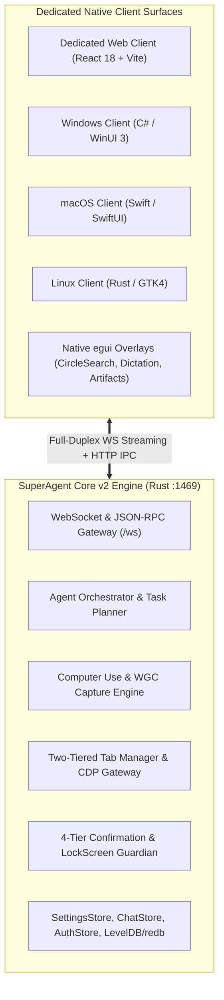

# 00 — Gap Analysis & Master Strategy: SuperAgent Next-Gen UI

## Executive Summary
This document provides a forensic comparison between the reverse-engineered **OpenAI Codex Desktop CUA/Sky Runtime** (`ui-blueprint/`) and the existing **SuperAgent UI Specification** (`docs/UI_SPECIFICATION.md`). It establishes the comprehensive architectural roadmap to transform SuperAgent from an AI assistant into a truly autonomous, multi-surface **SuperAgent**, integrating native Computer Use, two-tiered browser tab leasing, hardware-level security guardians, 3D VRM companion presence, and full test matrices.

---

## 1. Forensic Feature & Settings Gap Matrix

The following matrix categorizes all capabilities identified during the comparative audit between `ui-blueprint` and `docs/UI_SPECIFICATION.md`:

| Capability Domain | Feature in `ui-blueprint` | Status in Current `UI_SPECIFICATION.md` | Strategic Gap & Action Plan |
| :--- | :--- | :--- | :--- |
| **Computer Use: Window Inspection** | Real-time `list_apps()`, `list_windows()`, process IDs, window handles, user-visible titles (`SKILL.md:110-145`). | ❌ Missing. Only high-level checkbox in Settings 16.11. | Create dedicated **Computer Use Stage** with live window picker, process inspector, and focus state manager. |
| **Computer Use: Occluded Capture** | Direct3D11 / Windows.Graphics.Capture (WGC) frame buffer capture of background windows without raising them (`SKILL.md:14`). | ❌ Missing. Screenshot capture assumes full-screen active display. | Implement **WGC Canvas** with Direct3D swapchain rendering and DPI-scaled bounding coordinate mapping. |
| **Computer Use: Accessibility Tree** | Formatted accessibility tree with explicit element indices (`element_index: 12`), roles, and document text (`SKILL.md:218-224`). | ❌ Missing. Trajectory only displays file diffs and command text. | Add **Live Accessibility Tree Inspector** view with searchable nodes, role badges, and coordinate fallback indicators. |
| **Computer Use: Adaptive Settling** | Dynamic settling delay (1000ms base + up to 5000ms hold on spinner/indicator) (`SKILL.md:243-247`). | ❌ Missing. Fixed action delays in settings. | Build **Adaptive Settling Indicator** with real-time UI animation countdown and stability status. |
| **Browser: Tab Claiming Architecture** | Two-tiered tab management: `claimExistingTab` leasing vs `createTab` isolation (`tab-claiming-chrome`). | ❌ Missing. Basic headless/headed toggle in Settings 16.12. | Build **Browser Tab Leasing Center** showing open tabs, domain matching, lease countdowns, and active tab chips. |
| **Browser: In-Page WebMCP Tools** | Injected in-page structured tool execution (`query_table`, `fill_checkout_form`) via WebMCP (`browser-safety.md:5`). | ❌ Missing. MCP is only specified as external background stdio/sse servers. | Build **WebMCP In-Page Tool Monitor** with real-time DOM tool registry and execution latency metrics. |
| **Browser: In-DOM Agent Indicator** | Injected floating page badge `⚡ SuperAgent Connected` inside active browser DOM. | ❌ Missing. No visual feedback inside user's real browser. | Inject **In-Page DOM Agent Ribbon** with pause/resume buttons and execution telemetry. |
| **Security: 4-Tier Confirmation** | Strict taxonomy: Hand-Off Required, Always Confirm, Pre-Approval Allowed, No Confirmation (`tinysky-alt-confirmations.md`). | ⚠️ Partial. Only basic 2-button `PermissionDialog` and 3-way `approvalMode`. | Upgrade to **4-Tier Guardian Modal** with explicit `[Data] -> [Destination] via [Mechanism]` disclosure. |
| **Security: LockScreen Guardian** | Hardware/WTS session watchdog blocking keystrokes/clicks on `WTS_SESSION_LOCK` or screensaver (`zo.guardian_denied`). | ❌ Missing. Only software app lock screen (`DesktopLockScreen`). | Implement **CUALockScreenGuardian Shield** with hardware session event hook and automatic input freeze. |
| **Security: Credential Recovery** | 7 explicit recovery actions (`fn`: delivery, new document, fresh tab, handoff, restart, resolve, stop) + iframe origin check. | ❌ Missing. Only basic 401 BYOK modal. | Create **Credential Vault & Safe Handoff Dialog** with cross-origin iframe validator and 7-branch recovery actions. |
| **Scripting: In-Process REPL Console** | High-token (25,000) NodeREPL / scripting host with variable inspector and session reset (`cua-repl`). | ❌ Missing. Terminal is only external `run_command` cards. | Build **In-Process Scripting & Execution Console** with live memory tree, variable inspector, and reset controls. |
| **Companion: 3D VRM Presence** | Interactive 3D companion presence reacting to agent actions in real time (`PartnerPage`, `PetSprite3D`). | ⚠️ Partial. Present in spec, but lacks deep multi-surface integration and procedural animations. | Expand **3D VRM Companion Engine** with emotion sync (Joy, Thinking, Error), lip-sync, mouse tracking, and desktop pet mode. |
| **Global Overlays** | Native overlays for Circle Search, Voice Dictation, and Artifacts (`egui` overlays). | ⚠️ Partial. Specified in high-level docs, but lacks detailed UI interaction specifications. | Standardize **Global Overlay Suite** with live audio waveform, OCR omnibox, and instant chat handoff. |

---

## 2. Master Architecture for SuperAgent Next-Gen UI



---

## 3. Demo Stubs & Code Search Standard

To allow rapid development of the complete frontend before the backend endpoints are finalized, every UI view, component, and state store will include explicit, standardized demo mocks.

### Standard Demo Tagging Pattern:
```typescript
// ============================================================================
// [DEMO_STUB: ComputerUseWindowList]
// DESCRIPTION: Mock list of open OS application windows for development & testing.
// BACKEND_ROUTE: GET /api/computer-use/windows -> superagent_core_v2::tools::computer_use
// SEARCH_TAG: #DEMO_COMPUTER_USE_WINDOWS
// ============================================================================
export const DEMO_OPEN_WINDOWS = [
  { id: 1042, app: "com.microsoft.VSCode", title: "AgentApp - Visual Studio Code", isMinimized: false, isOccluded: false },
  { id: 2088, app: "com.google.Chrome", title: "SuperAgent Dashboard - Google Chrome", isMinimized: false, isOccluded: true },
  { id: 3104, app: "com.spotify.client", title: "Spotify Free", isMinimized: true, isOccluded: true },
];
// ============================================================================
// [END_DEMO_STUB: ComputerUseWindowList]
// ============================================================================
```

### Benefits of This Standard:
1. **Searchability**: A simple search for `[DEMO_STUB:` or `#DEMO_` instantly identifies all placeholder mocks in the entire repository.
2. **Contract Consistency**: Each stub specifies its intended `BACKEND_ROUTE` and Rust handler so backend engineers know the exact schema needed.
3. **Toggleable Testing**: Allows running the entire native frontend in "Mock Demonstration Mode" for rapid visual regression testing without needing live OS permissions.

---

## 4. Documentation Structure

The next-gen UI plan is broken down into 9 dedicated, comprehensive specification files in `docs/ui_plans/`:

1. `docs/ui_plans/01_computer_use_and_window_automation.md`: Window picker, WGC occluded capture, accessibility tree inspector, and mouse trajectory overlay.
2. `docs/ui_plans/02_browser_automation_and_tab_leasing.md`: Two-tiered tab leasing, in-page WebMCP tool monitor, CDP event inspector, and DOM banner.
3. `docs/ui_plans/03_security_guardian_and_credential_vault.md`: 4-tier confirmation dialog, LockScreen Guardian shield, `zo` state machine, and 7-branch credential recovery.
4. `docs/ui_plans/04_interactive_scripting_and_repl_console.md`: In-process REPL console, 25k token streaming buffers, live variables inspector, and reset routines.
5. `docs/ui_plans/05_companion_and_3d_vrm_ecosystem.md`: 3D VRM companion engine, emotion blendshapes, look-at mouse tracking, lip-sync, and floating desktop pet.
6. `docs/ui_plans/06_creative_and_hardware_workspaces.md`: Image generation canvas, video workbench, 3D studio, and PCB ECAD schematic/layout editors.
7. `docs/ui_plans/07_settings_governance_and_system_doctor.md`: 24-panel settings matrix, system doctor diagnostics, provider keys, and hardware allocation.
8. `docs/ui_plans/08_global_overlays_and_system_tray.md`: Circle to search overlay, voice dictation bar with live audio visualizer, and system tray launcher.
9. `docs/ui_plans/09_comprehensive_test_matrix_and_scenarios.md`: Exhaustive test scenarios, unit tests, end-to-end integration flows, and edge case matrices.
