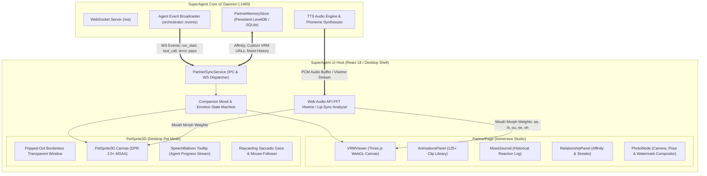
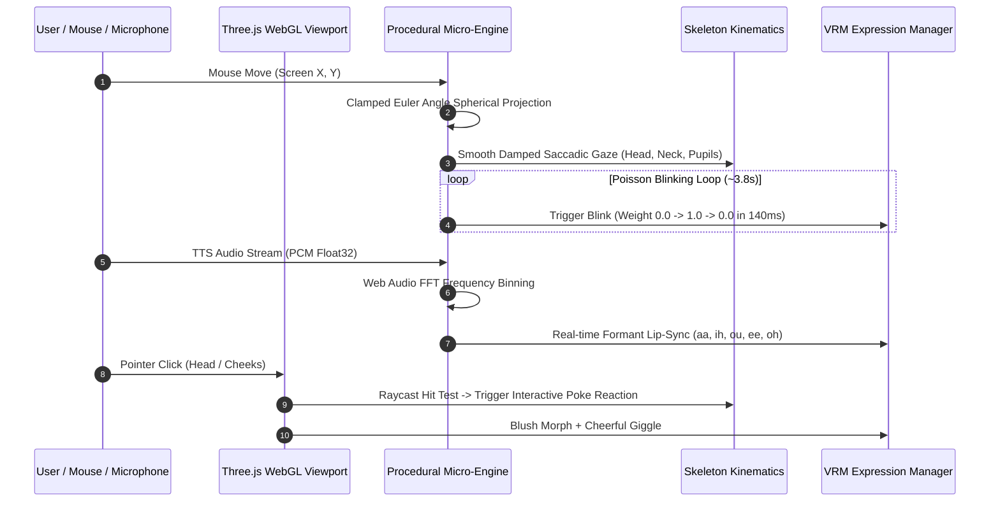

# 05 — 3D VRM Companion & Live Presence Ecosystem: Architecture & UI Specification

## Executive Summary
This document specifies the architecture, user experience, kinematics pipelines, and system integration contracts for SuperAgent's **3D VRM Companion & Live Presence Engine**. SuperAgent transcends static CLI text generation and traditional web chat boxes by providing an embodied, emotionally resonant 3D companion (`PartnerPage` and `PetSprite3D`). 

The companion reacts dynamically to runtime agent events—celebrating successful compilation, pondering during tool executions, exhibiting confusion upon lint failures, welcoming the user upon session initialization, and resting during inactivity. Built atop `@pixiv/three-vrm`, Three.js WebGL/WebGPU, and custom skeletal physics, the ecosystem supports both full-screen immersive studio interactions and a transparent, borderless, always-on-top desktop pet mode.

---

## 1. System Architecture & Component Topology



---

## 2. 3D Model Handling & VRM Asset Pipeline

### 2.1 Supported File Formats & Standards
SuperAgent exclusively adopts the official **VRM standard (VRM 0.0 and VRM 1.0)** built atop glTF 2.0:
- **VRM 0.0 (`VRM_v0`)**: Legacy standard with `blendShapeMaster`, `firstPerson`, and `secondaryAnimation` (Spring Bones).
- **VRM 1.0 (`VRMC_vrm`)**: Modern specification with standard expression presets, normalized coordinate axes (Z-forward, Y-up), decoupled physics (`VRMC_springBone`), and constraints (`VRMC_node_constraint`).
- Automatic standard detection and normalization is handled transparently via `@pixiv/three-vrm`'s `VRMLoaderPlugin`.

### 2.2 Drag-and-Drop Custom Avatar Importer (`AvatarImportModal`)
Users can import custom avatars directly via drag-and-drop into the browser or desktop window:
1. **Magic Header Inspection**: Validates binary glTF header (`0x46546C67` for `glTF`) and JSON chunk chunkType (`0x4E4F534A`).
2. **Metadata Extraction**:
   - Title, Author, Version, Contact Information, Reference URL.
   - Allowed User Rights: `avatarUsageName` (Everyone, OnlyAuthor), `commercialUsageName` (Allow, Disallow), `creditNotation` (Required, Unnecessary).
3. **Skeleton & Rigging Validation**:
   - Verifies humanoid bone hierarchy (`hips`, `spine`, `chest`, `neck`, `head`, `leftUpperArm`, `rightUpperArm`, `leftUpperLeg`, `rightUpperLeg`).
   - Automatically computes bounding box dimensions and hip rest height to calibrate ground clearance.
4. **Spring Bone & Collider Sanity**:
   - Detects hair, skirt, ribbon, and chest spring bone groups.
   - Colliders mapped against bone spheres; caps total spring bones to 256 active chains to prevent frame drops on lower-tier GPUs.
5. **Texture & VRAM Optimization**:
   - Detects uncompressed textures. Textures exceeding $2048\times2048$ are downsampled or converted to mipmapped compressed textures.
   - Sets 16x anisotropic filtering on all face and garment diffuse textures.
6. **Local Persistence**:
   - Saves avatar binary to `~/.superagent/companions/<avatar_id>.vrm` (Desktop) or IndexedDB `superagent_avatars` store (Web).
   - Generates a $256\times256$ portrait thumbnail rendered against a transparent background.

---

## 3. Kinematics, Skeleton & Blendshape Proxy Controllers

### 3.1 Standardized Morph Target Mapping
VRM models standardize facial morphology into expression presets. SuperAgent normalizes all expressions across VRM 0.0 and 1.0:

| VRM 1.0 Standard Name | VRM 0.0 Legacy Fallback | Facial Feature & Mesh Deformation |
| :--- | :--- | :--- |
| `happy` | `joy` | Raised cheekbones, upturned mouth corners, slight eyelid squint. |
| `angry` | `angry` | Lowered brow inner corners, narrowed eyes, tensed lip line. |
| `sad` | `sorrow` | Drooped eyebrows, downturned mouth corners, softened gaze. |
| `relaxed` | `fun` | Gentle smile, fully relaxed forehead and brows. |
| `surprised` | `surprised` | Widened eye apertures, elevated eyebrows, slightly open mouth (`O`). |
| `blink` | `blink` | Bilateral synchronized eyelid closure (0.0 to 1.0). |
| `blinkLeft` | `blink_l` | Unilateral left eyelid closure (winking). |
| `blinkRight` | `blink_r` | Unilateral right eyelid closure (winking). |
| `aa` | `a` | Low-mid open mouth vowel position (`ah`). |
| `ih` | `i` | Wide teeth-revealing mouth spread (`ee`). |
| `ou` | `u` | Pursed forward lip trumpet (`oo`). |
| `ee` | `e` | Mid-open conversational smile vowel. |
| `oh` | `o` | Round vertical cylindrical mouth opening. |
| `lookUp` / `lookDown` | `lookup` / `lookdown` | Procedural eye pupil pitch rotation. |
| `lookLeft` / `lookRight` | `lookleft` / `lookright` | Procedural eye pupil yaw rotation. |
| `neutral` | `neutral` | Default relaxed resting expression. |

### 3.2 Continuous Morph Target Interpolator
All expression transitions are mediated by a critically damped spring-damper equation rather than linear stepping:
$$W_t = W_{t-1} + (W_{\text{target}} - W_{t-1}) \cdot \left(1 - e^{-\lambda \cdot \Delta t}\right)$$
Where $\lambda = 12.5\,\text{s}^{-1}$ ensures rapid response ($<150\,\text{ms}$) without robotic snapping or mesh tearing.

### 3.3 Preserved Rest Kinematics & Ground Clearance
To ensure avatars of varying limb proportions do not sink into the floor or hover unrealistically:
1. On initial model load, the avatar is normalized in a zeroed T-Pose.
2. The distance from `hips` bone to the lowest bounding box vertex of `leftFoot` / `rightFoot` is computed as $H_{\text{rest}}$.
3. The root object's Y-translation is pinned:
$$Y_{\text{root}} = H_{\text{rest}} + \Delta Y_{\text{pose}}$$
Where $\Delta Y_{\text{pose}}$ accounts for crouching, sitting, or jumping animations.

---

## 4. Spring Bone Physics & Simulation Engine

### 4.1 Verlet Physics Integration
Secondary animation (hair strands, neckties, skirts, ribbons, bust physics) uses Verlet integration parameterized per bone chain:
- **Stiffness (`stiffnessForce`)**: Resistance against displacement (default: `1.8` for hair strands, `3.2` for short ribbons).
- **Gravity Power (`gravityPower`)**: Gravitational downward pull (default: `-9.81\,\text{m/s}^2` scaled by `0.4` for stylized bounce).
- **Gravity Direction (`gravityDir`)**: 3D vector defining directional forces (e.g., simulated room draft or head motion inertia).
- **Drag Force (`dragForce`)**: Air resistance deceleration factor (default: `0.35` for smooth settling without indefinite oscillation).

### 4.2 Collider Groups & Collision Spheres
To prevent hair and garments from clipping through the avatar's body:
- **Head Sphere Collider**: $r = 0.14\,\text{m}$ anchored to `head` bone prevents hair strands penetrating the face and cheeks.
- **Chest Capsule Collider**: Anchored between `chest` and `neck` prevents neckties and ribbons penetrating the ribcage.
- **Arm Capsule Colliders**: Left and right upper/lower arms prevent hands passing through hanging sleeves.
- **Pelvis Sphere Collider**: Anchored to `hips` keeps skirts expanding outward naturally during seated poses.

---

## 5. Emotion & Mood Synchronization Engine

### 5.1 Real-Time Agent Event Mapping
The agent orchestrator emits JSON-RPC / WebSocket events over `/ws`. The companion mood engine listens and transitions states:

| Agent Lifecycle Event | Companion Mood | Primary Facial Expression | Skeletal Pose & Action | Audio / Visual VFX |
| :--- | :--- | :--- | :--- | :--- |
| `agent:run_started` | **Pondering** | `neutral` + 30% `surprised` | Hand on chin, weight shift (`thinking`) | Subtle pulsing azure aura |
| `tool:call_streaming` | **Focus / Working** | `relaxed` + focused gaze | Rapid typing posture, subtle head nods | Soft mechanical keyboard click cues |
| `agent:run_finished_success` | **Joy / Excited** | 100% `happy` + `blink` | Double thumbs up (`thumbs_up_double`) or Jump (`jump_joy`) | Golden sparkles particle burst |
| `agent:test_passed` | **Triumphant** | 100% `happy` | Fist pump victory (`fist_pump`), cheerful bow | Confetti shimmer emitter |
| `agent:error` / `lint:failure` | **Concerned / Confused** | 60% `sad` + 30% `surprised` | Head tilt, hand behind neck (`blush` / `reluctant`) | Blue sweat drop emoji bubble |
| `agent:blocked_on_permission` | **Attentive / Waiting** | `neutral` + wide eyes | Leaning forward toward camera (`lean_in`) | Pulsing amber question mark badge |
| `app:session_start` | **Welcoming** | 80% `happy` | Friendly wave (`wave_energetic`) | Soft chime chime audio cue |
| `app:idle_inactivity` (>10m) | **Sleepy / Resting** | 40% `relaxed` + 70% `blink` | Heavy eyelids, slow breathing sway (`idle_sleepy`) | Floating lavender "Zzz" particles |

### 5.2 Mood Decay & Priority Queue
Moods operate on a priority hierarchy:
1. **Critical Interrupts (Priority 10)**: Task Success, Fatal Error, Permission Block. Interrupts any active animation immediately with a 200ms ease-in.
2. **Operational States (Priority 5)**: Thinking, Typing, Reading Files. Looping postures active while background tasks run.
3. **Ambient States (Priority 1)**: Natural Idles, Sleepy, Attentive.
- When an ephemeral event (e.g., `fist_pump` on test pass) completes its duration (e.g., 3.5s), the mood engine smoothly blends back to the prevailing operational or ambient state.

---

## 6. Procedural Micro-Interactions & Real-Time Dynamics



### 6.1 Natural Stochastic Eye Blinking
Humans do not blink on fixed metronome intervals. SuperAgent implements a stochastic Poisson process:
- **Mean Interval**: $\mu = 3.75\,\text{s}$ with Gaussian variance $\sigma = 1.2\,\text{s}$.
- **Double-Blink Mechanism**: 15% probability of triggering a rapid secondary blink 120ms after the first blink resolves.
- **Blink Duration**: 70ms eye closure, 15ms hold, 85ms eye opening curve.
- **Inhibition**: Blinking is momentarily suppressed during intense thinking or focused typing states.

### 6.2 Saccadic Gaze & Mouse Head Tracking
The companion's eyes and head track the user's cursor across the screen:
1. **Coordinate Normalization**: Screen coordinates $(X_{\text{px}}, Y_{\text{px}})$ are normalized to viewport space $[-1.0, 1.0]$.
2. **Angle Clamping**:
   - `head` Bone: Yaw clamped to $[-35^\circ, +35^\circ]$, Pitch clamped to $[-20^\circ, +25^\circ]$.
   - `neck` Bone: Receives 30% of the computed head rotation for anatomical realism.
   - `eyes` (LookAt): Pupils track with low-latency saccadic micro-jitters ($\pm1.5^\circ$), simulating human eye fixation jumps.
3. **Velocity Clamping**: Maximum rotational speed capped at $180^\circ/\text{s}$ to prevent jarring whiplash when the user rapidly flings their mouse.

### 6.3 Real-Time TTS Viseme Lip-Sync
When SuperAgent speaks audio responses through TTS (ElevenLabs, Edge-TTS, or local Kokoro-82M):
1. **Audio Node Tap**: PCM audio flows through a Web Audio API `AnalyserNode` with `fftSize = 512`.
2. **Frequency Formant Splitting**:
   - Band 1 ($200 - 800\,\text{Hz}$): Formant $F_1 \rightarrow$ Drives open vowel `aa`.
   - Band 2 ($800 - 2200\,\text{Hz}$): Formant $F_2 \rightarrow$ Drives wide vowel `ee` / `ih`.
   - Band 3 ($2200 - 4500\,\text{Hz}$): High Frequencies $\rightarrow$ Drives rounded vowel `ou` / `oh`.
3. **Amplitude Thresholding**: Signals below $-42\,\text{dB}$ noise floor clamp to zero, preventing ambient room noise or breathing artifacts from twitching the avatar's lips.
4. **Procedural Fallback**: If audio is muted or streamed as raw text tokens, a phoneme timing generator calculates syllable duration (average $120\,\text{ms}$ per syllable) and modulates mouth aperture organically.

---

## 7. Full Companion Studio UI (`PartnerPage`)

### 7.1 Studio Layout Specification
The `PartnerPage` is partitioned into a 3-column responsive layout:
1. **Left Inspector Column (320px)**:
   - **Companion Persona Card**: Avatar portrait, display name, user nickname, voice persona picker.
   - **Relationship & Affinity Panel (`RelationshipPanel`)**: 
     * Affinity Level (0–100 XP bar), daily interaction streak counter with flame badge.
     * Milestones unlocked list ("First Code Run", "100 Tasks Shipped", "Midnight Oil Burned").
   - **Personality Tuning Sliders**:
     * Warmth (1: Reserved $\rightarrow$ 5: Devoted & Nurturing)
     * Playfulness (1: Serious Professional $\rightarrow$ 5: Teasing & Bubbly)
     * Directness (1: Gentle & Subtle $\rightarrow$ 5: Blunt & Decisive)
     * Formality (1: Slang & Casual $\rightarrow$ 5: Polite & Academic)
2. **Center 3D Viewport Stage**:
   - High-DPI WebGL canvas featuring 4-point studio lighting, soft radial pedestal shadow, and camera angle toggles (`Portrait`, `Half-Body`, `Full-Body`).
   - Interactive Raycast Zones: Clicking on avatar's head triggers head-patting blush; clicking hands triggers high-five.
3. **Right Operational Column (380px)**:
   - **Tab 1: Animations Catalog (`AnimationsPanel`)**: Categorized grid of 125+ motion clips with duration badges, search filter, and instant trigger buttons.
   - **Tab 2: Mood Journal (`MoodJournal`)**: Chronological audit log of emotional reactions to user coding sessions with timestamps and notes.
   - **Tab 3: Photo Studio (`PhotoMode`)**: Custom pose selector, expression overrides, HDRI backdrops, and high-res screenshot capture.

---

## 8. Photo Mode & Customization (`PhotoMode`)

### 8.1 Studio Camera & Lighting Engine
- **Camera Presets**:
  - `Portrait`: FOV $24^\circ$, focused on facial expressions and eye contact.
  - `Half-Body`: FOV $32^\circ$, captures waist-up gestures and hand poses.
  - `Full-Body`: FOV $42^\circ$, captures entire footwear, dress, and dynamic stances.
  - `Free Orbit`: Unconstrained camera controls with mouse orbit, pan, and zoom.
- **HDRI Environment Maps**:
  - `Cyberpunk Neon`: High-contrast purple and cyan rim lights with wet asphalt reflections.
  - `Sunset Horizon`: Warm golden hour side illumination ($3200\,\text{K}$).
  - `Studio Clean`: Neutral 3-point softbox photography setup ($5500\,\text{K}$).
  - `Dark Obsidian`: Minimalist slate grey backdrop with single overhead rim spotlight.
  - `Chroma Key Green`: Solid `#00FF00` background for transparent video/streaming OBS composition.

### 8.2 Expression Overrides & Sliders
Provides granular manual sliders for fine-tuning before taking a snapshot:
- Smile / Happiness slider ($0.0 - 1.0$)
- Brow Arch / Curiosity slider ($0.0 - 1.0$)
- Cheek Blush Intensity ($0.0 - 1.0$)
- Eye Squint / Focus ($0.0 - 1.0$)

### 8.3 High-Resolution Snapshot Capture Pipeline
1. Temporarily scales the WebGL render buffer to $2\times$ or $4\times$ native device pixel ratio ($3840\times2160$ UHD).
2. Performs anti-aliased beauty render pass with ground contact shadow and post-processing bloom.
3. Composites the image onto an offscreen 2D canvas.
4. Renders a stylized semi-transparent watermark badge in the bottom-right corner:
   - Avatar name & user nickname
   - "SuperAgent Companion Studio" brand badge
   - Current date & high-precision timestamp
5. Triggers lossless PNG or WebP download and saves to user's gallery directory.

---

## 9. Floating Desktop Pet Mode (`PetSprite3D`)

### 9.1 Window Host Architecture
The companion can be popped out into an independent, desktop-native floating widget:
- **Tauri / Windows WinUI 3**: Borderless, transparent window (`transparent: true`, `decorations: false`, `alwaysOnTop: true`).
- **macOS SwiftUI**: Borderless floating panel (`NSPanel`, `styleMask: [.nonactivatingPanel]`, `level: .floating`).
- **Linux GTK4 / Libadwaita**: Wayland / X11 layer-shell overlay surface.

### 9.2 Window Dragging & Screen Snapping
- **Repositioning**: Left-click drag on transparent empty space or avatar body moves the window across monitors.
- **Edge Snapping**: When dragged within 24px of any display edge or taskbar, the pet snaps magnetically to the border.
- **Off-Screen Clamp**: Prevents the companion from being lost outside active display bounds during monitor unplugging or resolution shifts.
- **Click-Through Mode**: Hotkey `Ctrl+Shift+P` (or tray menu toggle) sets OS window property `WS_EX_TRANSPARENT` / `ignoresMouseEvents = true`, allowing the user to click through the avatar onto background IDE code without moving the pet.

### 9.3 Speech Balloon Tooltip System
When the agent executes commands or provides status updates, an animated comic-style speech bubble appears anchored above the companion's head:
- **Bubble Physics**: Renders with rounded border, drop shadow, and downward directional tail pointing to the avatar's skull.
- **Content Formatting**: Displays short status summaries, task completions, or tool execution cards. Long text is intelligently truncated with an expand pill.
- **Typing Dots Animation**: While the agent generates tokens, three bouncing dots indicate live thinking.
- **Auto-Dismiss & Pinning**: Ephemeral notifications auto-fade after 6 seconds; critical questions requiring approval remain pinned until dismissed or answered.

---

## 10. Standardized Demo Stubs

### 10.1 VRM Model Library Demo Stub
```typescript
// ============================================================================
// [DEMO_STUB: VrmModelLibraryDemo]
// DESCRIPTION: Mock catalog of installed and default 3D VRM companion avatars.
// BACKEND_ROUTE: GET /api/companions/models -> superagent_core_v2::companion::catalog
// SEARCH_TAG: #DEMO_VRM_MODEL_LIBRARY
// ============================================================================
export interface VrmModelRecord {
  id: string;
  name: string;
  author: string;
  vrmVersion: '0.0' | '1.0';
  fileUrl: string;
  thumbnailUrl: string;
  fileSizeBytes: number;
  tags: string[];
  features: {
    hasSpringBones: boolean;
    hasVisemes: boolean;
    expressionsCount: number;
    materialsCount: number;
  };
  license: {
    commercial: boolean;
    attributionRequired: boolean;
    redistribution: boolean;
  };
}

export const DEMO_VRM_MODELS: VrmModelRecord[] = [
  {
    id: 'companion-kai-default',
    name: 'Kai',
    author: 'SuperAgent Studios',
    vrmVersion: '1.0',
    fileUrl: '/models/vrm/kai_companion_v1.vrm',
    thumbnailUrl: '/models/vrm/thumbnails/kai_portrait.png',
    fileSizeBytes: 14680064,
    tags: ['cyberpunk', 'assistant', 'default', 'anime-stylized'],
    features: {
      hasSpringBones: true,
      hasVisemes: true,
      expressionsCount: 18,
      materialsCount: 8,
    },
    license: {
      commercial: true,
      attributionRequired: false,
      redistribution: true,
    },
  },
  {
    id: 'companion-lily-procedural',
    name: 'Lily',
    author: 'OpenSource VRM Collective',
    vrmVersion: '0.0',
    fileUrl: '/models/vrm/lily_casual.vrm',
    thumbnailUrl: '/models/vrm/thumbnails/lily_portrait.png',
    fileSizeBytes: 22020096,
    tags: ['casual', 'bubbly', 'student'],
    features: {
      hasSpringBones: true,
      hasVisemes: true,
      expressionsCount: 24,
      materialsCount: 12,
    },
    license: {
      commercial: true,
      attributionRequired: true,
      redistribution: false,
    },
  },
  {
    id: 'companion-zen-mecha',
    name: 'Zenith-01',
    author: 'MechaWorks',
    vrmVersion: '1.0',
    fileUrl: '/models/vrm/zenith_robot.vrm',
    thumbnailUrl: '/models/vrm/thumbnails/zenith_portrait.png',
    fileSizeBytes: 18874368,
    tags: ['mecha', 'android', 'futuristic'],
    features: {
      hasSpringBones: false,
      hasVisemes: true,
      expressionsCount: 12,
      materialsCount: 16,
    },
    license: {
      commercial: false,
      attributionRequired: true,
      redistribution: false,
    },
  },
];
// ============================================================================
// [END_DEMO_STUB: VrmModelLibraryDemo]
// ============================================================================
```

### 10.2 Companion Mood State Demo Stub
```typescript
// ============================================================================
// [DEMO_STUB: CompanionMoodStateDemo]
// DESCRIPTION: Mock reactive mood state machine and real-time event dispatcher.
// BACKEND_ROUTE: GET /api/companions/active/mood -> superagent_core_v2::companion::mood
// SEARCH_TAG: #DEMO_COMPANION_MOOD_STATE
// ============================================================================
export type CompanionMood = 
  | 'idle' 
  | 'thinking' 
  | 'working' 
  | 'celebrating' 
  | 'concerned' 
  | 'welcoming' 
  | 'sleeping';

export interface CompanionMoodState {
  currentMood: CompanionMood;
  lastEventTrigger: string;
  intensity: number; // 0.0 to 1.0
  activeAction: string;
  lookAtTarget: { x: number; y: number; z: number };
  isBlinking: boolean;
  isLipSyncing: boolean;
  lipSyncPhoneme: 'aa' | 'ih' | 'ou' | 'ee' | 'oh' | 'rest';
  speechBubble: {
    visible: boolean;
    text: string;
    level: 'info' | 'success' | 'warning' | 'error';
    timeoutMs: number;
  } | null;
}

export const DEMO_COMPANION_MOOD_STATE: CompanionMoodState = {
  currentMood: 'celebrating',
  lastEventTrigger: 'test_passed: cargo test -p superagent-core-v2',
  intensity: 0.95,
  activeAction: 'thumbs_up_double',
  lookAtTarget: { x: 0.15, y: 0.08, z: 2.2 },
  isBlinking: false,
  isLipSyncing: true,
  lipSyncPhoneme: 'aa',
  speechBubble: {
    visible: true,
    text: 'All 42 protocol test suites passed cleanly! Ready to commit and merge! 🎉',
    level: 'success',
    timeoutMs: 5000,
  },
};
// ============================================================================
// [END_DEMO_STUB: CompanionMoodStateDemo]
// ============================================================================
```

### 10.3 Animation Clips Catalog Demo Stub
```typescript
// ============================================================================
// [DEMO_STUB: AnimationClipsCatalog]
// DESCRIPTION: Mock catalog of available procedural and skeletal motion clips.
// BACKEND_ROUTE: GET /api/companions/animations -> superagent_core_v2::companion::motions
// SEARCH_TAG: #DEMO_ANIMATION_CLIPS_CATALOG
// ============================================================================
export interface AnimationClipMetadata {
  id: string;
  label: string;
  emoji: string;
  category: 'Core Idles' | 'Greetings' | 'Affection' | 'Joy & Praise' | 'Focus & Work' | 'Melancholy';
  durationSeconds: number;
  isLooping: boolean;
  boneMask: 'full_body' | 'upper_body_only' | 'facial_only';
  recommendedBlendTimeSec: number;
  description: string;
}

export const DEMO_ANIMATION_CLIPS: AnimationClipMetadata[] = [
  {
    id: 'idle_natural',
    label: 'Natural Breathing Idle',
    emoji: '🧍',
    category: 'Core Idles',
    durationSeconds: 4.0,
    isLooping: true,
    boneMask: 'full_body',
    recommendedBlendTimeSec: 0.4,
    description: 'Subtle diaphragm breathing expansion with natural shoulder contrapposto sway.',
  },
  {
    id: 'wave_energetic',
    label: 'Energetic Greeting Wave',
    emoji: '👋',
    category: 'Greetings',
    durationSeconds: 3.5,
    isLooping: false,
    boneMask: 'upper_body_only',
    recommendedBlendTimeSec: 0.25,
    description: 'Enthusiastic high wave with wrist articulation and warm tilted gaze.',
  },
  {
    id: 'thinking_ponder',
    label: 'Deep Pondering',
    emoji: '🤔',
    category: 'Focus & Work',
    durationSeconds: 5.0,
    isLooping: true,
    boneMask: 'upper_body_only',
    recommendedBlendTimeSec: 0.35,
    description: 'Left elbow supported by right arm, index finger resting on jawline, looking upward.',
  },
  {
    id: 'thumbs_up_double',
    label: 'Double Thumbs Up',
    emoji: '👍👍',
    category: 'Joy & Praise',
    durationSeconds: 3.8,
    isLooping: false,
    boneMask: 'upper_body_only',
    recommendedBlendTimeSec: 0.2,
    description: 'Both arms raised with firm thumbs-up approval and proud head nod.',
  },
  {
    id: 'jump_joy',
    label: 'Joyful Hop & Celebrate',
    emoji: '🎉',
    category: 'Joy & Praise',
    durationSeconds: 4.2,
    isLooping: false,
    boneMask: 'full_body',
    recommendedBlendTimeSec: 0.2,
    description: 'Dynamic jumping hop with arms extended overhead celebrating project milestone.',
  },
  {
    id: 'typing_rapid',
    label: 'Rapid Cyberpunk Typing',
    emoji: '💻',
    category: 'Focus & Work',
    durationSeconds: 2.0,
    isLooping: true,
    boneMask: 'upper_body_only',
    recommendedBlendTimeSec: 0.15,
    description: 'Continuous finger articulation on virtual terminal keyboard matching agent tool output.',
  },
];
// ============================================================================
// [END_DEMO_STUB: AnimationClipsCatalog]
// ============================================================================
```

---

## 11. Comprehensive Test Case Catalog

### 11.1 Model Loading & Verification Test Suite

| Test Case ID | Test Description | Input / Trigger | Expected Outcome & System Response |
| :--- | :--- | :--- | :--- |
| `TC-VRM-001` | Corrupted VRM File Load | Drag and drop 0-byte or corrupted `.vrm` binary. | Importer catches invalid magic bytes, aborts parser, surfaces non-blocking error toast: *"Invalid VRM file structure."*, keeps default avatar loaded. |
| `TC-VRM-002` | Missing Essential Humanoid Bones | Load `.vrm` lacking `hips` or `head` bone mappings. | Model parser logs warning, activates bone synthesizer fallback or marks avatar incompatible with message: *"Model missing humanoid bone: hips."* |
| `TC-VRM-003` | Oversized Texture Memory Pressure | Import VRM with $4\times 8192\times8192$ uncompressed PNG textures. | Texture pipeline downsamples maps to $2048\times2048$ mipmaps, keeping VRAM footprint under 250MB. |
| `TC-VRM-004` | VRM 0.0 to 1.0 Coordinate Normalization | Load legacy VRM 0.0 with inverted Z-axis forward vector. | `@pixiv/three-vrm` automatically flips coordinate basis, avatar faces camera correctly without mirrored hands. |

### 11.2 Blendshapes & Kinematics Fallback Test Suite

| Test Case ID | Test Description | Input / Trigger | Expected Outcome & System Response |
| :--- | :--- | :--- | :--- |
| `TC-VRM-005` | Missing Viseme Morph Target | TTS audio streams phoneme `oh` on avatar missing `oh` blendshape. | System gracefully falls back to `aa` morph weighted at 50% without throwing null reference exceptions. |
| `TC-VRM-006` | Expression Stack Overlap | Agent event `test_passed` occurs while `sad` error expression is decaying. | Priority queue interrupts `sad`, blends out sorrow at $15\,\text{s}^{-1}$, blends in `happy` at $25\,\text{s}^{-1}$ cleanly without facial mesh clipping. |
| `TC-VRM-007` | Extreme Mouse Gaze Angle Clamp | User moves mouse to secondary monitor at $(4000\text{px}, -500\text{px})$. | Saccadic angle limiter strictly clamps head yaw to $+35^\circ$ and pitch to $+25^\circ$. Model does not exhibit neck break or 360-degree spin. |

### 11.3 Graphics Context & Hardware Fault Recovery

| Test Case ID | Test Description | Input / Trigger | Expected Outcome & System Response |
| :--- | :--- | :--- | :--- |
| `TC-VRM-008` | WebGL Context Loss (`webglcontextlost`) | GPU driver restart or laptop docking event fires `webglcontextlost`. | Event handler intercepts event, prevents default page crash, displays lightweight 2D sprite fallback, and automatically reinitializes Three.js scene upon `webglcontextrestored`. |
| `TC-VRM-009` | High-DPI Scaling Transition | Moving window from $100\%$ scaling display ($1920\times1080$) to $200\%$ 4K display. | Resize observer detects DPI change, updates `renderer.setPixelRatio(Math.min(window.devicePixelRatio, 2.5))`, recalculates viewport dimensions without blur or stretching. |
| `TC-VRM-010` | Low-Power Background Throttling | Application minimized or hidden behind another window. | Render loop throttles from 60 FPS down to 10 FPS or pauses `requestAnimationFrame`, dropping CPU/GPU utilization to $<0.5\%$. |

### 11.4 Floating Desktop Pet Multi-Monitor Positioning

| Test Case ID | Test Description | Input / Trigger | Expected Outcome & System Response |
| :--- | :--- | :--- | :--- |
| `TC-VRM-011` | Primary Display Disconnect | Secondary monitor where pet was anchored is unplugged. | Window manager detects OS display configuration change, clamps pet position to primary desktop screen coordinates $(100, 100)$ to prevent orphan off-screen window. |
| `TC-VRM-012` | Click-Through Toggle Activation | User presses global hotkey `Ctrl+Shift+P`. | Floating pet window toggles `pointer-events: none` / `WS_EX_TRANSPARENT`. Mouse clicks pass cleanly through to active VSCode or terminal editor below. |
| `TC-VRM-013` | Speech Balloon Long Text Truncation | Agent emits 800-word markdown diff into speech balloon. | Speech bubble truncates text after 3 lines, adds `... [View in Chat]` action button, avoiding screen obstruction. |
