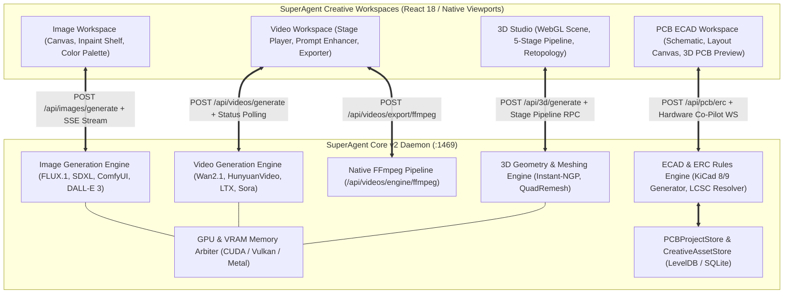
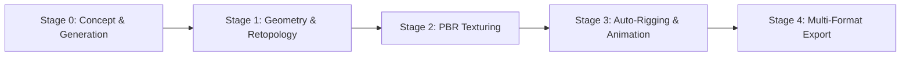
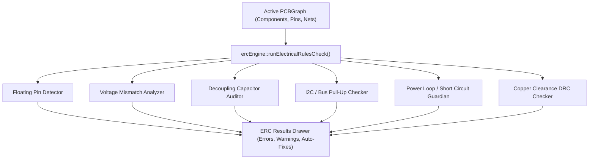

# 06 — Creative & Hardware Workspaces: Image, Video, 3D Studio & PCB ECAD Architecture & UI Specification

## Executive Summary
This document specifies the end-to-end architecture, UX interactions, data schemas, rendering engines, and verification contracts for SuperAgent's dedicated **Creative & Hardware Workspaces**:
1. **Image Generation Workspace (`ImageWorkspacePage`)**: Multi-model prompt canvas, inpainting shelf, watermark compositor, color palette conditioning, and filmstrip gallery.
2. **Video Generation Workspace (`VideoWorkspacePage`)**: Video player stage, cinematographic prompt enhancer, first/end frame shelf, and FFmpeg exporter modal.
3. **3D Studio Workspace (`ThreeDStudio`)**: 5-stage creation pipeline (Concept $\rightarrow$ Geometry/Retopology $\rightarrow$ PBR Textures $\rightarrow$ Auto-Rigging $\rightarrow$ Multi-Format Export).
4. **PCB & Hardware ECAD Workspace (`PCBWorkspacePage`)**: Schematic editor, multi-layer PCB copper layout canvas, 3D PCB board preview, Electrical Rules Check (ERC) engine, AI Hardware Co-Pilot, and native KiCad 8/9 export.

These workspaces empower SuperAgent to move beyond software code into generative visual media, 3D asset engineering, and physical electronic hardware design.

---

## 1. Unified Creative & Hardware Topology



---

## 2. Image Generation Workspace (`ImageWorkspacePage`)

### 2.1 Layout & Canvas View
The `ImageWorkspacePage` provides a high-performance viewport designed for visual inspection and fine editing:
1. **Interactive Viewport**:
   - Supports fluid zooming from $10\%$ to $1600\%$ with smooth deceleration physics.
   - Sub-pixel bilinear interpolation at $<100\%$; pixel-grid outline snapping at $>800\%$ for fine inpainting mask alignment.
   - Panning via Middle Mouse Drag, Spacebar + Left Drag, or standard trackpad gestures.
   - Center & Frame hotkey (`F` or `Ctrl+0`).
2. **Comparison Slider (A/B Inspection)**:
   - Split-screen curtain slider allowing side-by-side or layered comparison between reference image / previous revision (Left) and newly generated image (Right).
   - Onion-skin opacity slider ($0 - 100\%$) for detecting structural drift in image-to-image workflows.
3. **HUD Metadata Overlay**:
   - Displays resolution, aspect ratio, seed, sampler, CFG scale, inference latency (seconds), and active model name.
   - One-click copy prompt button and seed recall button.

### 2.2 Advanced Settings Drawer (`AdvancedSettingsDrawer`)
- **Prompt & Negative Prompt**:
  - Textarea with token counter and prompt weighting syntax highlighting (e.g., `(photorealistic:1.3)`).
- **Engine Selector**:
  - **Local Hardware**: FLUX.1 [schnell/dev], SDXL Turbo, Stable Diffusion 3.5 Large, SD 1.5. Automatically verifies local GPU VRAM availability via `/api/images/hardware/profile`.
  - **Cloud APIs**: OpenAI DALL-E 3, Google Imagen 3, Midjourney v6, Black Forest Labs FLUX.1 Pro (via BYOK API keys).
- **Aspect Ratios**:
  - Segmented buttons: `1:1` ($1024\times1024$), `16:9` ($1344\times768$), `9:16` ($768\times1344$), `4:3` ($1152\times864$), `3:2` ($1216\times832$), `21:9` ($1536\times640$).
- **Generation Parameters**:
  - Steps slider: $1 - 100$ (defaults calibrated per model, e.g. 4 steps for Schnell, 30 for SDXL).
  - CFG Scale slider: $1.0 - 20.0$ ($0.5$ step precision).
  - Sampler Selection: `Euler a`, `DPM++ 2M Karras`, `DDIM`, `UniPC`.
  - Seed Control: Random toggle (`-1`) or fixed numeric seed with instant clipboard paste.

### 2.3 Reference & Inpainting Shelf (`AttachmentShelf`)
- **Mask Painter**:
  - Brush controls: Brush Size ($4 - 128\,\text{px}$), Feathering / Blur Radius ($0 - 32\,\text{px}$).
  - Erase mode, Clear Mask button, and Invert Mask button.
- **Style Reference & IP-Adapter**:
  - Drag-and-drop reference image shelf for style transfer and composition guidance.
  - Guidance Mode: `face_lock` (InsightFace landmark preservation) vs `style_pose` (CLIP image embedding injection).
  - Denoising Strength slider ($0.1 - 1.0$).

### 2.4 Brand Watermark Modal (`BrandLogoModal`)
- **Watermark Engine**:
  - Supports SVG vector and transparent PNG logos.
  - **7-Point Anchor Placement**: `Top-Left`, `Top-Center`, `Top-Right`, `Center`, `Bottom-Left`, `Bottom-Center`, `Bottom-Right`.
  - Opacity slider ($0\% - 100\%$) and Scale slider ($5\% - 50\%$ relative to image width).
  - Margin padding slider ($8 - 64\,\text{px}$).
  - Live composite preview before saving.

### 2.5 Color Palette Conditioning Modal (`ColorPaletteModal`)
- **Curated Palettes**:
  - `Cyberpunk Neon` (`#FF0055`, `#00FFFF`, `#7928CA`, `#000000`)
  - `Sunset Horizon` (`#FF5E36`, `#FFAE34`, `#7B2CBF`, `#10002B`)
  - `Teal & Obsidian` (`#00B4D8`, `#0077B6`, `#03045E`, `#0F172A`)
  - `Pastel Dream` (`#FFB5A7`, `#FCD5CE`, `#F8EDEB`, `#F9DCC4`)
  - `Earthy Moss` (`#2D6A4F`, `#52B788`, `#D8F3DC`, `#1B4332`)
  - `Monochrome Noir` (`#000000`, `#333333`, `#888888`, `#FFFFFF`)
- **Custom Palette Builder**:
  - Color picker for custom hex entries.
  - Palette Enforcement Weight ($0.1 - 1.0$): Injects RGB histogram conditioning into the latent cross-attention layers.

### 2.6 Virtualized Filmstrip Gallery
- Virtual scrolling bottom gallery holding all historical generations from the session.
- Clicking any thumbnail mounts it immediately onto the main canvas.
- Hover quick-action toolbar: Download (lossless PNG/WebP), Copy Prompt, Recall Parameters, Send to Inpainting Shelf, Delete Record.

---

## 3. Video Generation Workspace (`VideoWorkspacePage`)

### 3.1 Video Player Stage (`VideoCanvasStage`)
- **Playback Controls**:
  - Custom HTML5 GPU-accelerated video player canvas.
  - Precision scrub bar with hovered thumbnail frame preview.
  - Timecode Display: High-accuracy `HH:MM:SS:FF` (Hours:Minutes:Seconds:Frames).
  - Frame-by-Frame Stepping: `←` (Previous Frame) and `→` (Next Frame) for forensic artifact inspection.
  - Speed Multiplier: `0.25x`, `0.5x`, `1.0x`, `1.5x`, `2.0x`.
  - A/B Loop Points: Set `In` point (`[`) and `Out` point (`]`) to continuously loop a specific segment.
  - Theater Mode and Fullscreen toggle (`F11`).

### 3.2 Cinematographic Prompt Enhancer
- **LLM Expansion Engine** (`/api/videos/prompt/enhance`):
  - Ingests basic concepts (e.g., "A sports car driving down a mountain road at night") and rewrites it into director-grade cinematographic language.
- **Cinematic Parameter Injection**:
  - **Camera Movements**: Static tripod, slow pan left/right, tilt up/down, dolly zoom (Vertigo effect), crane boom down, tracking shot, 360-degree orbit, dynamic FPV drone dive.
  - **Lighting & Atmosphere**: Golden hour sidelight, volumetric god rays, heavy film noir chiaroscuro, anamorphic neon street flares, overcast diffused softbox.
  - **Optics & Lens Choice**: 35mm anamorphic (horizontal blue flare, oval bokeh), 85mm portrait ($f/1.4$ shallow depth of field), 16mm ultra-wide fisheye.

### 3.3 Engine Selector & Generation Parameters
- **Video Generation Engines**:
  - `Wan2.1` (Alibaba Cloud Wan Video 14B / 1.3B)
  - `HunyuanVideo` (Tencent Hunyuan DiT)
  - `CogVideoX` (THUDM 5B / 2B)
  - `LTX-Video` (Lightricks Real-time Video Diffusion)
  - `OpenAI Sora` (Cloud API integration)
- **Parameters**:
  - Duration selector: `4s`, `6s`, `10s`.
  - Framerate toggle: `24fps` (cinematic film cadence) or `30fps` (smooth broadcast).
  - Native Resolution: `720p` ($1280\times720$) or `1080p` ($1920\times1080$).

### 3.4 Video Attachment Shelf (`VideoAttachmentShelf`)
- **First-Frame Image Input**:
  - Ingests a still concept image to initialize the motion sequence (Image-to-Video).
- **End-Frame Image Input**:
  - Ingests a secondary target image, triggering latent interpolation between the start and end anchors.
- **Motion Brush & Region Mask**:
  - Allows painting directional motion vectors over specific zones (e.g., animate flowing water while keeping mountain rocks static).

### 3.5 Video Exporter Modal (`VideoExportModal`) & FFmpeg Engine
- **Export Format Selection**:
  - `mp4` (H.264 / AAC for universal web playback).
  - `webm` (VP9 / Opus for open-source high-compression streaming).
  - `gif` (Optimized palette 256-color animated GIF with Floyd-Steinberg dithering).
  - `prores` (Apple ProRes 422 HQ for professional NLE editing in Premiere/DaVinci Resolve).
- **Post-Processing Filters**:
  - **AI Upscaling**: $1.0\times$ (Pass-through), $2.0\times$, $4.0\times$ via Real-ESRGAN video models.
  - **Frame Interpolation**: Frame doubling via RIFE ($24\text{fps} \rightarrow 60\text{fps}$).
  - **Audio Track Mixing**: Merges ambient procedural audio, music loops, or voiceover onto video master.
- **FFmpeg Provisioning Status**:
  - System polls `/api/videos/engine/ffmpeg/status`. If missing or broken, displays a banner with a 1-click installer downloading static zero-dependency FFmpeg binaries.

---

## 4. 3D Studio Workspace (`ThreeDStudio`)

### 4.1 Viewport Controls (`ThreeDViewport`)
- **3D Scene Graph Engine**: Built atop Three.js WebGL / WebGPU with full PBR shading.
- **Camera Navigation Physics**:
  - Left Mouse Drag: Orbit rotation around object centroid with inertia damping.
  - Right Mouse Drag: Pan horizontally and vertically across the viewing plane.
  - Scroll Wheel: Exponential zoom in/out with near-plane clipping prevention ($0.05\,\text{m}$).
  - ViewCube Gizmo: Interactive orientation cube (`Top`, `Front`, `Right`, `Isometric`) in top-right corner.
- **Shading Modes**:
  - `PBR Realistic`: Full physically-based rendering with environment reflections and roughness maps.
  - `Textured`: Unlit diffuse texture map preview for quick asset inspection.
  - `Clay / MatCap`: Studio grey sculpt shading highlighting surface curvature and imperfections.
  - `Wireframe`: Polygon edge topology visualizer with backface culling toggle.
  - `Normals`: RGB color-coded tangent space normal map visualizer.
- **Lighting & Environment**:
  - Toggleable ground grid floor with metric 10cm subdivisions.
  - Studio Environment HDRIs: Cyberpunk Neon, Clean Studio White, Warehouse Industrial, Chroma Green.
  - Dynamic contact soft shadow under mesh bounding box.

### 4.2 5-Stage Creation Pipeline (`StageNavigation`)



#### Stage 0: Concept & Generation
- Text-to-3D generation prompt input with negative prompt.
- Image-to-3D upload: Upload front, side, or single-view concept artwork.
- A-Pose / T-Pose toggle for character and creature generation.
- Stylization Presets: `Realistic PBR`, `Low-Poly Stylized`, `Anime / Toon`, `Voxel Isometric`.

#### Stage 1: Geometry & Retopology
- **Remeshing Engine**:
  - Converts raw marching-cube or NeRF point clouds into clean manifold quad/triangle geometry.
  - Target Polygon Count Presets:
    * `Low-Poly`: $5,000$ triangles (mobile game / web companion ready).
    * `Mid-Poly`: $20,000$ triangles (standard desktop realtime asset).
    * `High-Poly`: $100,000$ triangles (cinematic hero asset).
- **Topology Repair Engine**:
  - Automatically heals non-manifold edges, closes hole boundaries, removes degenerate zero-area faces, and recalculates vertex normals.
  - Automatic UV Unwrapping with seam carving and island packing.

#### Stage 2: Texturing & PBR Materials
- Generates and proceduralizes complete physically based material channel maps:
  1. **Albedo / Base Color** (sRGB diffuse map)
  2. **Normal Map** (OpenGL / DirectX tangent space normal map)
  3. **Roughness Map** (Greyscale micro-facet roughness)
  4. **Metallic Map** (Greyscale conductor/dielectric mask)
  5. **Ambient Occlusion (AO)** (Cavity shadow contact map)
- Texture Resolution Selector: $1024\times1024$ ($1\text{K}$), $2048\times2048$ ($2\text{K}$), $4096\times4096$ ($4\text{K}$).

#### Stage 3: Auto-Rigging & Skeletal Animation
- Automatically detects humanoid landmarks (head, spine, shoulders, elbows, wrists, hips, knees, ankles).
- Fits standard humanoid bone hierarchy matching Unity/Mixamo/VRM standard.
- Computes smooth skinning weight deformation matrices.
- Test Animation Preview Library:
  - `Idle Breathing`, `Walk Cycle`, `Run Sprint`, `Cheering Jump`, `Combat T-Pose`.

#### Stage 4: Multi-Format Export
- Formats:
  - `.glb` (Binary glTF 2.0 with embedded PBR textures and animations).
  - `.gltf` (Human-readable JSON glTF with external `.bin` and texture folders).
  - `.obj` + `.mtl` (Classic Wavefront geometry with material library).
  - `.fbx` (Autodesk Filmbox with bone armatures for Blender / Maya / Unreal Engine).
  - `.usdz` (Apple Universal Scene Description for iOS AR QuickLook).

---

## 5. PCB & Hardware ECAD Workspace (`PCBWorkspacePage`)

### 5.1 Multi-Stage ECAD Canvas
The PCB workspace provides three synchronized views representing electronic hardware:

#### 1. Schematic View (`ECADSchematicCanvas`)
- High-performance vector canvas rendering electronic symbols (`U1`, `R1`, `C1`, `J1`).
- **Interactive Wire Routing**: Click component pin to start net wire; orthogonal auto-routing with $90^\circ$ elbow joints and junction connection dots.
- **Net Naming & Buses**: Direct net labeling (e.g., `+3V3`, `GND`, `I2C_SDA`, `USB_D_P`).
- **Grid Snapping**: Calibrated 10px / 50mil electrical schematic snap grid.
- **Component Placement Drawer**: Searchable library of ICs, passives, connectors, and sensors with parametric properties.

#### 2. PCB Layout View (`PCBLayoutCanvas`)
- 2D board substrate outline with multi-layer stackup:
  - `F.Cu` (Top Copper Layer - Red `#FF4444`)
  - `B.Cu` (Bottom Copper Layer - Blue `#4444FF`)
  - `In1.Cu` / `In2.Cu` (Internal Ground & Power Planes)
  - `F.SilkS` / `B.SilkS` (Silkscreen text & component outlines - White `#FFFFFF`)
  - `F.Mask` / `B.Mask` (Solder mask openings)
  - `Edge.Cuts` (Milling board boundary - Yellow `#FFFF00`)
- **Ratsnest Connectivity**: Dynamic elastic flylines indicating unrouted net connections between SMD/THT pads.
- **Trace Routing Engine**: Interactive trace drawing with $45^\circ$ angle snapping, interactive via insertion (`V` key), and copper clearance violation halos.
- **Copper Pour Zones**: Polygonal ground plane fill with thermal relief spokes connecting to GND pads.

#### 3. 3D Board Preview (`PCB3DPreview`)
- Interactive WebGL 3D model of the fully assembled electronic board:
  - Realistic multi-layer FR4 epoxy resin fiberglass core.
  - Solder Mask Finishes: Classic Gloss Green, Matte Stealth Black, Royal Navy Blue, Signal Red, Clean Polar White, High-Tech Purple.
  - ENIG (Electroless Nickel Immersion Gold) or HASL shiny tin-lead pad metallization.
  - High-fidelity 3D STEP package models mounted to pads (SOIC-8, QFN-32, 0603/0402 passives, USB Type-C receptacle, tactile buttons, pin headers).

---

### 5.2 Electrical Rules Check Engine (`ercEngine`)
The ERC engine runs continuous static analysis over the active `PCBGraph` data model, preventing costly hardware manufacturing errors:



#### Rule Definitions & Failure Criteria:
1. `floating_pin` (Severity: **Warning** / **Error**):
   - Mandatory input pins (`input`, `power_in`) or reset lines left unconnected without pull-up or pull-down termination.
2. `voltage_mismatch` (Severity: **Error**):
   - Direct connection between incompatible logic level domains (e.g., driving a $5.0\,\text{V}$ rail directly into an ESP32 $3.3\,\text{V}$ GPIO pin without a level shifter or resistor divider).
3. `missing_decoupling` (Severity: **Warning**):
   - Microcontrollers, ADCs, or power management ICs lacking a $100\,\text{nF}$ ceramic decoupling capacitor within close electrical proximity to their $V_{\text{DD}}$ / $V_{\text{CC}}$ pins.
4. `missing_pullup` (Severity: **Error**):
   - Open-drain bus lines (`I2C_SDA`, `I2C_SCL`) lacking required pull-up resistors ($2.2\,\text{k}\Omega - 4.7\,\text{k}\Omega$) connected to the logic high rail.
5. `power_loop` (Severity: **Error**):
   - Dangerous circuit topology where multiple independent power sources (e.g., $5\,\text{V}$ USB VBUS and a $3.7\,\text{V}$ LiPo battery) are tied together without ideal diode or Schottky diode reverse protection.
6. `trace_clearance` (Severity: **Error**):
   - Copper traces spaced closer than the manufacturer minimum trace clearance (default: $0.15\,\text{mm}$ / $6\,\text{mil}$).

---

### 5.3 AI Hardware Co-Pilot (`hardwareAiEngine`)
- **Conversational Circuit Synthesis**:
  - Embedded AI chat drawer allows natural language hardware engineering prompts:
    * *"Add an ESP32-S3 microcontroller with USB Type-C 5V power, an AMS1117-3.3V LDO regulator, power and status LEDs, and a BME280 environmental sensor on I2C."*
  - The AI Co-Pilot parses the requirement, generates the component instances, matches manufacturer part numbers (MPNs), verifies LCSC catalog IDs, establishes power rails, and automatically connects net wires.
- **LCSC Component Catalog Resolution**:
  - Resolves standard parts to live inventory LCSC part numbers (e.g., `C2040` for 100nF capacitor, `C165948` for ESP32-S3).
- **Starter Architecture Templates**:
  - `Blank Project`: Empty schematic canvas.
  - `ESP32-S3 IoT Node`: Dual-core Wi-Fi/BLE MCU with USB-C, auto-reset circuit, and flash/RAM.
  - `RP2040 Pico Breakout`: Raspberry Pi RP2040 MCU with 12MHz crystal oscillator, QSPI flash, and debug header.
  - `USB-C LiPo Charger`: TP4056 single-cell lithium battery charging IC with over-current and thermal protection.
  - `STM32 Industrial Sensor Node`: STM32G0 with RS485 transceiver and isolated wide-input DC-DC buck converter.

---

### 5.4 Multi-Format ECAD Exporters (`exporters`)
SuperAgent exports directly to open and industry-standard ECAD formats without vendor lock-in:
- **KiCad 8 & 9**:
  - Generates native sexpr `.kicad_sch` schematic files with full symbol definitions, sheet coordinates, and net labels.
  - Generates `.kicad_pcb` board files with footprint layout, pads, tracks, vias, and board outline.
- **Altium Designer**:
  - Generates `.net` wire netlist files compatible with Altium Designer schematic net imports.
- **SKiDL**:
  - Generates clean Python code utilizing the SKiDL library for programmatic circuit synthesis and testing.
- **EasyEDA**:
  - Generates EasyEDA standard JSON schema format for one-click import into EasyEDA Web / Desktop.
- **Interactive Bill of Materials (BOM CSV)**:
  - Generates production-ready spreadsheet with columns: `Designator`, `Qty`, `MPN`, `Value`, `Package`, `Manufacturer`, `LCSC Part #`, `Description`.
- **SMT Pick-and-Place (Centroid CSV)**:
  - Generates component centroid data (`Designator`, `Val`, `Package`, `Mid X`, `Mid Y`, `Rotation`, `Layer`) for automated SMT pick-and-place manufacturing lines (JLCPCB, PCBWay).

---

## 6. Standardized Demo Stubs

### 6.1 Image Generation Parameters Demo Stub
```typescript
// ============================================================================
// [DEMO_STUB: ImageGenerationParamsDemo]
// DESCRIPTION: Mock generation parameters, inpainting state, and gallery record.
// BACKEND_ROUTE: POST /api/images/generate -> superagent_core_v2::image_workspace
// SEARCH_TAG: #DEMO_IMAGE_GENERATION_PARAMS
// ============================================================================
export interface ImageGenerationParamsStub {
  id: string;
  prompt: string;
  negativePrompt: string;
  modelId: string;
  modelName: string;
  aspectRatio: string;
  width: number;
  height: number;
  steps: number;
  cfgScale: number;
  seed: number;
  sampler: string;
  watermark: {
    enabled: boolean;
    logoUrl: string;
    anchor: 'bottom_right' | 'bottom_left' | 'top_right' | 'top_left';
    opacity: number;
    scale: number;
  };
  colorConditioning: {
    enabled: boolean;
    paletteName: string;
    hexColors: string[];
    weight: number;
  };
  outputUrl: string;
  generationLatencySec: number;
}

export const DEMO_IMAGE_GEN_PARAMS: ImageGenerationParamsStub = {
  id: 'img-gen-9021',
  prompt: 'A futuristic cybernetic laboratory with holographic terminals, neon teal lighting, 8k resolution, cinematic lighting, masterpiece',
  negativePrompt: 'blurry, distorted, low quality, artifacts, watermark, grainy, out of frame',
  modelId: 'flux-1-dev-q4',
  modelName: 'FLUX.1 Dev (Q4 Quantized)',
  aspectRatio: '16:9',
  width: 1344,
  height: 768,
  steps: 28,
  cfgScale: 4.5,
  seed: 492817291,
  sampler: 'Euler a',
  watermark: {
    enabled: true,
    logoUrl: '/assets/superagent_badge.svg',
    anchor: 'bottom_right',
    opacity: 0.85,
    scale: 0.12,
  },
  colorConditioning: {
    enabled: true,
    paletteName: 'Teal & Obsidian',
    hexColors: ['#00B4D8', '#0077B6', '#03045E', '#0F172A'],
    weight: 0.75,
  },
  outputUrl: '/demo/outputs/cyber_lab_16_9.png',
  generationLatencySec: 4.82,
};
// ============================================================================
// [END_DEMO_STUB: ImageGenerationParamsDemo]
// ============================================================================
```

### 6.2 Video Pipeline Jobs Demo Stub
```typescript
// ============================================================================
// [DEMO_STUB: VideoPipelineJobsDemo]
// DESCRIPTION: Mock video generation pipeline job queue and FFmpeg export options.
// BACKEND_ROUTE: GET /api/videos/jobs -> superagent_core_v2::video_workspace
// SEARCH_TAG: #DEMO_VIDEO_PIPELINE_JOBS
// ============================================================================
export interface VideoPipelineJob {
  id: string;
  prompt: string;
  engine: 'wan2_1' | 'hunyuan_video' | 'cog_video_x' | 'ltx_video' | 'sora';
  status: 'queued' | 'diffusing' | 'interpolating' | 'encoding' | 'completed' | 'failed';
  progressPercent: number;
  durationSeconds: number;
  fps: number;
  resolution: string;
  firstFrameImageUrl?: string;
  endFrameImageUrl?: string;
  exportFormat: 'mp4' | 'webm' | 'gif' | 'prores';
  upscaleMultiplier: number;
  outputVideoUrl?: string;
}

export const DEMO_VIDEO_PIPELINE_JOBS: VideoPipelineJob[] = [
  {
    id: 'vid-job-104',
    prompt: 'Cinematic FPV drone shot flying through a neon illuminated cyberpunk canyon at twilight, 35mm anamorphic lens, volumetric smoke',
    engine: 'wan2_1',
    status: 'encoding',
    progressPercent: 88,
    durationSeconds: 6,
    fps: 24,
    resolution: '1280x720',
    firstFrameImageUrl: '/demo/outputs/canyon_start_frame.png',
    exportFormat: 'mp4',
    upscaleMultiplier: 2.0,
    outputVideoUrl: '/demo/outputs/canyon_flythrough_720p.mp4',
  },
  {
    id: 'vid-job-105',
    prompt: 'Fluid motion transition of an autonomous robot hand assembling a miniature processor on a circuit board',
    engine: 'ltx_video',
    status: 'completed',
    progressPercent: 100,
    durationSeconds: 4,
    fps: 30,
    resolution: '1920x1080',
    exportFormat: 'mp4',
    upscaleMultiplier: 1.0,
    outputVideoUrl: '/demo/outputs/robot_hand_assemble_1080p.mp4',
  },
];
// ============================================================================
// [END_DEMO_STUB: VideoPipelineJobsDemo]
// ============================================================================
```

### 6.3 3D Studio Pipeline Demo Stub
```typescript
// ============================================================================
// [DEMO_STUB: ThreeDStudioPipelineDemo]
// DESCRIPTION: Mock 5-stage 3D studio asset pipeline state and mesh metadata.
// BACKEND_ROUTE: GET /api/3d/active/pipeline -> superagent_core_v2::three_d_workspace
// SEARCH_TAG: #DEMO_THREE_D_STUDIO_PIPELINE
// ============================================================================
export interface ThreeDStudioPipelineStub {
  assetId: string;
  assetName: string;
  currentStage: 0 | 1 | 2 | 3 | 4; // Concept -> Remesh -> PBR -> Rig -> Export
  concept: {
    prompt: string;
    stylization: 'realistic' | 'low_poly' | 'anime' | 'voxel';
    isHumanoidPose: boolean;
  };
  geometry: {
    trianglesCount: number;
    verticesCount: number;
    isManifold: boolean;
    retopologyPreset: 'low_5k' | 'mid_20k' | 'high_100k';
    uvMapped: boolean;
  };
  materials: {
    resolution: '1k' | '2k' | '4k';
    channelsPresent: string[]; // ['albedo', 'normal', 'roughness', 'metallic', 'ao']
    shadingMode: 'pbr' | 'textured' | 'wireframe' | 'clay';
  };
  rigging: {
    isRigged: boolean;
    bonesCount: number;
    activeAnimation: string; // 'idle_breathing'
  };
  exportOptions: {
    supportedFormats: string[]; // ['.glb', '.gltf', '.obj', '.fbx', '.usdz']
    selectedFormat: string;
  };
}

export const DEMO_THREE_D_PIPELINE: ThreeDStudioPipelineStub = {
  assetId: 'asset-3d-cyber-warrior',
  assetName: 'Cybernetic Scout V3',
  currentStage: 2,
  concept: {
    prompt: 'Tactical android scout warrior with lightweight carbon fiber armor and glowing optical visor',
    stylization: 'realistic',
    isHumanoidPose: true,
  },
  geometry: {
    trianglesCount: 20480,
    verticesCount: 10420,
    isManifold: true,
    retopologyPreset: 'mid_20k',
    uvMapped: true,
  },
  materials: {
    resolution: '2k',
    channelsPresent: ['albedo', 'normal', 'roughness', 'metallic', 'ao'],
    shadingMode: 'pbr',
  },
  rigging: {
    isRigged: true,
    bonesCount: 54,
    activeAnimation: 'idle_breathing',
  },
  exportOptions: {
    supportedFormats: ['.glb', '.gltf', '.obj', '.fbx', '.usdz'],
    selectedFormat: '.glb',
  },
};
// ============================================================================
// [END_DEMO_STUB: ThreeDStudioPipelineDemo]
// ============================================================================
```

### 6.4 PCB Schematic Graph Demo Stub
```typescript
// ============================================================================
// [DEMO_STUB: PcbSchematicGraphDemo]
// DESCRIPTION: Mock PCB graph data model, components, nets, and ERC status.
// BACKEND_ROUTE: GET /api/pcb/projects/:id -> superagent_core_v2::pcb::project
// SEARCH_TAG: #DEMO_PCB_SCHEMATIC_GRAPH
// ============================================================================
export interface PcbSchematicGraphStub {
  projectId: string;
  name: string;
  revision: string;
  components: Array<{
    id: string; // e.g. "U1"
    name: string;
    mpn: string;
    package: string;
    category: string;
    lcscPart?: string;
    pinsCount: number;
    x: number;
    y: number;
  }>;
  nets: Array<{
    id: string; // e.g. "+3V3"
    name: string;
    netClass: string;
    connectionsCount: number;
  }>;
  ercResults: Array<{
    id: string;
    severity: 'error' | 'warning' | 'info';
    category: string;
    title: string;
    message: string;
    affectedComponents: string[];
    affectedNets: string[];
    suggestedFix: string;
  }>;
}

export const DEMO_PCB_SCHEMATIC_GRAPH: PcbSchematicGraphStub = {
  projectId: 'pcb-proj-esp32-node',
  name: 'ESP32-S3 IoT Environmental Node',
  revision: 'Rev B',
  components: [
    {
      id: 'U1',
      name: 'ESP32-S3-WROOM-1-N8R8',
      mpn: 'ESP32-S3-WROOM-1-N8R8',
      package: 'Module-41',
      category: 'MCU',
      lcscPart: 'C165948',
      pinsCount: 41,
      x: 280,
      y: 180,
    },
    {
      id: 'U2',
      name: 'AMS1117-3.3 Linear Regulator',
      mpn: 'AMS1117-3.3',
      package: 'SOT-223',
      category: 'Power',
      lcscPart: 'C6186',
      pinsCount: 4,
      x: 120,
      y: 180,
    },
    {
      id: 'U3',
      name: 'BME280 Environmental Sensor',
      mpn: 'BME280',
      package: 'LGA-8',
      category: 'Sensor',
      lcscPart: 'C92489',
      pinsCount: 8,
      x: 480,
      y: 220,
    },
    {
      id: 'J1',
      name: 'USB Type-C 16-Pin Receptacle',
      mpn: 'TYPE-C-31-M-12',
      package: 'USB-C-16P',
      category: 'Connector',
      lcscPart: 'C165948',
      pinsCount: 16,
      x: 40,
      y: 180,
    },
    {
      id: 'C1',
      name: '100nF Ceramic Decoupling Capacitor',
      mpn: 'CL10B104KB8NNNC',
      package: '0603',
      category: 'Passive',
      lcscPart: 'C2040',
      pinsCount: 2,
      x: 250,
      y: 160,
    },
  ],
  nets: [
    { id: 'VBUS_5V', name: 'VBUS_5V', netClass: 'power', connectionsCount: 2 },
    { id: '+3V3', name: '+3V3', netClass: 'power', connectionsCount: 4 },
    { id: 'GND', name: 'GND', netClass: 'ground', connectionsCount: 6 },
    { id: 'I2C_SDA', name: 'I2C_SDA', netClass: 'i2c', connectionsCount: 2 },
    { id: 'I2C_SCL', name: 'I2C_SCL', netClass: 'i2c', connectionsCount: 2 },
  ],
  ercResults: [
    {
      id: 'erc-warn-pullup',
      severity: 'error',
      category: 'pullup',
      title: 'Missing I2C Pull-Up Resistors',
      message: 'Nets I2C_SDA and I2C_SCL are open-drain lines and require 4.7k pull-up resistors to +3V3.',
      affectedComponents: ['U1', 'U3'],
      affectedNets: ['I2C_SDA', 'I2C_SCL'],
      suggestedFix: 'Insert two 4.7kΩ resistors (0603, LCSC C25900) between +3V3 and SDA/SCL.',
    },
  ],
};
// ============================================================================
// [END_DEMO_STUB: PcbSchematicGraphDemo]
// ============================================================================
```

---

## 7. Comprehensive Test Case Catalog

### 7.1 Image & Video VRAM Exhaustion Test Suite

| Test Case ID | Test Description | Input / Trigger | Expected Outcome & System Response |
| :--- | :--- | :--- | :--- |
| `TC-CREATIVE-001` | GPU VRAM Exhaustion during FLUX.1 | User triggers $1536\times1536$ generation on a 6GB VRAM GPU. | GPU memory arbiter catches out-of-memory error before CUDA crash, halts pipeline, drops resolution to $1024\times1024$, activates CPU offload, and surfaces guidance toast: *"High VRAM detected: Enabled layer offloading."* |
| `TC-CREATIVE-002` | Video Generation Concurrency Guard | User triggers a 10s HunyuanVideo job while an existing Wan2.1 job is diffusing. | System queues the second job with badge *"Queued (Position 1/1)"*, prevents simultaneous diffusion pipelines from crashing the GPU driver. |
| `TC-CREATIVE-003` | Missing FFmpeg Binary Detection | User clicks "Export MP4" on a machine lacking local FFmpeg. | Modal detects missing binary via `/api/videos/engine/ffmpeg/status`, presents "Provision FFmpeg (1-Click)" action button, downloads static binary, and resumes export without page refresh. |

### 7.2 3D Geometry & Retopology Test Suite

| Test Case ID | Test Description | Input / Trigger | Expected Outcome & System Response |
| :--- | :--- | :--- | :--- |
| `TC-CREATIVE-004` | Non-Manifold Mesh Self-Intersection | Import an unstructured `.obj` mesh containing 42 non-manifold edges and flipped normal faces. | Geometry repair engine cleans topology during Stage 1, welds co-planar vertices, recalculates surface normal vectors outward, and displays: *"Repaired 42 non-manifold edges."* |
| `TC-CREATIVE-005` | High-Poly Polygon Decimation Stress | Decimate an 800,000-triangle 3D scan to Low-Poly (5,000 tris). | Decimation algorithm preserves silhouette boundary loops and UV seams, achieves target triangle budget within $\pm2\%$, and produces no degenerate zero-area faces. |
| `TC-CREATIVE-006` | PBR Channel Baking Texture Overflow | Request $4\text{K}$ texture baking across 5 material channels on a low-end integrated GPU. | System detects VRAM limitation ($<2\text{GB}$), downscales target texture maps to $2048\times2048$, completes bake cleanly without browser tab crash. |

### 7.3 PCB Electrical Rules & Routing Test Suite

| Test Case ID | Test Description | Input / Trigger | Expected Outcome & System Response |
| :--- | :--- | :--- | :--- |
| `TC-CREATIVE-007` | Voltage Level Clash Detection | Connect a $5.0\,\text{V}$ net wire directly to a $3.3\,\text{V}$ logic pin on an ESP32 IC. | `ercEngine` triggers high-severity error badge: *"Voltage Level Mismatch: 5.0V source connected to 3.3V input on U1 (Pin 14)"*, highlights net in red, offers "Insert Level Shifter" button. |
| `TC-CREATIVE-008` | Missing Decoupling Capacitor Rule | Place a complex MCU without wiring a $100\,\text{nF}$ capacitor to its $V_{\text{DD}}$ pin. | `ercEngine` surfaces warning badge: *"Missing Decoupling Capacitor for U1"*, auto-fix suggestion injects a $100\,\text{nF}$ capacitor (0603, LCSC C2040) between $V_{\text{DD}}$ and GND. |
| `TC-CREATIVE-009` | KiCad 8/9 Sexpr Roundtrip Verification | Create a 24-component schematic with custom nets in SuperAgent, export to `.kicad_sch`, re-import. | All components, hierarchical blocks, pin mappings, net names, and sheet coordinates match 1:1 with zero netlist drops or floating dangling pins. |
| `TC-CREATIVE-010` | 10,000 Component Canvas Pan/Zoom Benchmark | Load an ultra-dense multi-layer server motherboard schematic with 10,000 components. | Canvas renders via WebGL/Canvas2D spatial indexing (QuadTree/R-Tree viewport culling), maintaining a steady 60 FPS pan and zoom cadence. |
